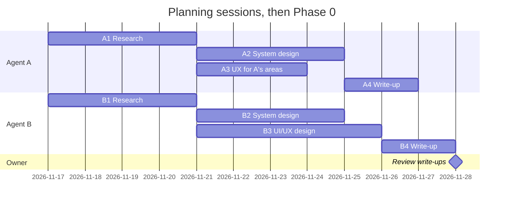

# Nexa revamp

Planning and coordination files for the Nexa revamp. The plan of record is
the "Nexa LMS: Platform revamp plan" doc, revision 2 (16 November 2026).

| File | What it is |
| --- | --- |
| [AGENTS.md](AGENTS.md) | Branches, worktrees, file ownership, contracts, and what needs the owner's approval |
| [MESSAGING.md](MESSAGING.md) | How the agents message each other across computers (GitHub issues) |
| [prompts/agent-a-platform.md](prompts/agent-a-platform.md) | Starting prompt for Agent A (Platform and business) |
| [prompts/agent-b-product.md](prompts/agent-b-product.md) | Starting prompt for Agent B (Product and learning) |
| [contracts/](contracts/) | The interfaces the two agents build against |
| [a/](a/) | Agent A's research, design, UX notes, write-up and HANDOFF.md |
| [b/](b/) | Agent B's research, design, UX notes, write-up and HANDOFF.md |

## How to start

1. Merge this folder into `main` so both agents branch from it.
2. Open a session for each main agent, each in its own worktree, and paste
   its prompt.
3. Each agent runs research first, then system design and UI/UX design in
   parallel, then the write-up. It may hand parts to subagents.
4. Review the two write-ups (`a/WRITEUP.md`, `b/WRITEUP.md`). Building
   starts with Phase 0 once you approve them.

## Timeline at a glance

The dates are a guide. The design sessions may start as soon as research
has a first draft.
