# Nexa platform: Agent A write-up

**Answer first.** Nexa becomes a multi-tenant tutoring platform built around a **workspace**: an organisation with tutor teams, or a solo practice. Workspaces pay Nexa **R99, R139 or R179 per active student per course for each 30-day period**, starting with a 14-day trial. Parents and adult students pay their tutors through one Paystack checkout that splits each payment straight to the tutors' bank accounts, and Nexa keeps 2%. Until January 2027 everything runs on the current Vercel Hobby and Neon setup, then moves to Vercel Pro in Cape Town and AWS RDS in af-south-1, before the first paying customer in February 2027. This document gathers sessions A1 (research), A2 (system design) and A3 (UX) into one read, with the diagrams. The detail lives in the linked files.

Status: for owner approval, 2026-11-16. Building starts with Phase 0 once the owner approves this write-up and Agent B's.

| Read more | Where |
| --- | --- |
| Research and owner decisions | [research/SUMMARY.md](research/SUMMARY.md) |
| System design (7 docs) | [design/README.md](design/README.md) |
| UX flows (6 docs) | [ux/README.md](ux/README.md) |
| Contracts with Agent B | [viewer.md](../contracts/viewer.md), [services.md](../contracts/services.md), [billing.md](../contracts/billing.md) |

## 1. Decisions

| Area | Decision | Source |
| --- | --- | --- |
| Tenancy | Workspace (`ORGANISATION` or `SOLO`) is the tenant; roles come from memberships, learner rows and guardianships; `workspaceId` on every tenant row | design 01 |
| Roles | Organisation owner/admin, solo practice, tutor, student, parent or guardian (optional), Nexa admin | plan rev 2, design 01 |
| Prices | Core R99, Plus R139, Pro R179 per active student per course per 30 days, excl. VAT | owner, 16 Nov |
| Services | `math-input` and `graphing` on Plus; `secure-tests` and `ai-marking` on Pro; Pro includes 30 AI marks per student per period; automarker, judge mode and code plagiarism parked; day pass later | owner, contracts/services.md |
| Billing periods | Exactly 30 days from each payment; seats charged in advance; catch-up and usage on the next renewal; a raised tier holds for 30 days; a late payment starts a new 30-day period on the payment date | owner, design 03 |
| Trial | 14 days, no card, Pro services on, capped at 20 students and 100 AI marks; read-only on day 15 if unpaid | plan, design 03 |
| Parent payments | Paystack (sole proprietor, R1,000,000 lifetime limit); one checkout across several children and tutors; split at capture; 2% to Nexa; the tutor bears the card fee | owner, design 04 |
| Onboarding v1 | Tutors create their own students and attest to parental consent; guardian invites, consent capture and magic links come later | owner, design 02 |
| Identity | Better Auth in Phase 1, database sessions, TOTP for owners and Nexa admins | design 02 |
| AI | Bedrock (Claude Haiku, Sonnet for hard cases); personal information redacted before any call; the tutor approves every mark | owner, plan rev 3 |
| Retention | Workspace data deleted 2 months after the last payment; tax retention of invoices deferred | owner, design 03 |
| Hosting | Stage 1: Vercel Hobby, Neon us-east-1. Stage 2 (January 2027): Vercel Pro `cpt1`, RDS af-south-1 | owner, design 06 |
| Backups | Weekly encrypted dumps to the Tigris bucket `nexa-lms-backups` in Johannesburg | owner, design 06 |
| Domain and mail | `nexa-lms.co.za`; app mail from `notify.nexa-lms.co.za` via Resend; Zoho Mail Free | owner, research 07 |

## 2. System context

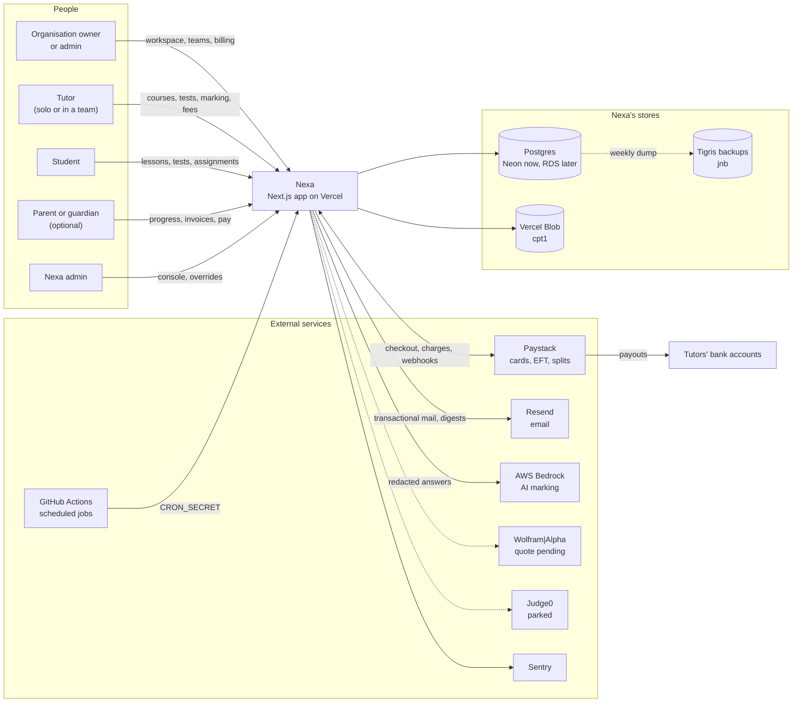

Dashed lines are not in v1: Wolfram waits on a quote, and Judge0 is parked with the coding automarker.

## 3. Deployment

### Stage 1: now to January 2027

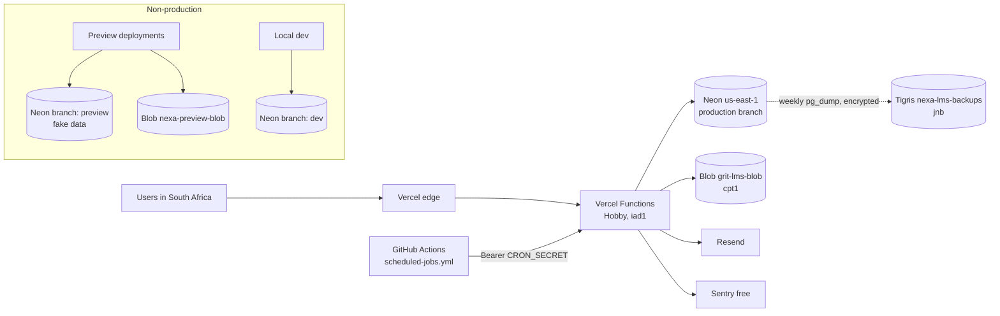

### Stage 2: January 2027, before the first payment

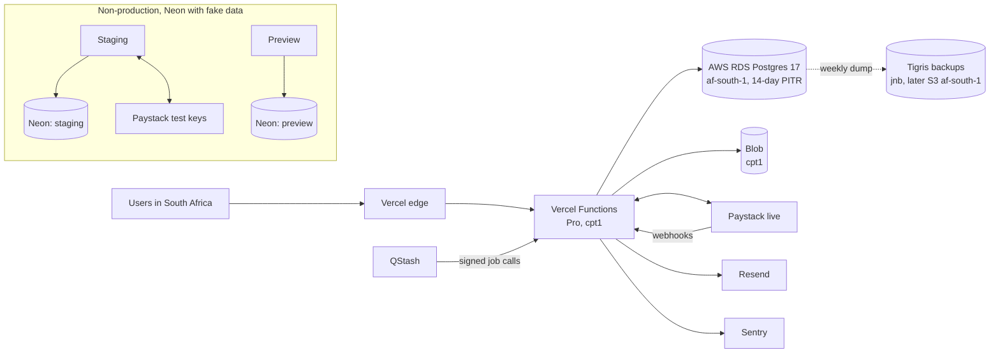

Functions and the database sit in the same AWS region in Stage 2: Vercel `cpt1` runs in af-south-1. That removes the 226 ms round trip to Virginia that every query pays today. The move is a `pg_dump` and restore of about 35 MB in a window of about 30 minutes, with Neon kept read-only for 14 days as the rollback ([research 06](research/06-database.md), [design 06](design/06-deployment.md)).

## 4. Use cases in A's areas

Mermaid has no use-case diagram, so this is a flowchart: people on the left, what they do on the right.

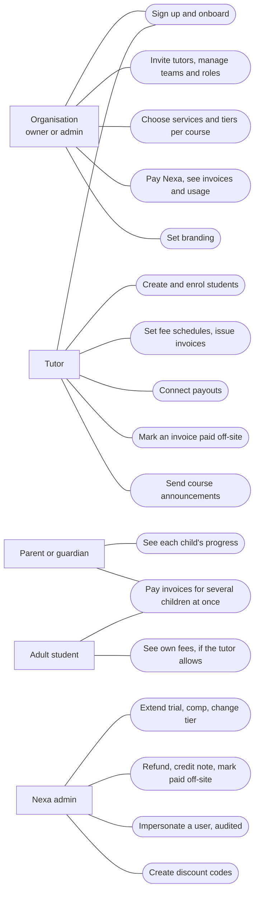

In v1, parents are linked by the tutor. Parents claiming children with a code and giving in-app consent come later ([design 02](design/02-identity.md)).

## 5. Data model: tenancy, billing and payments

Key relations only. Every field is in [design 01](design/01-tenancy-roles.md), [03](design/03-billing.md) and [04](design/04-payments.md).

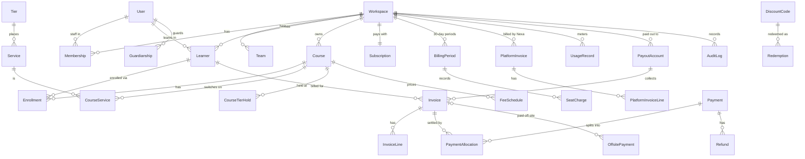

`PlatformInvoice` is what a workspace owes Nexa (Gate 1). `Invoice` is what a parent or adult student owes a tutor (Gate 2). Money is stored in integer cents.

## 6. Sequences

### 6.1 Trial to paid

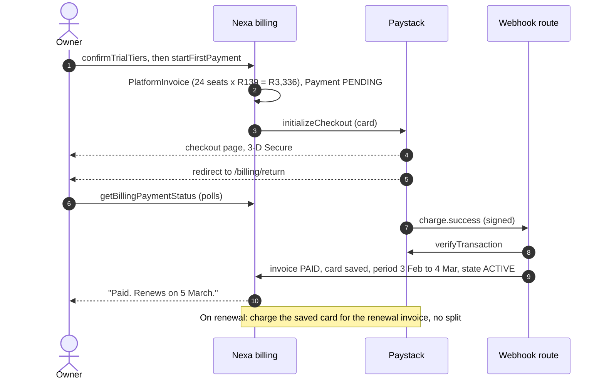

### 6.2 Parent checkout across two tutors

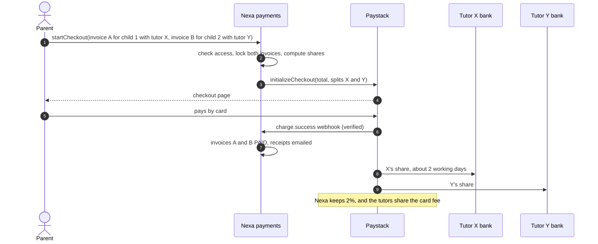

### 6.3 Webhook handling

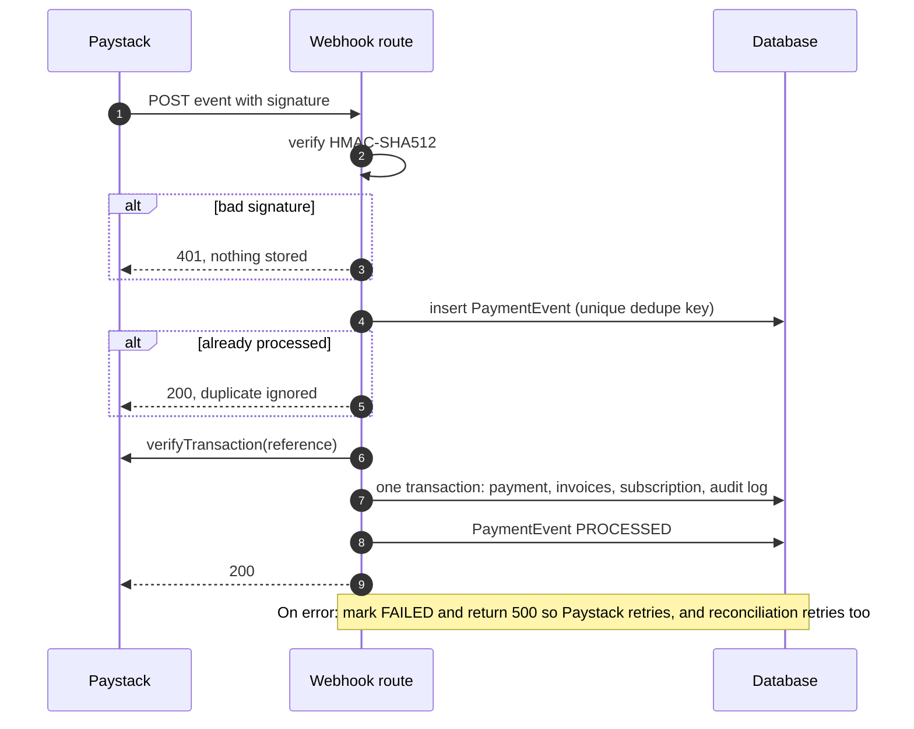

### 6.4 Off-site payment marked by an admin

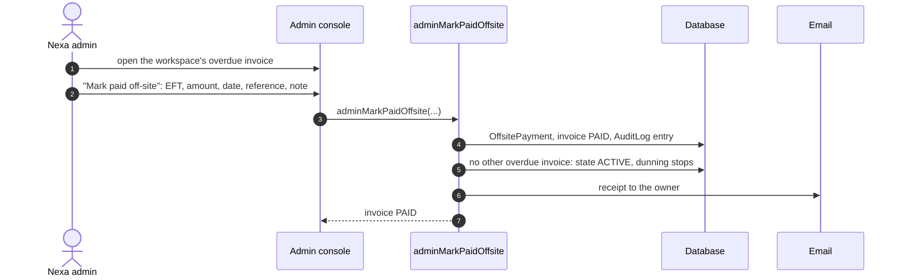

## 7. Activities

### 7.1 Sign-up and onboarding (v1)

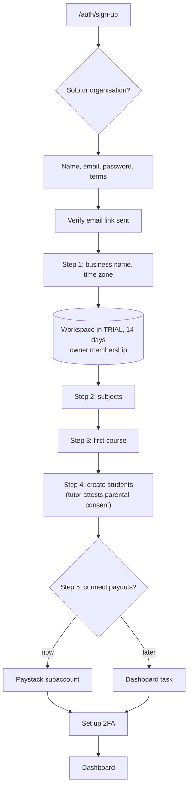

### 7.2 Renewal run (daily job)

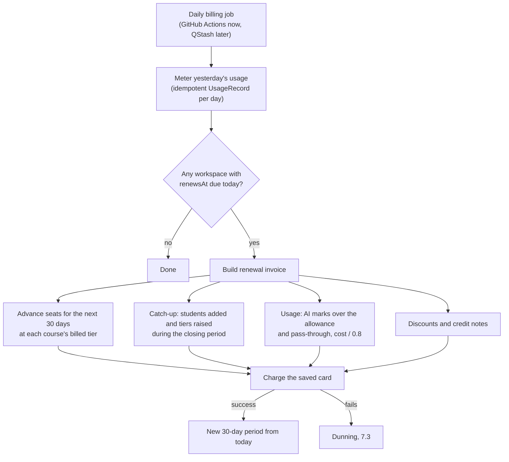

### 7.3 Dunning

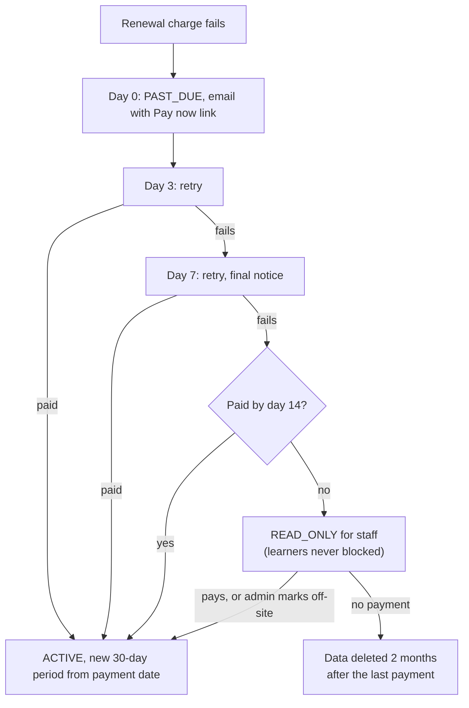

## 8. Personal data flow (POPIA)

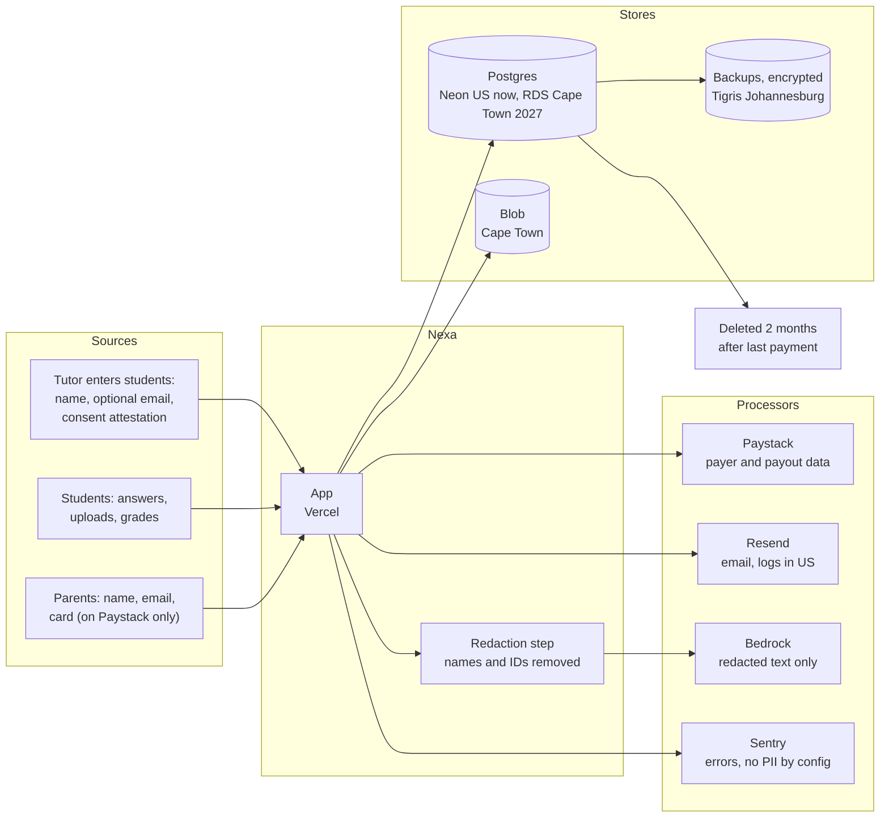

| Risk | Handling |
| --- | --- |
| Children's data held in the US until the database move | Move to af-south-1 in January 2027. Say so honestly in the privacy notice until then. A lawyer to confirm whether POPIA s57 prior authorisation applies ([research 09](research/09-compliance.md)) |
| Parental consent in v1 | The tutor attests to it when creating a student and is responsible under the tutor terms (lawyer to confirm the wording) |
| AI marking outside South Africa | Only redacted text is sent. De-identified information falls outside POPIA (s6(1)(b)) |
| Card data | Never touches Nexa. Paystack's hosted checkout handles it (PCI scope stays with Paystack) |
| Email logs | Resend keeps logs in the US. Subject lines carry no student details |

## 9. Costs

| Period | Monthly cost | What |
| --- | --- | --- |
| Now to January 2027 | about R9 | `.co.za` domain only. Hobby, Neon Free, Tigris free allowance, Resend Free |
| From January 2027 | about R740 | Vercel Pro R340 and RDS R374, plus the domain |

A solo tutor with 12 students in 2 courses on Plus pays 24 × R139 = **R3,336** per 30 days, which covers the platform's running cost on its own ([design 03](design/03-billing.md)).

## 10. Phase 0 for Agent A

Phase 0 starts once this write-up and B's are approved. Each item is its own branch and pull request.

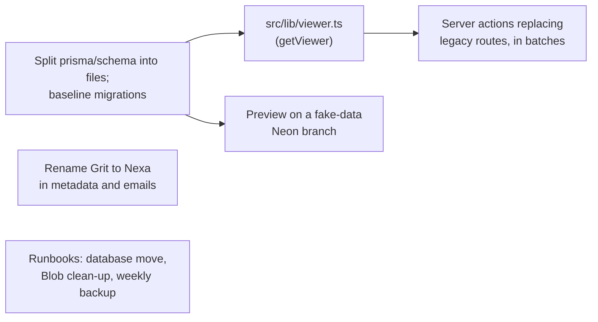

1. Split `prisma/schema.prisma` into the multi-file layout (Prisma 6.7 or later) and baseline migrations. Nothing runs against the shared database without the owner's approval.
2. Ship `getViewer()` to [viewer.md](../contracts/viewer.md).
3. Server actions and queries that replace the legacy routes, batch by batch ([design 07](design/07-legacy-replacement.md)). Batch 0, the feed leak, is already fixed (PR #52).
4. Point Preview at a schema-only Neon branch seeded with fake data, with its own Blob store.
5. Rename Grit to Nexa in metadata, emails and config.
6. Runbooks for the database move, the Blob audit and clean-up, and the weekly backup to Tigris. Ask the owner before running any of them.

## 11. Open items

| Item | Who |
| --- | --- |
| Paystack sales: multi-split on one account, renewal charges, chargeback fees, minimum charge, ID number for account checks | Owner |
| Wolfram quote (draft in research/SUMMARY.md) | Owner sends |
| Lawyer: tutor consent attestation (POPIA s35); US hosting before the move (s57) | Owner |
| Accountant: retention of invoices (deferred) | Owner, later |
| Preview Blob store: standing approval to empty it monthly | Owner |
| Uptime checker choice; 2FA timing for owners; when to buy Resend Pro | Owner |
| `deleteEntry` on the assignments overview; who edits `providers.tsx` | Agent B |
| Rendering Tiptap JSON in emails, per `editor.md` | A, now unblocked by B's contract |
