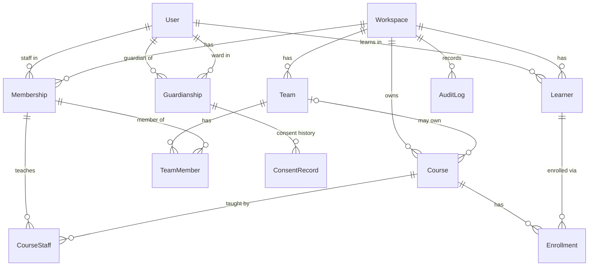

# Tenancy, roles and permissions

**Answer first.** The **workspace** is the tenant. It is either an `ORGANISATION` (a centre with tutor teams; the owner never teaches) or a `SOLO` practice (one tutor who owns and teaches). Staff join a workspace through a **Membership** with role `OWNER`, `ADMIN` or `TUTOR`. Learners join through a **Learner** row per workspace and an **Enrollment** per course; the enrolment is what billing counts. Parents and guardians are linked to students by a user-level **Guardianship** that crosses workspaces, so one parent account can see and pay for several children with different tutors. Every tenant row carries `workspaceId`, enforced in one data-access layer. Today's tutors and students move into one organisation workspace in a single data migration.

Status: draft for A2, 2026-11-16. Owner decisions in [research/SUMMARY.md](../research/SUMMARY.md) apply. There are no Simple or Technical modes (plan revision 3).

## 1. Entities

| Entity | Key fields | Notes |
| --- | --- | --- |
| `User` | `id`, `email` (unique), `name`, `platformRole` (`USER` or `NEXA_ADMIN`), `emailVerified` (boolean) and `emailVerifiedAt`, `twoFactorEnabled`, `dateOfBirth?` | One login per person. `platformRole` replaces today's `Role` enum; what a person is in a workspace comes from the rows below |
| `Workspace` | `id`, `kind` (`ORGANISATION`, `SOLO`), `name`, `slug` (unique), `timezone` (default `Africa/Johannesburg`), `logoUrl?`, `accentColor?`, `billingState`, `trialEndsAt?`, `createdAt` | The tenant. `billingState` is owned by [03-billing.md](03-billing.md) |
| `Team` | `id`, `workspaceId`, `name` | Organisations only. A solo practice has no teams |
| `Membership` | `id`, `workspaceId`, `userId`, `role` (`OWNER`, `ADMIN`, `TUTOR`), `status` (`ACTIVE`, `SUSPENDED`), `invitedById?`, `joinedAt` | Unique on (`workspaceId`, `userId`). Created `ACTIVE` when an `Invite` is accepted; pending invites live in `Invite` ([02-identity.md](02-identity.md)). A solo practice has exactly one `OWNER` who also teaches |
| `TeamMember` | `teamId`, `membershipId`, `isLead` | Many-to-many. A team lead can manage the team's courses |
| `Course` (B's model, gains fields) | `workspaceId`, `teamId?`, `ownerMembershipId` | Replaces `tutorId`. A course belongs to a team or to one tutor inside one workspace |
| `CourseStaff` | `courseId`, `membershipId`, `role` (`LEAD`, `ASSISTANT`) | Co-teaching. The owner membership is always `LEAD` |
| `Learner` | `id`, `workspaceId`, `userId`, `status` (`ACTIVE`, `ARCHIVED`), `paymentVisible` (default `false`), `isMinor` | A student's place in one workspace. `paymentVisible` lets the student see their own invoices (adult students) |
| `Enrollment` | `id`, `workspaceId`, `courseId`, `learnerId`, `status` (`ACTIVE`, `DROPPED`, `COMPLETED`), `startedAt`, `endedAt?` | Replaces the implicit `CourseEnrollments` join. Billing counts a learner as active in a month if any enrolment interval overlaps it. **Rows are append-only intervals:** dropping sets `endedAt`; re-enrolling creates a new row and never resets `startedAt`. A partial unique index allows one open row (`endedAt IS NULL`) per (`courseId`, `learnerId`) |
| `Guardianship` | `id`, `guardianUserId`, `studentUserId`, `relationship` (`PARENT`, `GUARDIAN`, `OTHER`), `status` (`PENDING`, `ACTIVE`, `REVOKED`), `consentAt?`, `consentVersion?` | User-level, not per workspace. POPIA consent for a minor is captured when the link becomes `ACTIVE`; the fields here cache the latest grant |
| `ConsentRecord` | `id`, `guardianshipId`, `guardianUserId`, `studentUserId`, `consentTextId`, `scopes`, `action` (`GRANT`, `WITHDRAW`), `method`, `at` | Append-only history of every grant and withdrawal ([02-identity.md](02-identity.md)). A minor's `Learner` row is created only once consent exists |
| `AuditLog` | `id`, `workspaceId?`, `actorUserId`, `impersonatorUserId?`, `action`, `targetType`, `targetId`, `data` (JSON), `at` | Every admin override, impersonation, role change and money action |

The profile tables `Tutor` and `Student` stay for now but gain `userId` (unique, foreign key) and stop matching on email. Their display fields (`fullName`, `imageUrl`, `bio`) move to `User` in a later clean-up.

## 2. Roles

A person can hold several roles at once: a tutor in one workspace can be a parent in another. The app works in one **context** at a time: the active workspace plus a persona.

| Role | Where it lives | Can be held by |
| --- | --- | --- |
| Organisation owner or admin | `Membership.role` = `OWNER` or `ADMIN` on an `ORGANISATION` workspace | Business owners and office staff. They never teach unless they also hold `TUTOR` through `CourseStaff` |
| Solo practice | `Membership.role` = `OWNER` on a `SOLO` workspace | One independent tutor, who is owner and tutor at once |
| Tutor | `Membership.role` = `TUTOR` (or a solo `OWNER`) | Teaches through `CourseStaff` |
| Student | A `Learner` row | Learners. Adult students can see their own fees when `paymentVisible` is on |
| Parent or guardian | An `ACTIVE` `Guardianship` | Optional. Sees each linked child's progress and pays their invoices, across workspaces |
| Nexa admin | `User.platformRole` = `NEXA_ADMIN` | Platform staff. Not a workspace member; acts through the admin console, every action audited |

## 3. Permissions matrix

`●` allowed, `◐` only for their own team, course or child, `–` not allowed. Permission keys are the strings `getViewer()` returns in `permissions` ([contracts/viewer.md](../../contracts/viewer.md)).

| Permission key | Owner | Admin | Tutor | Student | Guardian | Nexa admin |
| --- | --- | --- | --- | --- | --- | --- |
| `workspace.settings` | ● | ● | – | – | – | ● |
| `workspace.branding` | ● | ● | – | – | – | ● |
| `workspace.delete` | ● | – | – | – | – | ● |
| `members.invite` | ● | ● | – | – | – | ● |
| `members.role` | ● | ◐ (not owners) | – | – | – | ● |
| `teams.manage` | ● | ● | ◐ (team lead) | – | – | ● |
| `courses.create` | ● | ● | ● | – | – | – |
| `courses.edit` | ● | ● | ◐ (course staff) | – | – | – |
| `courses.services` | ● | ● | ◐ (course lead) | – | – | ● |
| `learners.invite` | ● | ● | ◐ (into own courses) | – | – | – |
| `learners.paymentVisibility` | ● | ● | ◐ (own learners) | – | – | – |
| `guardians.link` | ● | ● | ◐ (own learners) | – | ◐ (claim with a code) | ● |
| `messages.announce` | ● | ● | ◐ (own courses) | – | – | – |
| `messages.direct` | ● | ● | ◐ (own learners and their guardians) | ◐ (own tutors) | ◐ (child's tutors) | – |
| `content.view` | ● | ● | ◐ | ◐ (enrolled) | ◐ (child's courses) | ● (impersonating) |
| `grades.view` | ● | ● | ◐ | ◐ (own) | ◐ (child) | ● (impersonating) |
| `billing.view` | ● | ● | – | – | – | ● |
| `billing.manage` (tiers, card, caps) | ● | ● | – | – | – | ● |
| `fees.manage` (fee schedules, invoices to parents) | ● | ● | ◐ (own learners) | – | – | ● |
| `fees.markOffsite` | ● | ● | ◐ (own learners) | – | – | ● |
| `fees.pay` | – | – | – | ◐ (`paymentVisible` and no active guardian) | ◐ (own children) | – |
| `payouts.connect` | ● | – | ◐ (solo owner, or if the org pays tutors directly) | – | – | – |
| `admin.console`, `admin.impersonate`, `admin.override` | – | – | – | – | – | ● |

## 4. Tenancy enforcement

- **One data-access layer.** All reads and writes for tenant models go through `withWorkspace(viewer)`, a Prisma client extension that adds `where: { workspaceId }` to every query on a tenant model and sets `workspaceId` on every create. Direct `prisma.course.findMany()` from feature code is a lint error (custom ESLint rule on imports of `@/lib/db` outside `src/lib/data/**`).
- **Tenant models:** `Course` and everything under it (lessons, tests, assignments, events, grades), `Team`, `Membership`, `Learner`, `Enrollment`, `Notification` (every row carries `workspaceId`; it is null only for account notices), and all billing and payment rows. `User`, `Guardianship` and `AuditLog` (nullable `workspaceId`) are not tenant-scoped.
- **Guardian reads cross workspaces** through one query module, `src/features/parents/queries.ts`, which joins `Guardianship` to `Learner` and `Enrollment`. It never uses the active workspace filter, and it returns only the child's own data.
- **Tests:** a check script (`scripts/check-tenancy.ts`) seeds two workspaces in a scratch database and asserts that no query in `src/lib/data/**` returns the other workspace's rows.
- **Later, if needed:** Postgres row-level security on `workspaceId` as a second line. Not in v1 (Prisma and pooled connections make it awkward).

## 5. Active workspace and persona

- The active workspace id is kept in an HTTP-only cookie `nexa_ws`. `getViewer()` validates it against the user's memberships and learner rows, and falls back to the most recently used workspace.
- The persona follows from the active workspace: a membership makes the user **staff** there, a learner row makes them a **learner**. A user with both in the same workspace (rare: a tutor taking a course) picks in the switcher.
- The **guardian** persona is not tied to a workspace. A guardian-only user has no active workspace and lands on the parent portal. A guardian who is also staff switches with the same switcher ("My children").
- The Nexa admin console lives under `/admin` and ignores the active workspace unless the admin is impersonating.

## 6. Payment visibility for students

| Situation | Who receives invoices | Who can pay |
| --- | --- | --- |
| Student has an active guardian | Each active guardian | Guardians only |
| No guardian, `paymentVisible` on | The student | The student |
| No guardian, `paymentVisible` off | Nobody in the app. The tutor collects off-site and can mark invoices paid | – |

A minor (`Learner.isMinor`) can only be invited with a guardian or by a tutor (plan, risks table). `paymentVisible` cannot be switched on for a minor.

## 7. Nexa admin

- Admins are users with `platformRole = NEXA_ADMIN`, set by hand in the database or by another admin. There is no sign-up path to it.
- **Impersonation** starts a session that carries `impersonatorUserId`. Every write during impersonation writes an `AuditLog` row with both ids. A banner shows on every page, and impersonation ends after 30 minutes.
- Overrides (extend trial, comp, change tier, refund, mark paid off-site) are in [03-billing.md](03-billing.md) and [04-payments.md](04-payments.md). Each writes an `AuditLog` row.

## 8. Migration of today's data

Today a course belongs to one `Tutor`, profiles match users by email, and enrolment is an implicit join. The migration runs once, in Phase 1, on a copy first.

1. Create one `Workspace` of kind `ORGANISATION` named "Nexa" (renamed by the owner later), with `billingState = COMPED` so nothing is billed until the owner chooses.
2. For each `User` with role `TUTOR`: create a `Membership` (`ADMIN` role; the owner's own account becomes `OWNER`). Set `Tutor.userId` by matching email; stop if any tutor has no matching user, and list them.
3. For each `Course`: set `workspaceId`, and `ownerMembershipId` from `tutorId → Tutor.userId → Membership`. Add a `CourseStaff` row with `LEAD`.
4. For each `Student`: set `Student.userId` by email, create a `Learner` (`isMinor = true` by default, since today's users are school learners; tutors can change it), and turn each implicit enrolment into an `Enrollment` with `startedAt` = the course's `createdAt` (the real join date is not stored today).
5. For each `User` with role `PARENT`: no links exist today, so nothing to migrate. They claim children with a code after launch.
6. For each `User` with role `ADMIN`: set `platformRole = NEXA_ADMIN`.
7. Add `workspaceId` to every tenant table, backfilled from its course.
8. Run `scripts/check-tenancy.ts` and a row-count comparison before and after.

Steps 1 to 7 are one `prisma migrate` migration plus a TypeScript backfill script, rehearsed on a Neon branch. Running it against the shared database needs the owner's approval (AGENTS.md section 4).

## Open questions

- None blocking. **Decision taken here, change if wrong:** today's data becomes one organisation workspace with billing comped, rather than one solo workspace per tutor.
