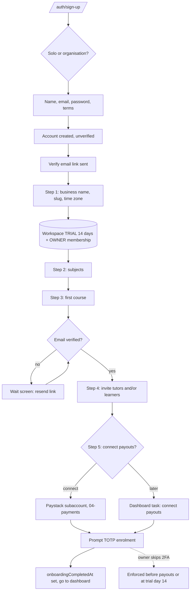
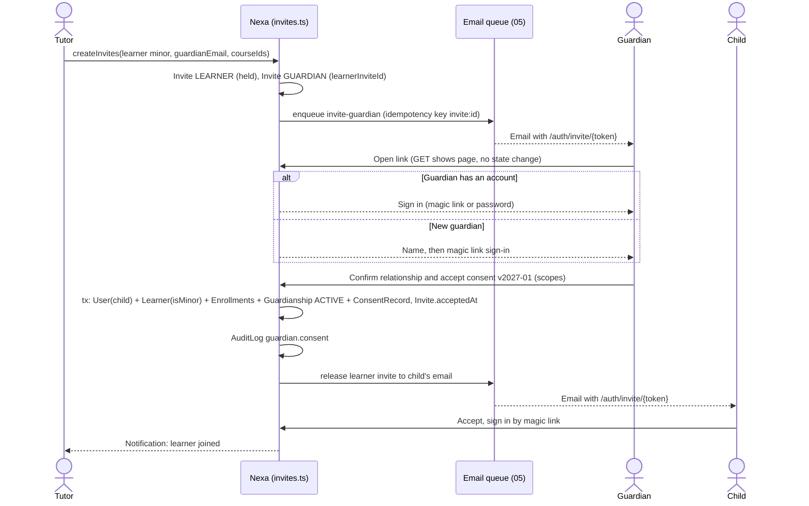

# Identity: sign-up, invites, sign-in and accounts

**Answer first.** Move from NextAuth v4 to **Better Auth** before any new sign-in feature is built. Auth.js v5 is still a beta, and both NextAuth packages have had security-only maintenance since the Better Auth team took them over. Sessions move from JWT to **database sessions**, so we can revoke them and impersonate users safely. Tutors and owners sign in with a password. TOTP 2FA is **required for every workspace `OWNER` and every `NEXA_ADMIN`**, and optional for other staff. Parents and learners sign in with single-use 15-minute magic links. Nobody self-registers as a learner or parent: they arrive through an invite or a guardian claim code. A minor's account is activated only once a guardian has recorded versioned consent. Profiles are keyed by `userId`, which makes email change, export and deletion safe.

Status: draft for A2, 2026-11-16. Builds on [01-tenancy-roles.md](01-tenancy-roles.md) (Workspace, Membership, Learner, Guardianship, AuditLog). Owner decisions in [research/SUMMARY.md](../research/SUMMARY.md) apply.

## 1. Today

| Area | State (read from code) | Problem |
| --- | --- | --- |
| Library | `next-auth` ^4.24.12, Credentials provider only, `session: { strategy: "jwt" }` (`src/lib/auth.ts`) | No magic links, no 2FA, no way to revoke a session |
| Adapter | `PrismaAdapter(prisma)` is configured, but the schema has no `Account`, `Session` or `VerificationToken` model | The adapter does nothing; JWT sessions never touch it |
| Errors | `authorize()` throws "No user found with this email." and "Invalid password." | Leaks whether an account exists (user enumeration) |
| Roles | `User.role` (`STUDENT`, `TUTOR`, `PARENT`, `ADMIN`) in the JWT; `src/lib/safe-action.ts` has one client per role | Replaced by `platformRole` and workspace roles (01) |
| Profiles | `Tutor` and `Student` match `User` on the email string (`api-guard.ts`, `notifications/server.ts`, `jobs.ts`) | Changing an email breaks every link |
| Verification | `EmailVerificationToken` (SHA-256 hash, 24 hours, one live token) in `src/features/auth/verification.ts` | Good pattern; folds into Better Auth's `verification` table |
| Password reset | `src/app/forgot-password/page.tsx` is a form with no action | No reset flow exists |
| Sign-up | None; staff create accounts | Self-serve sign-up is new |
| Middleware | `src/middleware.ts` uses `withAuth`, protects `/dashboard/*` | Rewrite for the new session cookie |

Footprint: 17 files import `next-auth`, 7 use `useSession`, `signIn` or `signOut` on the client, 17 use the role-based clients or guards, and 48 read `user.email`.

## 2. Library choice

| Option | Status (checked 2026-11-16) | What we would build ourselves | Migration cost |
| --- | --- | --- | --- |
| Stay on NextAuth v4 | `next-auth@4.24.15` is `latest`, published 2026-07-20 ([npm registry](https://registry.npmjs.org/next-auth)). Maintained for "security patches and urgent issues" by the Better Auth team since 22 Sep 2025 ([better-auth.com blog](https://better-auth.com/blog/authjs-joins-better-auth)) | Magic links (Email provider needs an adapter and DB tables), TOTP, backup codes, session revocation (impossible with JWT unless we add a denylist), impersonation, rate limiting | Low now, high later: every feature in this doc is custom code on a frozen library |
| Auth.js v5 | Still `5.0.0-beta.32`, published 2026-07-20, never released stable ([npm registry](https://registry.npmjs.org/next-auth)). Same security-only maintenance | Same list as v4, minus some App Router glue | Medium: new config shape and `auth()` helper, the same tables as Better Auth, and still no 2FA |
| **Better Auth** | `better-auth@1.7.25` is `latest`, published 2026-11-14; 1.8 is in beta ([npm registry](https://registry.npmjs.org/better-auth)). The blog post "strongly recommends" it for new projects. Reported (**Unverified**, secondary sources only) to have been acquired by Vercel in July 2026 | Lockout counters, invites, claim codes, consent (ours in every option) | Medium, one time. See below |

Plugins we use, each checked 2026-11-16:

- `magicLink`: single use ("consumed on the first verification attempt"), default 5 minutes, `expiresIn` configurable ([docs](https://www.better-auth.com/docs/plugins/magic-link)).
- `twoFactor`: TOTP, single-use backup codes, a 30-day trusted device, and enrolment needs the password ([docs](https://www.better-auth.com/docs/plugins/2fa)).
- `admin`: impersonation with `impersonationSessionDuration` (default 1 hour), `revokeUserSessions`, and `banUser`, which also revokes sessions ([docs](https://www.better-auth.com/docs/plugins/admin)).
- Built-in rate limiting with `storage: "database"`. The default memory store does not suit serverless, and limiting is off in development unless enabled ([docs](https://www.better-auth.com/docs/concepts/rate-limit)).
- Database sessions with an optional cookie cache ([docs](https://www.better-auth.com/docs/concepts/session-management)).

We do **not** use Better Auth's `organization` plugin. Workspaces, memberships and teams are ours (01), and two membership models would conflict.

**Decision taken here: Better Auth.** The alternative is Auth.js v5, which gives no 2FA and comes from a project whose own maintainers point new work elsewhere.

### Migration cost (Better Auth)

| Work | Size |
| --- | --- |
| New tables `Session`, `Account`, `Verification`, `TwoFactor`, `RateLimit` in `prisma/schema/core.prisma`. Keep cuid ids with `advanced.database.generateId` | 1 migration |
| `User`: `emailVerified` becomes a boolean (Better Auth's shape) plus `emailVerifiedAt DateTime?` (the backfill copies today's timestamp). Map the admin plugin's `role` field to `platformRole`, with `adminRoles: ["NEXA_ADMIN"]`. Add `banned`, `banReason`, `banExpires`, `twoFactorEnabled`, `failedSignIns`, `lockedUntil`, `deletedAt` | Same migration |
| Passwords: copy each `User.password` (bcrypt) into an `Account` row with `providerId = "credential"`. Set `emailAndPassword.password.verify` to accept `$2` bcrypt hashes and rehash with the default scrypt on the next sign-in. Drop `User.password` after 90 days | Backfill script `scripts/migrate-auth-accounts.ts` |
| `src/lib/auth.ts` rewritten; `src/lib/auth-client.ts` (new, `createAuthClient`); route `src/app/api/auth/[...all]/route.ts` replaces `[...nextauth]` | 3 files |
| `src/lib/safe-action.ts`: the role clients become `viewerActionClient` plus `requirePermission(key)` from 01. `src/lib/api-guard.ts` gets the same treatment until the legacy routes are deleted | 2 files plus 17 call sites |
| Client calls (`useSession`, `signIn`, `signOut`) move to `authClient`. These are B's components, so A ships `auth-client.ts` and B swaps the 7 imports | 7 files (B) |
| `src/middleware.ts`: an optimistic check with `getSessionCookie()`; the real check happens in `getViewer()` | 1 file |
| Everyone signs in again once at cutover | Announce by email to the owner's test users only |

Estimate: 4 to 6 working days, including tests. It must land in Phase 1 **before** invites and magic links, so nothing is built twice.

## 3. Sessions

**Decision taken here: database sessions**, with Better Auth's cookie cache at `maxAge` 300 seconds. The alternative is JWT, which needs a denylist for revocation and keeps impersonation state inside a token we cannot recall.

| Need | How database sessions meet it |
| --- | --- |
| Sign out everywhere, password change, ban, membership removed | `revokeSessions(userId)` deletes the rows. The cookie cache means a revoked session lives at most 5 more minutes; money and admin actions call `getSession({ disableCookieCache: true })` |
| Impersonation (01 §7) | The admin plugin writes `Session.impersonatedBy`. `getViewer()` copies it into `viewer.impersonatorUserId`, and the data layer writes it to `AuditLog.impersonatorUserId`. Set `impersonationSessionDuration: 1800` (30 minutes, per 01) |
| Device list in settings | `Session.ipAddress`, `userAgent` and `createdAt` are shown, and each row can be revoked |
| Latency | One indexed read per request at most, and none while the cookie cache is valid |

Lifetimes: `expiresIn` 30 days with `updateAge` 1 day for learners and guardians. Staff get 14 days. Nexa admins get 12 hours, never with a trusted device. The active workspace stays in the `nexa_ws` cookie (01 §5), not on the session.

## 4. Sign-up and onboarding

Only workspace creators sign up on their own. Two entry points on `/auth/sign-up` set `Workspace.kind`: "I teach on my own" (`SOLO`) and "I run a tutoring business" (`ORGANISATION`).

1. **Account**: name, email, password (at least 10 characters; the Better Auth `haveIBeenPwned` plugin checks a hash prefix only). Ticking the terms box is required. The account starts unverified.
2. **Verify email**: a link that lasts 24 hours and a resend button. Steps 4 and 5 stay locked until the email is verified, because they send email or move money.
3. **Onboarding**, 5 steps at `/auth/onboarding/[step]`. Each step saves as it goes, and the user can leave and come back.

| Step | Solo | Organisation | Writes |
| --- | --- | --- | --- |
| 1. Business name | Practice name, slug, time zone | Business name, slug, time zone, optional logo | `Workspace` (trial starts: `billingState = TRIAL`, `trialEndsAt` = now + 14 days, owned by 03), `Membership` `OWNER` |
| 2. Subjects | Subjects they teach (pick from a list or type) | Subjects the business offers | `Workspace.subjects String[]` (**Decision taken here**: a tag list that pre-fills course names. Alternative: a `Subject` table, later if reporting needs it) |
| 3. First course | Name, subject, grade; the owner becomes `CourseStaff` `LEAD` | Name and subject, then either "I'll invite the tutor" (a staff invite) or leave it unassigned | `Course` (B's model, through B's `createCourse` action) |
| 4. Invite | Learners (email, adult or minor, guardian email if minor) | Tutors and admins first, then learners (optional) | `Invite` rows (§5) |
| 5. Connect payouts | Paystack subaccount (04-payments) | Same, by the owner | **Skippable.** "Do this later" sets a dashboard task. Parent invoices cannot be sent until payouts are connected |

`Workspace.onboardingCompletedAt` is set after step 5 or after "skip". Until then `/dashboard` redirects to the next unfinished step. TOTP enrolment (§7) is prompted after step 5 and enforced before payouts or by day 14.

## 5. Invites

| Field | Type | Notes |
| --- | --- | --- |
| `id` | cuid | |
| `workspaceId` | FK | Tenant row |
| `kind` | `STAFF`, `LEARNER`, `GUARDIAN` | |
| `email` | string, lower-cased | |
| `tokenHash` | string, unique | SHA-256 of a 32-byte random token; the raw token exists only in the email link (same pattern as today's `verification.ts`) |
| `role` | `Membership.role?` | `STAFF` only: `ADMIN` or `TUTOR` (never `OWNER`; ownership moves by transfer) |
| `courseIds` | `String[]` | `LEARNER`: enrolments to create. `STAFF`: `CourseStaff` rows to create |
| `isMinor` | boolean | `LEARNER` only |
| `learnerInviteId` | FK `Invite?` | `GUARDIAN` invite for a minor: the learner invite it unlocks |
| `learnerId` | FK `Learner?` | `GUARDIAN` invite for an existing learner |
| `displayName` | string | What the inviter typed. For a minor, this is the only child data held before consent |
| `invitedById` | FK `User` | |
| `expiresAt` | datetime | 7 days. "Resend" makes a new token and moves the expiry |
| `acceptedAt`, `acceptedByUserId` | | Set once; the token is dead after that |
| `revokedAt` | datetime? | |

There is one pending invite per (`workspaceId`, `email`, `kind`), enforced by a partial unique index where `acceptedAt` and `revokedAt` are null. Code lives in `src/features/auth/invites.ts` (`createInvites`, `acceptInvite`, `revokeInvite`), and the page is `src/app/auth/invite/[token]/page.tsx`. Permissions follow 01: `members.invite` for staff, `learners.invite` for learners, `guardians.link` for guardians.

**Flows.**

- **Staff.** On acceptance, a new user sets a password, or an existing user signs in. This creates a `Membership` `ACTIVE` plus `CourseStaff` rows, and prompts for 2FA.
- **Adult learner.** On acceptance, the user signs in by magic link (or sets an optional password). This creates `Learner` (`isMinor = false`) and an `Enrollment` per course.
- **Minor learner.** The inviter must give a guardian email. The **guardian** invite goes out first, and no child `User` exists yet. Once the guardian accepts and consents (§9), the learner invite is released to the child's email. If the child has no email, the guardian can "set up my child's sign-in" (**Open question**). The `Learner` is created only after consent.
- **Guardian for an existing learner.** On acceptance, this creates a `Guardianship` `ACTIVE` with consent.

### Guardian claim code

Today's learners have no guardians (01 §8 step 5). A tutor with `guardians.link` makes a code for one learner, shown once, for example `NEXA-7KQ4-M2XD` (8 Crockford base32 characters). The tutor gives it to the parent outside the app.

| `GuardianClaimCode` field | Notes |
| --- | --- |
| `id`, `workspaceId`, `learnerId`, `createdById` | |
| `codeHash` (unique) | SHA-256 of the normalised code |
| `expiresAt` | 14 days |
| `usedAt`, `usedByUserId` | Single use |
| `failedAttempts` | |

The parent opens `/auth/claim`, enters the code and their email, and signs in by magic link. They then confirm the child's first name (shown masked, for example "T\*\*\*\*"), and consent. This creates the `Guardianship` `ACTIVE`. If the learner already has an active guardian, the new link is `PENDING` until the tutor approves it. Rate limits: 5 code attempts per IP per hour, and 10 per code across all IPs before the code is voided. Code lives in `src/features/auth/claim-codes.ts`.

## 6. Magic links

| Rule | Value |
| --- | --- |
| Who may use them | Users with **no** staff membership and not `NEXA_ADMIN`. For anyone else, `sendMagicLink` sends a "use your password" email instead (same response on screen) |
| Expiry | 15 minutes (`expiresIn: 900`) |
| Single use | Yes. Better Auth consumes the token on verification |
| Link scanners | The link opens `/auth/magic?token=…`, a page with a "Sign in" button that POSTs. Mail scanners that prefetch GETs (Outlook Safe Links) cannot burn the token. **Decision taken here**; the alternative is to accept that some links break |
| Rate limits | 3 per email per 15 minutes, 10 per IP per hour, through the `RateLimit` table |
| Response | Always "If an account exists, we've sent a link" |
| Email | The `magic-link` template, transactional ([05](05-messaging-email.md)) |

## 7. Passwords and 2FA

| Who | Password | TOTP |
| --- | --- | --- |
| `NEXA_ADMIN` | Required | **Required** before `/admin` loads. No trusted device |
| Workspace `OWNER` (solo or organisation) | Required | **Required** before `payouts.connect` or `billing.manage` writes, and for all access from trial day 14 |
| `ADMIN`, `TUTOR` | Required | Optional, prompted after the first invite is accepted. An owner can make it required for their workspace (`Workspace.require2fa`) |
| Learner, guardian | Optional (magic link by default) | Not offered in v1 |

**Decision taken here:** 2FA is required for every owner, solo owners included, because a solo owner controls payouts too. The alternative is to require it only for organisation owners. Recovery uses 10 single-use backup codes. If they are lost, a Nexa admin resets 2FA after checking identity by email and phone, writes an `AuditLog` row, and revokes all sessions.

**Password reset** (replaces the stub at `src/app/forgot-password`): `requestPasswordReset` sends a link that lasts 30 minutes and is single use. On success all sessions are revoked, a "your password changed" notice goes out, and the screen always shows the same response.

## 8. Profiles, email change, export and deletion

**Profiles keyed by `userId`.** `Tutor.userId` and `Student.userId` become unique, required foreign keys (01 §8 steps 2 and 4). Every email join is replaced by an id join:

- `api-guard.ts` `tutorOwnsCourse`, `studentForSession` and `visibleCoursesWhere`
- `notifications/server.ts` `usersByEmails`
- `jobs.ts` `studentUsers`

`Tutor.email` and `Student.email` stop being written and are dropped in the clean-up release.

**Email change** (`src/features/auth/email-change.ts`):

1. The user re-authenticates: password + TOTP for staff, a fresh magic link for passwordless users.
2. A confirm link goes to the **new** address and lasts 1 hour. A notice goes to the **old** address with "This wasn't me", which works for 7 days, revokes all sessions and restores the old email.
3. On confirm: `User.email` is updated, `emailVerifiedAt` is set to now, other sessions are revoked, and an `AuditLog` row `user.email_changed` is written. The new address must not belong to another user.

**POPIA data export** (`src/features/users/export.ts`): any user, and a guardian for each linked child, can request an export once per 24 hours. A queued job writes a ZIP of JSON files into a private Blob path:

- profile, memberships, learner rows, enrolments
- submissions, grades, messages they wrote, notifications
- consent records, invoices and payments

The `data-export-ready` email carries a signed link that expires in 7 days, and the file is deleted after 7 days.

**Account deletion** (`src/features/users/deletion.ts`):

| Rule | Detail |
| --- | --- |
| Blockers | The sole `OWNER` of a workspace must transfer ownership or close the workspace first |
| Grace | `User.deletedAt` is set, sessions are revoked, and sign-in is blocked. The user can cancel by email link for 14 days |
| After grace | A job anonymises the user: name becomes "Former user", email becomes `deleted+<id>@invalid`, and the password, 2FA, sessions and preferences are deleted. Messages they wrote stay, attributed to "Former user". Submissions and grades are deleted unless the workspace must keep them; the learner's guardian or the tutor exports first |
| Kept | Invoices and payment rows are kept 5 years for tax (**Open question** for the lawyer on the exact period), with the name only. `AuditLog` and `ConsentRecord` are kept |
| Minors | A guardian can delete the child's account. A minor cannot delete their own account without a guardian |

## 9. Minors and guardian consent

- `Learner.isMinor` comes from `User.dateOfBirth` when known, otherwise from the inviter's tick. A minor learner can only be created through §5: a tutor or guardian invite, with consent first. `paymentVisible` stays false (01 §6).
- `ConsentText`: `id`, `version` (for example `2027-01`), `locale`, `body` (markdown), `scopes` (`CORE`, `CROSS_BORDER`, `AI_MARKING`, `MARKETING`), `publishedAt`. Texts are never edited; a change is a new version.
- `ConsentRecord`, append-only: `id`, `guardianshipId`, `guardianUserId`, `studentUserId`, `consentTextId`, `scopes` granted, `action` (`GRANT`, `WITHDRAW`), `ip`, `userAgent`, `method` (`INVITE`, `CLAIM_CODE`), `at`. Each record mirrors the latest grant into `Guardianship.consentAt`, `consentVersion` and `consentEvidence` (01).
- `CORE` and `CROSS_BORDER` are required to activate the learner. The `AI_MARKING` scope is checked by B's AI marking queue through `hasConsent(learnerId, "AI_MARKING")` in `src/features/parents/consent.ts`. `MARKETING` defaults to off.
- When a new consent version raises the scopes, guardians re-consent at next sign-in. Withdrawing `CORE` archives the learner and starts deletion (§8).
- At 18: a nightly job flips `isMinor` from `dateOfBirth` and asks the learner to give their own consent.
- **Migrated learners** (all `isMinor = true`, no guardian) need claim codes. See the open questions.

## 10. Rate limiting and lockout

| Endpoint | Limit (key) |
| --- | --- |
| Password sign-in | 5 per 15 minutes per IP + email |
| 2FA verify | 5 per 10 minutes per session |
| Magic link | 3 per 15 minutes per email, 10 per hour per IP |
| Password reset request | 3 per hour per email |
| Sign-up | 5 per hour per IP |
| Invite create | 200 per day per workspace (Resend Free also caps at 100 a day, see 05) |
| Claim code | 5 per hour per IP |

- **Store:** Better Auth `rateLimit` with `storage: "database"`, `enabled: true` in every environment. Move to Redis-backed secondary storage only if the table gets hot.
- **Lockout:** 10 failed passwords on one account in 30 minutes set `User.lockedUntil` to now + 30 minutes. The owner of the address gets an email with a reset link. The counter resets on success. Code lives in `src/features/auth/lockout.ts`, registered as a Better Auth `hooks.before` on `/sign-in/email`.
- **Errors:** all sign-in errors read "Email or password is incorrect". This fixes today's enumeration leak.
- Every lockout, 2FA reset, ban and impersonation writes an `AuditLog` row.

## 11. Code locations

| Path | Contents |
| --- | --- |
| `src/lib/auth.ts` | `betterAuth({...})` config, `getSession()`, `AuthError` |
| `src/lib/auth-client.ts` | `createAuthClient` with the `magicLinkClient`, `twoFactorClient` and `adminClient` plugins |
| `src/lib/viewer.ts` | `getViewer()` (contract `viewer.md`) built on the session |
| `src/lib/safe-action.ts` | `viewerActionClient`, `requirePermission` |
| `src/app/api/auth/[...all]/route.ts` | Better Auth handler |
| `src/features/auth/` | `invites.ts`, `claim-codes.ts`, `lockout.ts`, `email-change.ts`, `onboarding.ts`, `schemas.ts`, `actions.ts` |
| `src/features/parents/consent.ts` | Consent records and `hasConsent` |
| `src/features/users/` | `export.ts`, `deletion.ts` |
| `src/app/auth/**` | `sign-in`, `sign-up`, `magic`, `invite/[token]`, `claim`, `two-factor`, `reset-password`, `onboarding/[step]` (A owns the routes; built from B's components) |
| `src/app/verify-email`, `src/app/forgot-password` | Kept as redirects to the new `/auth/*` pages |

## Issues with 01

- `Membership.status = INVITED` needs a `userId`, which an invitee may not have yet. Proposal: pending invites live in `Invite`, and a `Membership` is created `ACTIVE` on acceptance. `INVITED` is then unused and can be dropped.
- `Learner` should not exist before consent for a minor. This doc creates it on consent, so 01 needs no `PENDING_CONSENT` status. Migrated minors are the exception (see the open questions).
- 01 keeps consent on `Guardianship` only. This doc adds an append-only `ConsentRecord` for per-scope history and withdrawals, and treats the `Guardianship` fields as a cache of the latest grant. This adds to 01 and does not contradict it.
- `User.emailVerified` changes from a timestamp to a boolean plus `emailVerifiedAt` (Better Auth's shape).

## Open questions

1. **Migrated learners:** today's learners are minors with no recorded guardian consent. Do we give tutors 30 days after launch to send claim codes, keeping access meanwhile? Or do we pause processing until consent is given? This is a POPIA s35 question for the lawyer.
2. **Young children without an email:** may a guardian manage a child's sign-in (for example a guardian-issued magic link to the guardian's inbox, with a switch to the child)? Or is a child email always required?
3. **Retention:** how long must invoices and learner work be kept after an account is deleted (tax 5 years? school records?).
4. Is a 14-day trial grace before owner 2FA is enforced acceptable, or must it be enforced at sign-up?
