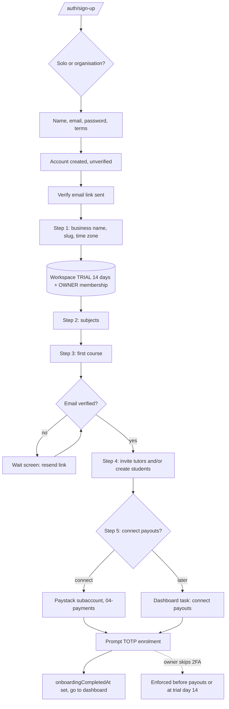
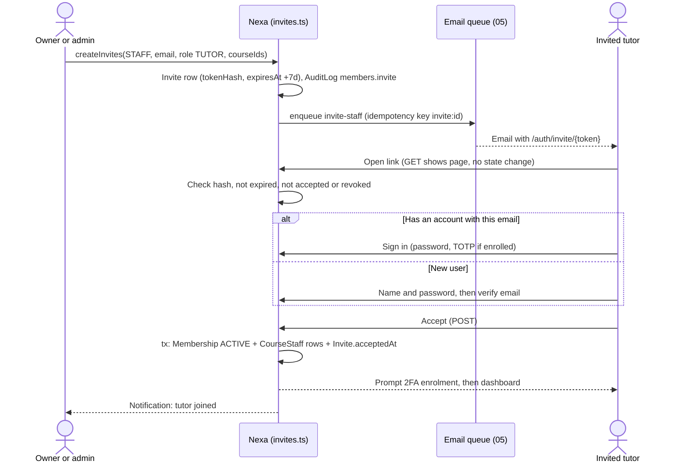

# Identity: sign-up, invites, sign-in and accounts

**Answer first.** Move from NextAuth v4 to **Better Auth** before any new sign-in feature is built. Auth.js v5 is still a beta, and both NextAuth packages have had security-only maintenance since the Better Auth team took them over. Sessions move from JWT to **database sessions**, so we can revoke them and impersonate users safely. Tutors and owners sign in with a password. TOTP 2FA is **required for every workspace `OWNER` and every `NEXA_ADMIN`**, and optional for other staff.

In v1, tutors create and onboard their own students directly. The tutor enters a name, an optional email and a username, and hands the student a one-time sign-in code. The tutor arranges guardians, email and parental consent offline, and is responsible for that consent. Guardian accounts, claim codes, consent records and magic links stay in the design, marked **later (post-v1)**. They are built as new tables, so adding them needs no change to v1 data. Profiles are keyed by `userId`, which makes email change, export and deletion safe. Data is kept until 2 months after a workspace's last payment, then deleted. Financial records are kept as tax law requires.

Status: draft for A2, 2026-11-16, revised the same day with the owner's answers (v1 onboarding, retention). Builds on [01-tenancy-roles.md](01-tenancy-roles.md) (Workspace, Membership, Learner, Guardianship, AuditLog). Owner decisions in [research/SUMMARY.md](../research/SUMMARY.md) apply.

## 1. Today

| Area | State (read from code) | Problem |
| --- | --- | --- |
| Library | `next-auth` ^4.24.12, Credentials provider only, `session: { strategy: "jwt" }` (`src/lib/auth.ts`) | No magic links, no 2FA, no way to revoke a session |
| Adapter | `PrismaAdapter(prisma)` is configured, but the schema has no `Account`, `Session` or `VerificationToken` model | The adapter does nothing; JWT sessions never touch it |
| Errors | `authorize()` throws "No user found with this email." and "Invalid password." | Leaks whether an account exists (user enumeration) |
| Roles | `User.role` (`STUDENT`, `TUTOR`, `PARENT`, `ADMIN`) in the JWT; `src/lib/safe-action.ts` has one client per role | Replaced by `platformRole` and workspace roles (01) |
| Profiles | `Tutor` and `Student` match `User` on the email string (`api-guard.ts`, `notifications/server.ts`, `jobs.ts`) | Changing an email breaks every link |
| Verification | `EmailVerificationToken` (SHA-256 hash, 24 hours, one live token) in `src/features/auth/verification.ts` | Good pattern; folds into Better Auth's `verification` table |
| Password reset | `src/app/forgot-password/page.tsx` is a form with no action | No reset flow exists |
| Sign-up | None; staff create accounts | Self-serve sign-up is new |
| Middleware | `src/middleware.ts` uses `withAuth`, protects `/dashboard/*` | Rewrite for the new session cookie |

Footprint: 17 files import `next-auth`, 7 use `useSession`, `signIn` or `signOut` on the client, 17 use the role-based clients or guards, and 48 read `user.email`.

## 2. Library choice

| Option | Status (checked 2026-11-16) | What we would build ourselves | Migration cost |
| --- | --- | --- | --- |
| Stay on NextAuth v4 | `next-auth@4.24.15` is `latest`, published 2026-07-20 ([npm registry](https://registry.npmjs.org/next-auth)). Maintained for "security patches and urgent issues" by the Better Auth team since 22 Sep 2025 ([better-auth.com blog](https://better-auth.com/blog/authjs-joins-better-auth)) | Magic links (Email provider needs an adapter and DB tables), TOTP, backup codes, session revocation (impossible with JWT unless we add a denylist), impersonation, rate limiting | Low now, high later: every feature in this doc is custom code on a frozen library |
| Auth.js v5 | Still `5.0.0-beta.32`, published 2026-07-20, never released stable ([npm registry](https://registry.npmjs.org/next-auth)). Same security-only maintenance | Same list as v4, minus some App Router glue | Medium: new config shape and `auth()` helper, the same tables as Better Auth, and still no 2FA |
| **Better Auth** | `better-auth@1.7.25` is `latest`, published 2026-11-14; 1.8 is in beta ([npm registry](https://registry.npmjs.org/better-auth)). The blog post "strongly recommends" it for new projects. Reported (**Unverified**, secondary sources only) to have been acquired by Vercel in July 2026 | Lockout counters, invites, claim codes, consent (ours in every option) | Medium, one time. See below |

Plugins we use, each checked 2026-11-16:

- `username`: lets tutor-created students sign in without an email (v1).
- `magicLink` (later, post-v1): single use ("consumed on the first verification attempt"), default 5 minutes, `expiresIn` configurable ([docs](https://www.better-auth.com/docs/plugins/magic-link)).
- `twoFactor`: TOTP, single-use backup codes, a 30-day trusted device, and enrolment needs the password ([docs](https://www.better-auth.com/docs/plugins/2fa)).
- `admin`: impersonation with `impersonationSessionDuration` (default 1 hour), `revokeUserSessions`, and `banUser`, which also revokes sessions ([docs](https://www.better-auth.com/docs/plugins/admin)).
- Built-in rate limiting with `storage: "database"`. The default memory store does not suit serverless, and limiting is off in development unless enabled ([docs](https://www.better-auth.com/docs/concepts/rate-limit)).
- Database sessions with an optional cookie cache ([docs](https://www.better-auth.com/docs/concepts/session-management)).

We do **not** use Better Auth's `organization` plugin. Workspaces, memberships and teams are ours (01), and two membership models would conflict.

**Decision taken here: Better Auth.** The alternative is Auth.js v5, which gives no 2FA and comes from a project whose own maintainers point new work elsewhere.

### Migration cost (Better Auth)

| Work | Size |
| --- | --- |
| New tables `Session`, `Account`, `Verification`, `TwoFactor`, `RateLimit` in `prisma/schema/core.prisma`. Keep cuid ids with `advanced.database.generateId` | 1 migration |
| `User`: `emailVerified` becomes a boolean (Better Auth's shape) plus `emailVerifiedAt DateTime?` (the backfill copies today's timestamp). Map the admin plugin's `role` field to `platformRole`, with `adminRoles: ["NEXA_ADMIN"]`. Add `banned`, `banReason`, `banExpires`, `twoFactorEnabled`, `failedSignIns`, `lockedUntil`, `deletedAt` | Same migration |
| Passwords: copy each `User.password` (bcrypt) into an `Account` row with `providerId = "credential"`. Set `emailAndPassword.password.verify` to accept `$2` bcrypt hashes and rehash with the default scrypt on the next sign-in. Drop `User.password` after 90 days | Backfill script `scripts/migrate-auth-accounts.ts` |
| `src/lib/auth.ts` rewritten; `src/lib/auth-client.ts` (new, `createAuthClient`); route `src/app/api/auth/[...all]/route.ts` replaces `[...nextauth]` | 3 files |
| `src/lib/safe-action.ts`: the role clients become `viewerActionClient` plus `requirePermission(key)` from 01. `src/lib/api-guard.ts` gets the same treatment until the legacy routes are deleted | 2 files plus 17 call sites |
| Client calls (`useSession`, `signIn`, `signOut`) move to `authClient`. These are B's components, so A ships `auth-client.ts` and B swaps the 7 imports | 7 files (B) |
| `src/middleware.ts`: an optimistic check with `getSessionCookie()`; the real check happens in `getViewer()` | 1 file |
| Everyone signs in again once at cutover | Announce by email to the owner's test users only |

Estimate: 4 to 6 working days, including tests. It must land in Phase 1 **before** invites and magic links, so nothing is built twice.

## 3. Sessions

**Decision taken here: database sessions**, with Better Auth's cookie cache at `maxAge` 300 seconds. The alternative is JWT, which needs a denylist for revocation and keeps impersonation state inside a token we cannot recall.

| Need | How database sessions meet it |
| --- | --- |
| Sign out everywhere, password change, ban, membership removed | `revokeSessions(userId)` deletes the rows. The cookie cache means a revoked session lives at most 5 more minutes; money and admin actions call `getSession({ disableCookieCache: true })` |
| Impersonation (01 §7) | The admin plugin writes `Session.impersonatedBy`. `getViewer()` copies it into `viewer.impersonatorUserId`, and the data layer writes it to `AuditLog.impersonatorUserId`. Set `impersonationSessionDuration: 1800` (30 minutes, per 01) |
| Device list in settings | `Session.ipAddress`, `userAgent` and `createdAt` are shown, and each row can be revoked |
| Latency | One indexed read per request at most, and none while the cookie cache is valid |

Lifetimes: `expiresIn` 30 days with `updateAge` 1 day for learners and guardians. Staff get 14 days. Nexa admins get 12 hours, never with a trusted device. The active workspace stays in the `nexa_ws` cookie (01 §5), not on the session.

## 4. Sign-up and onboarding

Only workspace creators sign up on their own. Two entry points on `/auth/sign-up` set `Workspace.kind`: "I teach on my own" (`SOLO`) and "I run a tutoring business" (`ORGANISATION`).

1. **Account**: name, email, password (at least 10 characters; the Better Auth `haveIBeenPwned` plugin checks a hash prefix only). Ticking the terms box is required. The account starts unverified.
2. **Verify email**: a link that lasts 24 hours and a resend button. Steps 4 and 5 stay locked until the email is verified, because they send email or move money.
3. **Onboarding**, 5 steps at `/auth/onboarding/[step]`. Each step saves as it goes, and the user can leave and come back.

| Step | Solo | Organisation | Writes |
| --- | --- | --- | --- |
| 1. Business name | Practice name, slug, time zone | Business name, slug, time zone, optional logo | `Workspace` (trial starts: `billingState = TRIAL`, `trialEndsAt` = now + 14 days, owned by 03), `Membership` `OWNER` |
| 2. Subjects | Subjects they teach (pick from a list or type) | Subjects the business offers | `Workspace.subjects String[]` (**Decision taken here**: a tag list that pre-fills course names. Alternative: a `Subject` table, later if reporting needs it) |
| 3. First course | Name, subject, grade; the owner becomes `CourseStaff` `LEAD` | Name and subject, then either "I'll invite the tutor" (a staff invite) or leave it unassigned | `Course` (B's model, through B's `createCourse` action) |
| 4. Add students | Create student accounts (§5.1) | Invite tutors and admins first (§5), then optionally create students | `User` + `Learner` + `Enrollment`; staff `Invite` rows |
| 5. Connect payouts | Paystack subaccount (04-payments) | Same, by the owner | **Skippable.** "Do this later" sets a dashboard task. Parent invoices cannot be sent until payouts are connected |

`Workspace.onboardingCompletedAt` is set after step 5 or after "skip". Until then `/dashboard` redirects to the next unfinished step. TOTP enrolment (§7) is prompted after step 5 and enforced before payouts or by day 14.

## 5. Invites

| Field | Type | Notes |
| --- | --- | --- |
| `id` | cuid | |
| `workspaceId` | FK | Tenant row |
| `kind` | `STAFF`, `LEARNER`, `GUARDIAN` | |
| `email` | string, lower-cased | |
| `tokenHash` | string, unique | SHA-256 of a 32-byte random token; the raw token exists only in the email link (same pattern as today's `verification.ts`) |
| `role` | `Membership.role?` | `STAFF` only: `ADMIN` or `TUTOR` (never `OWNER`; ownership moves by transfer) |
| `courseIds` | `String[]` | `LEARNER`: enrolments to create. `STAFF`: `CourseStaff` rows to create |
| `isMinor` | boolean | `LEARNER` only |
| `learnerInviteId` | FK `Invite?` | `GUARDIAN` invite for a minor: the learner invite it unlocks |
| `learnerId` | FK `Learner?` | `GUARDIAN` invite for an existing learner |
| `displayName` | string | What the inviter typed. For a minor, this is the only child data held before consent |
| `invitedById` | FK `User` | |
| `expiresAt` | datetime | 7 days. "Resend" makes a new token and moves the expiry |
| `acceptedAt`, `acceptedByUserId` | | Set once; the token is dead after that |
| `revokedAt` | datetime? | |

There is one pending invite per (`workspaceId`, `email`, `kind`), enforced by a partial unique index where `acceptedAt` and `revokedAt` are null. Code lives in `src/features/auth/invites.ts` (`createInvites`, `acceptInvite`, `revokeInvite`), and the page is `src/app/auth/invite/[token]/page.tsx`. In v1 only `kind = STAFF` is used. `LEARNER` and `GUARDIAN` invites, and the fields `isMinor`, `learnerInviteId` and `learnerId`, are **later (post-v1)**. They are created now so the later flows need no migration. Permission: `members.invite` (01).

**Staff invite (v1).** On acceptance, a new user sets a password, or an existing user signs in. This creates a `Membership` `ACTIVE` plus `CourseStaff` rows, and prompts for 2FA.

### 5.1 Tutor-created students (v1)

Tutors create and onboard their own students. No invite, guardian or consent step is needed in v1. The tutor arranges email, guardians and parental consent offline.

| Input | Notes |
| --- | --- |
| Full name | Required |
| Email | Optional. When given it must be unique. It is not emailed until it is verified, and verification only starts when the student asks for it in settings |
| Username | Required, unique across Nexa, suggested from the name (for example `thandi.m4`). Better Auth `username` plugin |
| Minor | A tick box, default on. Sets `Learner.isMinor` |
| Courses | Creates `Enrollment` rows |

- `createStudentAccount` in `src/features/students/actions.ts` (permission `learners.invite`) writes `User`, `Learner` and `Enrollment`s in one transaction. It returns a **one-time sign-in code**: 10 characters, for example `KQ4M-2XD7-PA`, shown once. The tutor hands it over, on paper or by message.
- The code is the initial password, stored as a normal scrypt hash. `User.mustChangePassword = true` forces a new password at first sign-in. The code expires after 14 days unused (`User.initialCodeExpiresAt`).
- Sign-in is by **username or email** plus password.
- A tutor with `learners.invite` on the learner can issue a new sign-in code (a reset). This revokes the student's sessions and writes `AuditLog` `learner.code_reset`. Limit: 10 resets per tutor per hour.
- A student without an email gets a placeholder. Better Auth requires an email, so `User.email` is set to `<userId>@students.nexa-lms.invalid` with `User.emailIsPlaceholder = true`. Nothing is ever sent to it (05 §3), and it is replaced when the student adds a real address (§8 email change). **Decision taken here**; the alternative is to make `User.email` nullable, which fights the library.
- **Consent in v1:** the tutor is responsible for getting parental consent for a minor. The tutor terms say so, and the create screen shows a required tick: "I have the consent of this student's parent or guardian". The tick is stored as `Learner.consentAttestedById` and `consentAttestedAt`, plus an `AuditLog` row. It does **not** block the `Learner` row. Whether a tutor attestation is enough under POPIA s35 is an open question for the lawyer.

### 5.2 Later (post-v1): learner and guardian invites, claim codes

These are kept here so the data model is ready. The owner will revisit them.

- **Adult learner invite:** accepting by magic link creates `Learner` and `Enrollment`s.
- **Guardian invite or claim code:** the guardian signs in by magic link and confirms the child. This creates `Guardianship` `ACTIVE` and a `ConsentRecord` (§9).
  - A tutor makes a single-use `GuardianClaimCode` for one learner: `id`, `workspaceId`, `learnerId`, `createdById`, `codeHash` (unique), `expiresAt` (14 days), `usedAt`, `usedByUserId`, `failedAttempts`. The code looks like `NEXA-7KQ4-M2XD`.
  - The parent enters it at `/auth/claim` (5 attempts per IP per hour; the code is void after 10 failures).
  - A second guardian stays `PENDING` until the tutor approves.
  - Code lives in `src/features/auth/claim-codes.ts`.
- **Consent-first minors:** a minor invited without the tutor attestation waits for guardian consent before the `Learner` is activated.

All of these add tables or rows (`GuardianClaimCode`, `ConsentText`, `ConsentRecord`, `Invite` of new kinds). None changes a v1 column. Tutor-created learners keep working, and a guardian can later claim them.

## 6. Magic links (later, post-v1)

Not in v1: learners sign in with a username and password (§5.1). Kept for guardians and young learners later.

| Rule | Value |
| --- | --- |
| Who may use them | Users with **no** staff membership and not `NEXA_ADMIN`. For anyone else, `sendMagicLink` sends a "use your password" email instead (same response on screen) |
| Expiry | 15 minutes (`expiresIn: 900`) |
| Single use | Yes. Better Auth consumes the token on verification |
| Link scanners | The link opens `/auth/magic?token=…`, a page with a "Sign in" button that POSTs, so mail scanners that prefetch GETs cannot burn the token |
| Rate limits | 3 per email per 15 minutes, 10 per IP per hour |
| Response | Always "If an account exists, we've sent a link" |

## 7. Passwords and 2FA

| Who | Password | TOTP |
| --- | --- | --- |
| `NEXA_ADMIN` | Required | **Required** before `/admin` loads. No trusted device |
| Workspace `OWNER` (solo or organisation) | Required | **Required** before `payouts.connect` or `billing.manage` writes, and for all access from trial day 14 |
| `ADMIN`, `TUTOR` | Required | Optional, prompted after the first invite is accepted. An owner can make it required for their workspace (`Workspace.require2fa`) |
| Learner | Required in v1: a tutor-issued sign-in code, then their own password (§5.1) | Not offered in v1 |
| Guardian (later, post-v1) | Optional (magic link by default) | Not offered |

**Decision taken here:** 2FA is required for every owner, solo owners included, because a solo owner controls payouts too. The alternative is to require it only for organisation owners. Recovery uses 10 single-use backup codes. If they are lost, a Nexa admin resets 2FA after checking identity by email and phone, writes an `AuditLog` row, and revokes all sessions.

**Password reset** (replaces the stub at `src/app/forgot-password`): `requestPasswordReset` sends a link that lasts 30 minutes and is single use. On success all sessions are revoked, a "your password changed" notice goes out, and the screen always shows the same response. A student without a verified email cannot reset by email; their tutor issues a new sign-in code (§5.1).

## 8. Profiles, email change, export and deletion

**Profiles keyed by `userId`.** `Tutor.userId` and `Student.userId` become unique, required foreign keys (01 §8 steps 2 and 4). Every email join is replaced by an id join:

- `api-guard.ts` `tutorOwnsCourse`, `studentForSession` and `visibleCoursesWhere`
- `notifications/server.ts` `usersByEmails`
- `jobs.ts` `studentUsers`

`Tutor.email` and `Student.email` stop being written and are dropped in the clean-up release.

**Email change** (`src/features/auth/email-change.ts`):

1. The user re-authenticates with password, plus TOTP if enrolled. A student adding a first real email in place of a placeholder follows the same steps, without the old-address notice.
2. A confirm link goes to the **new** address and lasts 1 hour. A notice goes to the **old** address with "This wasn't me", which works for 7 days, revokes all sessions and restores the old email.
3. On confirm: `User.email` is updated, `emailVerifiedAt` is set to now, other sessions are revoked, and an `AuditLog` row `user.email_changed` is written. The new address must not belong to another user.

**Retention rule (owner decision, 2026-11-16).** Workspace data is kept until **2 months after the workspace's last successful payment**, then deleted. Financial records (invoices, payments, refunds, payouts) are kept for as long as tax law requires; the period is a question for the accountant. A job `purgeLapsedWorkspaces` in `src/features/workspaces/retention.ts` runs nightly:

| Case | Deletion date |
| --- | --- |
| Paying workspace that stops paying | Last successful payment + 2 months |
| Trial that never paid | `trialEndsAt` + 2 months (**Decision taken here**; the alternative is to keep it until the owner deletes it) |
| `COMPED` workspace (including the migrated one) | Never automatically; only on owner request |

- **Warnings:** the owner gets email warnings at 30 days and at 7 days before deletion, and the deletion date shows in billing.
- **What is deleted:** courses, learner work, grades, messages, notifications, email logs (05 §9), and Blob files.
- **Users:** a user with no remaining membership, learner row or guardianship is then anonymised as below.
- **Approval:** the first production run needs the owner's approval of the list (AGENTS.md §4).

**POPIA data export** (`src/features/users/export.ts`): any user can request an export once per 24 hours, as can a tutor for a learner they teach (in v1 the tutor passes it to the parent offline). A queued job writes a ZIP of JSON files into a private Blob path:

- profile, memberships, learner rows, enrolments
- submissions, grades, messages they wrote, notifications
- consent attestations, invoices and payments

The export is available until the workspace's retention date. The link is signed, expires in 7 days, and the file is deleted after 7 days.

**Account deletion** (`src/features/users/deletion.ts`):

| Rule | Detail |
| --- | --- |
| Blockers | The sole `OWNER` of a workspace must transfer ownership or close the workspace first. Closing starts the retention clock from the last payment |
| Grace | `User.deletedAt` is set, sessions are revoked, and sign-in is blocked. The user can cancel for 14 days |
| After grace | Anonymise: name becomes "Former user", email becomes `deleted+<id>@invalid`, and password, 2FA, sessions and preferences are deleted. Messages they wrote stay as "Former user" until the workspace's retention date. Learner work and grades are deleted at once unless the tutor exported them first |
| Kept | Financial records, with the name only, for the period tax law requires (accountant question). `AuditLog` rows about money are kept with them |
| Minors (v1) | The tutor deletes a student's account on the parent's request. Later (post-v1) a guardian can do it directly |

## 9. Minors and consent

**v1: the tutor is responsible.**

- `Learner.isMinor` comes from the tutor's tick, or from `User.dateOfBirth` when known.
- The tutor attests that they have parental consent (§5.1). The attestation is recorded but blocks nothing.
- The tutor terms place the duty to obtain and keep parental consent on the tutor (**Open question** for the lawyer: is this enough under POPIA s35, and what must the terms say?).
- Today's migrated learners (01 §8: `isMinor = true`) are covered by the owner, who is their tutor, attesting once at migration.
- `paymentVisible` stays false for minors (01 §6).
- Nexa's own safeguards still apply in v1. Student personal information is redacted before any LLM call (owner decision), and no student data appears in email subject lines (05 §4).

**Later (post-v1): guardian consent captured in Nexa.**

- `ConsentText`: `id`, `version` (for example `2027-01`), `locale`, `body`, `scopes` (`CORE`, `CROSS_BORDER`, `AI_MARKING`, `MARKETING`), `publishedAt`. A text is never edited; a change is a new version.
- `ConsentRecord`, append-only: `id`, `guardianshipId`, `guardianUserId`, `studentUserId`, `consentTextId`, `scopes`, `action` (`GRANT`, `WITHDRAW`), `ip`, `userAgent`, `method` (`INVITE`, `CLAIM_CODE`, `TUTOR_ATTESTED`), `at`. The latest grant is mirrored into `Guardianship.consentAt`, `consentVersion` and `consentEvidence` (01).
- When this ships, v1 attestations are copied in as `ConsentRecord` rows with `method = TUTOR_ATTESTED`, and guardians who claim a child confirm consent in-app.
- `hasConsent(learnerId, scope)` lives in `src/features/parents/consent.ts`. In v1 it returns `true` when the tutor attestation exists, so B's AI marking can call it from day one.
- At 18: a nightly job flips `isMinor` from `dateOfBirth`.

## 10. Rate limiting and lockout

| Endpoint | Limit (key) |
| --- | --- |
| Password sign-in (email or username) | 5 per 15 minutes per IP + identifier |
| 2FA verify | 5 per 10 minutes per session |
| Magic link (later) | 3 per 15 minutes per email, 10 per hour per IP |
| Password reset request | 3 per hour per email |
| Sign-up | 5 per hour per IP |
| Invite create | 200 per day per workspace (Resend Free also caps at 100 a day, see 05) |
| Claim code (later) | 5 per hour per IP |
| Student sign-in code reset | 10 per hour per tutor |

- **Store:** Better Auth `rateLimit` with `storage: "database"`, `enabled: true` in every environment. Move to Redis-backed secondary storage only if the table gets hot.
- **Lockout:** 10 failed passwords on one account in 30 minutes set `User.lockedUntil` to now + 30 minutes. The owner of the address gets an email with a reset link. The counter resets on success. Code lives in `src/features/auth/lockout.ts`, registered as a Better Auth `hooks.before` on `/sign-in/email`.
- **Errors:** all sign-in errors read "Email or password is incorrect". This fixes today's enumeration leak.
- Every lockout, 2FA reset, ban and impersonation writes an `AuditLog` row.

## 10a. Migration status (2026-11-20)

**Stage 1 (built):** `better-auth@1.7.18` (the newest release at least two weeks old) in `src/lib/better-auth.ts`, mounted at `/api/ba` and answering 404 unless `BETTER_AUTH_ENABLED=1`.
- Migrations: `13_better_auth_tables` (`Session`, `Account`, `Verification`, `TwoFactor`, `RateLimit`; User gains `emailConfirmed`, `image`, `updatedAt`, `username`, `displayUsername`, `twoFactorEnabled`) and `14_user_password_default` (`User.password` defaults to "", which Better Auth requires and which matches no password).
- Better Auth's `emailVerified` boolean maps to `User.emailConfirmed`, so the existing DateTime keeps working. Ids come from Prisma's `cuid()` (`generateId: false`).
- `scripts/migrate-auth-accounts.ts` copies each `User.password` (bcrypt) into a credential `Account` and sets `emailConfirmed`; it is idempotent and refreshes a hash changed through NextAuth since. `verify` accepts bcrypt and scrypt; new hashes are scrypt.
- Sign-up is off; plugins `username` and `twoFactor`; rate limits stored in the database (5 sign-ins a minute per IP); telemetry off; cookies prefixed `nexa`.

**Stage 2 (built 2026-11-20, owner approved; switched on by an env var):**
- `AUTH_PROVIDER=better-auth` (with `NEXT_PUBLIC_AUTH_PROVIDER`) makes `auth()` read Better Auth's session in the shape the app already uses, so `getViewer`, every page and the safe-action clients follow. Middleware checks the `nexa` session cookie.
- Sign-up opens, email or Google (`docs/revamp/a/ops/google-sign-in.md`). A self sign-up has no role yet (`User.roleUnconfirmed`, migration 15; legacy role STUDENT meanwhile, which grants nothing without a workspace). They choose tutor, student or parent once on `/dashboard/welcome` (`chooseAccountRole`); a student gets a Student profile so tutors can enrol them. Only a confirmed TUTOR (or ADMIN) may create a workspace. The viewer has `user.roleConfirmed`. Email sign-ups verify first, and the link goes through our email queue. A Google account with the email of an existing user links to it.
- The legacy Phase 0 viewer is now only for accounts created before 2026-11-20 (all backfilled into tenancy); a newer user has persona "none" until a tutor adds them or they create a workspace.
- Every place that sets a password (reset, admin reset, change own password, creating a student) also writes the credential `Account` (`features/auth/credential.ts`); a reset signs out every device.
- `src/lib/auth-client.ts` gives B `useAppSession`, `signInWithPassword` (email or username), `signInWithGoogle`, `signUpWithPassword` and `appSignOut`. Each works in both modes, so B can swap before the switch.

**Cutover order:** B swaps its 7 client files and builds the sign-up page; run `scripts/migrate-auth-accounts.ts --apply` on production; set the two env vars and redeploy; everyone signs in once more. Then make 2FA required for owners and Nexa admins, and remove NextAuth.

## 11. Code locations

| Path | Contents |
| --- | --- |
| `src/lib/auth.ts` | `betterAuth({...})` config, `getSession()`, `AuthError` |
| `src/lib/auth-client.ts` | `createAuthClient` with the `usernameClient`, `twoFactorClient` and `adminClient` plugins (`magicLinkClient` later) |
| `src/lib/viewer.ts` | `getViewer()` (contract `viewer.md`) built on the session |
| `src/lib/safe-action.ts` | `viewerActionClient`, `requirePermission` |
| `src/app/api/auth/[...all]/route.ts` | Better Auth handler |
| `src/features/students/actions.ts` | `createStudentAccount`, `resetStudentSignInCode` (v1) |
| `src/features/workspaces/retention.ts` | `purgeLapsedWorkspaces` |
| `src/features/auth/` | `invites.ts`, `claim-codes.ts` (later), `lockout.ts`, `email-change.ts`, `onboarding.ts`, `schemas.ts`, `actions.ts` |
| `src/features/parents/consent.ts` | Consent records and `hasConsent` |
| `src/features/users/` | `export.ts`, `deletion.ts` |
| `src/app/auth/**` | `sign-in`, `sign-up`, `invite/[token]`, `two-factor`, `set-password` (first sign-in), `magic` and `claim` (later), `reset-password`, `onboarding/[step]` (A owns the routes; built from B's components) |
| `src/app/verify-email`, `src/app/forgot-password` | Kept as redirects to the new `/auth/*` pages |

## Issues with 01

- `Membership.status = INVITED` needs a `userId`, which an invitee may not have yet. Proposal: pending invites live in `Invite`, and a `Membership` is created `ACTIVE` on acceptance. `INVITED` is then unused and can be dropped.
- 01 §6 says a minor "can only be invited with a guardian or by a tutor". v1 uses the tutor path only (§5.1), which fits.
- `Learner` gains `consentAttestedById` and `consentAttestedAt` (v1). The later `ConsentRecord` adds to 01's `Guardianship` consent fields and does not replace them.
- `User` gains `username` (unique), `emailIsPlaceholder`, `mustChangePassword` and `initialCodeExpiresAt`. `emailVerified` changes from a timestamp to a boolean plus `emailVerifiedAt` (Better Auth's shape).

## Open questions

1. **Lawyer:** in v1 the tutor is responsible for parental consent for minors. Is a tutor attestation plus a clause in the tutor terms enough under POPIA s35, and what must the clause say?
2. **Accountant:** how long must invoices, payments and payouts be kept (Tax Administration Act; 5 years is assumed until confirmed)?
3. **Later (owner deferred):** guardian accounts, in-app consent capture, claim codes and magic links. When do they enter the plan?
4. **Later (owner deferred):** sign-in for children without an email beyond tutor-issued codes, for example a guardian-managed sign-in.
5. **Later (owner deferred):** safeguarding rules for staff–minor messaging (05 §2).
6. Is a 14-day trial grace before owner 2FA is enforced acceptable, or must it be enforced at sign-up?
