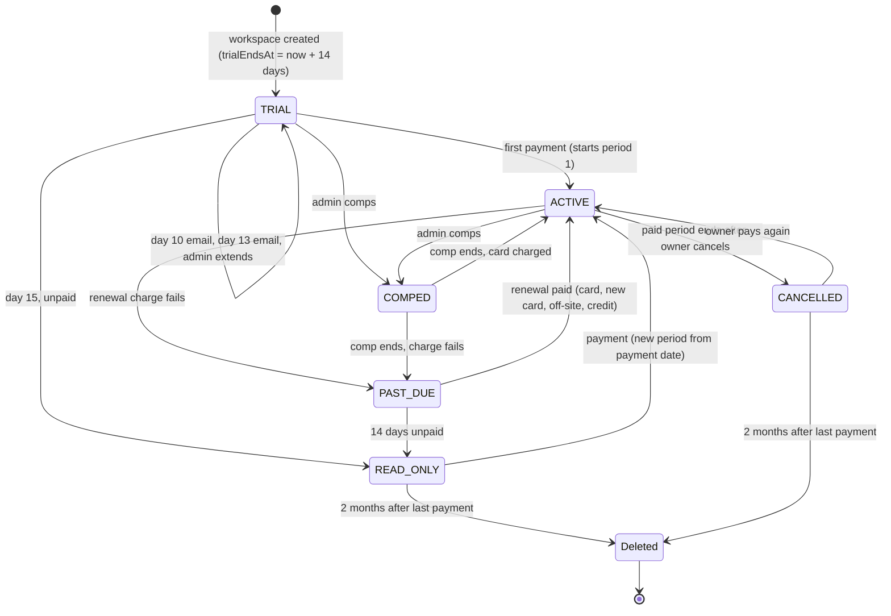
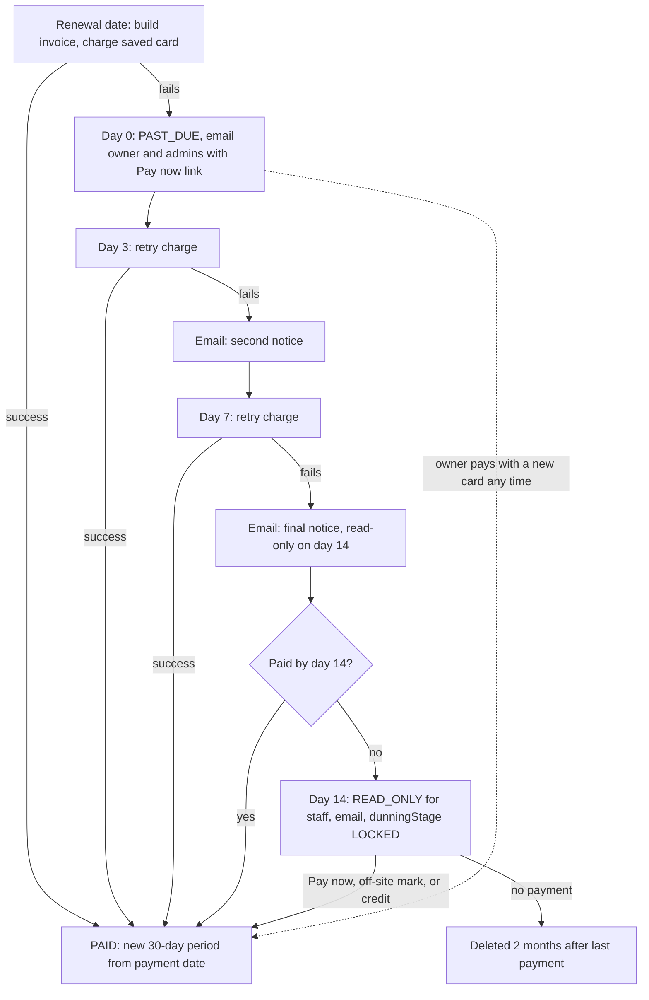

# Billing: Nexa bills workspaces (Gate 1)

**Answer first.** Each course sits on a tier, and the tier is the highest tier of the services switched on for it: Core R99, Plus R139, Pro R179 per active student per course per 30-day period. Billing runs in 30-day periods anchored to the payment date: each payment is valid for the next 30 days, and the renewal charge falls on the day after the period ends. Seats are charged in advance at renewal for the learners enrolled then; learners added and tier raises during a period are charged as catch-up lines on the next renewal, together with usage and API pass-through in arrears. A raised tier holds for 30 days from the raise. Every workspace starts in a 14-day `TRIAL`; the owner's first payment starts the first period, and an unpaid renewal follows dunning emails on days 0, 3 and 7 and goes read-only for staff after 14 days. Learners and parents are never blocked by billing.

Status: draft for A2, revised 2026-11-16 with the owner's answers. Builds on [01-tenancy-roles.md](01-tenancy-roles.md). Payment mechanics are in [04-payments.md](04-payments.md). All money is integer cents (ZAR), excluding VAT unless a line says otherwise.

## 1. Entities

Code: schema in `prisma/schema/billing.prisma`, logic in `src/features/billing/**`, jobs under `src/app/api/cron/billing-*`.

| Model | Fields (type) | Notes |
| --- | --- | --- |
| `Tier` | `key` (`TierKey`: `CORE`, `PLUS`, `PRO`), `rank` (Int: 1, 2, 3), `name` (String), `priceCents` (Int), `aiMarksPerStudent` (Int), `activeFrom` (DateTime), `activeTo` (DateTime?) | Seeded: 9900, 13900, 17900; `aiMarksPerStudent` 0, 0, 30. A price change adds a new row; invoices snapshot the price. Unique (`key`, `activeFrom`) |
| `Service` | `key` (String, PK, kebab-case), `name` (String), `kind` (`BASIC`, `PREMIUM`, `ADDON`), `tier` (`TierKey`), `status` (`ACTIVE`, `PARKED`, `LATER`, `HIDDEN`), `meter` (`Meter`?), `unitPriceCents` (Int?) | Seeded from section 2. `PARKED` and `LATER` keys exist so keys stay stable, but cannot be switched on and never count toward a tier |
| `CourseService` | `id`, `workspaceId`, `courseId`, `serviceKey`, `enabled` (Boolean), `changedAt` (DateTime), `changedByUserId` (String) | Unique (`courseId`, `serviceKey`). Only premium keys get rows; basic keys are always on |
| `CourseTierHold` | `id`, `workspaceId`, `courseId`, `tierKey` (`TierKey`), `raisedAt` (DateTime), `holdUntil` (DateTime = `raisedAt` + 30 days), `raisedByUserId` | Written when a course's derived tier goes up. Section 2 |
| `CourseTierOverride` | `id`, `workspaceId`, `courseId` (unique), `tierKey` (`TierKey`), `until` (DateTime?), `reason` (String), `createdByUserId` | Admin only. Replaces the billed tier; does not change `hasService` |
| `Subscription` | `id`, `workspaceId` (unique), `provider` (`PAYSTACK`, `PAYFAST`), `providerCustomerCode` (String?), `authorizationCodeEnc` (String?, AES-GCM), `cardBrand`, `cardLast4` (String?), `cardExpMonth`, `cardExpYear` (Int?), `status` (`NONE`, `AUTHORISED`, `FAILED`, `REVOKED`), `currentPeriodStart` (DateTime?), `currentPeriodEnd` (DateTime?, exclusive), `renewsAt` (DateTime?, = `currentPeriodEnd`), `lastPaidAt` (DateTime?), `deleteAfter` (DateTime?), `billingEmail` (String), `legalName` (String?), `customerVatNumber` (String?), `compedUntil` (DateTime?), `readOnlySince` (DateTime?), `cancelAtPeriodEnd` (Boolean), `cancelledAt` (DateTime?), `trialEmailDay` (Int?) | One per workspace, created with the workspace |
| `BillingPeriod` | `id`, `workspaceId`, `start` (DateTime), `end` (DateTime, exclusive, = `start` + 30 days), `status` (`OPEN`, `CLOSED`), `openedByInvoiceId` (String) | Unique (`workspaceId`, `start`). Periods never overlap; a late payment can leave a gap (section 3) |
| `SeatCharge` | `id`, `workspaceId`, `billingPeriodId`, `courseId`, `learnerId`, `tierKey` (`TierKey`), `kind` (`ADVANCE`, `CATCH_UP`), `invoiceId` | Unique (`billingPeriodId`, `courseId`, `learnerId`). Records which seat was billed at which tier, so catch-ups never double-charge |
| `UsageRecord` | `id`, `workspaceId`, `meter` (`Meter`), `scopeKey` (String: a `courseId`, or `""` for workspace-wide), `day` (Date, workspace timezone), `quantity` (Int), `providerCostMilliCents` (Int, default 0), `source` (`NIGHTLY`, `EVENT`, `ADMIN`), `computedAt` | Unique (`workspaceId`, `meter`, `scopeKey`, `day`). Always written by upsert |
| `PlatformInvoice` | `id`, `number` (String, unique, `NX-2027-000123`), `workspaceId`, `opensPeriodStart` (DateTime), `closesPeriodId` (String?, the period billed in arrears), `status` (`DRAFT`, `OPEN`, `PAID`, `PAST_DUE`, `VOID`, `UNCOLLECTIBLE`), `subtotalCents`, `discountCents`, `creditCents`, `vatRateBps` (Int?), `vatCents`, `totalCents`, `issuedAt`, `dueAt`, `paidAt?`, `paidVia` (`CARD`, `OFFSITE`, `CREDIT`, `COMPED`)?, `attemptCount` (Int), `nextAttemptAt?`, `dunningStage` (`NONE`, `DAY0`, `DAY3`, `DAY7`, `LOCKED`) | Nexa to workspace. Named so it does not clash with the parent `Invoice` in 04. Unique (`workspaceId`, `closesPeriodId`) |
| `PlatformInvoiceLine` | `id`, `invoiceId`, `kind` (`ADVANCE`, `CATCH_UP`, `TIER_UPGRADE`, `ADDON`, `PASS_THROUGH`, `DISCOUNT`, `CREDIT`, `COMP`, `VAT`), `courseId?`, `courseTitle` (snapshot), `tierKey?`, `serviceKey?`, `description`, `quantity` (Int), `unitPriceCents` (Int), `amountCents` (Int, negative for discounts and credits), `discountCodeId?`, `creditNoteId?` | |
| `CreditNote` | `id`, `workspaceId`, `amountCents` (Int > 0), `reason`, `status` (`OPEN`, `APPLIED`, `VOID`), `appliedToInvoiceId?`, `createdByUserId`, `createdAt` | Admin only. Applied as a `CREDIT` line on the next invoice |
| `DiscountCode` | `id`, `code` (String, unique, upper case), `issuerWorkspaceId` (String?; null = Nexa), `description`, `kind` (`PERCENT`, `FIXED`), `percentBps` (Int?), `amountCents` (Int?), `scope` (`WORKSPACE_BILL`, `TIER`, `ADDON`, `PARENT_INVOICE`), `scopeTierKey?`, `scopeServiceKey?`, `startsAt`, `endsAt?`, `maxRedemptions` (Int?), `redemptionCount` (Int), `durationPeriods` (Int?; null = no limit), `active` (Boolean), `createdByUserId` | "First N months" is stored as N periods. `PARENT_INVOICE` codes are used in 04 |
| `Redemption` | `id`, `discountCodeId`, `redeemerKey` (String: `ws:<id>` or `user:<id>:learner:<id>`), `workspaceId?`, `payerUserId?`, `learnerId?`, `redeemedAt`, `periodsApplied` (Int), `exhaustedAt?` | Unique (`discountCodeId`, `redeemerKey`) |
| `UsageCap` | `id`, `workspaceId`, `meter` (`Meter`), `limitQuantity` (Int), `hardStop` (Boolean, default true), `source` (`TUTOR`, `TRIAL`), `notifiedPeriodStart` (DateTime?), `notifiedLevel` (Int: 0, 80, 100) | Unique (`workspaceId`, `meter`, `source`). Per billing period |
| `BillingConfig` | singleton: `vatRegistered` (Boolean, false), `vatNumber` (String?), `vatRateBps` (Int, 1500), `vatEffectiveFrom` (Date?), `apiMarginBps` (Int, 8000 = divide by 0.8), `trialDays` (Int, 14), `periodDays` (Int, 30), `retentionMonthsAfterLastPayment` (Int, 2) | Platform config, not code. Read by `getBillingConfig()` |

`Workspace.billingState` and `Workspace.trialEndsAt` stay where 01 put them. `Meter` enum (v1): `ACTIVE_STUDENTS`, `AI_MARKS`, `LIVE_ROOM_MINUTES`, `STORAGE_MB`, `API_REQUESTS`.

## 2. Service keys, tiers and the 30-day tier hold

Keys come from [research/02-service-catalogue.md](../research/02-service-catalogue.md), adjusted by the owner decisions. The full list goes into `contracts/services.md`.

| Tier | Keys (status `ACTIVE`) |
| --- | --- |
| Core (basic) | `courses-lessons`, `templates`, `tests`, `assignments`, `gradebook`, `calendar`, `messages`, `notifications`, `portals`, `fee-collection`, `storage-allowance`, `bulk-import` |
| Plus | `graphing`, `math-input`, `question-bank`, `live-sessions`, `advanced-analytics`, `custom-branding` |
| Pro | `secure-tests`, `ai-marking` (30 answers per active student per period included), `api-access` |
| Add-ons | `live-room`, `extra-storage` |
| `PARKED` (owner decision) | `automarker`, `judge-mode`, `code-plagiarism` (Pro), `runner-capacity` (add-on) |
| `LATER` (not v1) | `day-pass` |
| Retired | `ai-credits`: the fixed R45 per 100 answers is gone. Marks above the allowance bill as pass-through (section 6) |

`math-solve` is not seeded until the Wolfram quote, or B's local maths engine, decides whether it is metered at all.

**Derived tier.** `derivedTier(course)` = the highest `Service.tier` among its enabled `ACTIVE` premium services, else `CORE`.

**Billed tier.** `billedTier(course, at)` = the active `CourseTierOverride` if any, else the highest of `derivedTier(course)` and every `CourseTierHold` with `holdUntil > at`. When `setCourseServices` raises the derived tier, it writes a `CourseTierHold` for 30 days. Lowering services takes effect for billing only once the hold expires. Example: switched to Pro on 10 February, back to Plus on 12 February: billed at Pro until 12 March. The service toggle says "this course is billed at Pro until 12 March".

**Day pass (later, not v1).** A day pass would give one course every Pro service for one day, without raising its tier, for a flat price per class (research suggested R99 up to 30 students, +R3 per extra student). It suits exam or competition days. The key is seeded as `LATER` so `services.md` stays stable; no flows, meters or actions exist for it in v1.

`hasService(viewer, courseId, key)` is true when `derivedTier(course)` is at least the key's tier, or the workspace is in `TRIAL` (every `ACTIVE` key on). For metered keys the workspace must also be under its cap.

## 3. The 30-day period

- **Rule:** a successful payment at time `t` starts a period `[t, t + 30 days)`. The renewal charge is attempted at `t + 30 days` (the start of the next period). In the workspace timezone a payment on 3 February 2027 covers 3 February to 4 March inclusive and renews on **5 March**. **Open question:** the owner's example said "renews on 2 March"; that would be a calendar rule ("same day next month, minus one"), not 30 days. This file uses exactly 30 days (`BillingConfig.periodDays`) until the owner confirms.
- **Late payment:** "each payment is valid for the next 30 days", so a renewal paid late starts the new period on the payment date, and `renewsAt` moves with it. **Decision taken here.** The days between the missed renewal and the late payment are not billed (at most 14; staff were nagged throughout). Alternative: keep the anchor and let the late payment cover the period from the due date.
- **First period:** the owner's first payment ends the trial. Paying before day 14 starts the paid period at once and lifts the trial caps; the remaining trial days are not added. **Decision taken here.** Alternative: save the card early and charge at `trialEndsAt`.
- **No proration** anywhere: adds, drops, tier changes and cancellation are all whole-period amounts.

## 4. What a renewal invoice charges

A renewal invoice for the period starting at `t` (which closes the previous period `P`, if any) has three parts:

1. **In advance for the coming period:** for each course, `ADVANCE` = learners with an `ACTIVE` enrolment at `t` × price of `billedTier(course, t)`. Each one writes a `SeatCharge(kind = ADVANCE)` for the new period.
2. **Catch-up for `P`:**
   - `CATCH_UP`: every (course, learner) whose `Enrollment` interval overlapped `P` and who has no `SeatCharge` for `P` (added after `P` started) is billed one full period at the highest tier the course was billed at during `P`. A learner added and dropped within `P` still counts once.
   - `TIER_UPGRADE`: for each `SeatCharge` in `P` whose `tierKey` is below the highest billed tier during `P` (a `CourseTierHold` raised in `P`), bill the difference in price, and update the `SeatCharge.tierKey`.
   - Drops during a period are never refunded; the seat was paid in advance.
3. **Usage in arrears for `P`:** add-ons (`live-room`, `extra-storage`) and `PASS_THROUGH` lines. AI marks: each Pro course gets a pool of `30 × seats billed at Pro in P`. Marks above the pool bill at `ceil(excessMarks × averageCostPerMark ÷ 0.8)`, where the average cost comes from the `AI_MARKS` usage rows of that course in `P`.

Then `DISCOUNT`, `CREDIT`, `COMP` and, only when `BillingConfig.vatRegistered` is true on the invoice date, `VAT = round((subtotal − discounts − credits) × vatRateBps / 10000)`. Totals never go below zero; unused credit stays `OPEN`.

Active seats are counted from `Enrollment` (the source of truth) by `listBillableSeats(workspaceId, from, to)` in `src/features/billing/queries.ts`. A learner in two courses is two seats. An `ARCHIVED` `Learner` still counts if their interval overlaps.

Code: `buildRenewalInvoice(workspaceId, at)` in `src/features/billing/invoice.ts`, one transaction. The unique `closesPeriodId` and the `SeatCharge` uniques make it idempotent.

### Worked example (owner prices)

A solo tutor finishes the trial and pays on **3 February 2027**: two courses (Grade 11 Maths, Grade 12 Maths), both Plus (`graphing` on), 12 students each, Nexa not VAT-registered.

| Invoice of 3 Feb (opens period 3 Feb to 4 Mar) | Qty | Unit (cents) | Amount (cents) |
| --- | --- | --- | --- |
| `ADVANCE` Grade 11 Maths, Plus | 12 | 13 900 | 166 800 |
| `ADVANCE` Grade 12 Maths, Plus | 12 | 13 900 | 166 800 |
| **Total** (24 × R139) | 24 | | **333 600** (R3,336.00) |

During the period a new student joins Grade 12 on 20 February, and the tutor switches on `ai-marking` for Grade 11 on 10 February (held at Pro until 12 March). Grade 11 uses 300 AI marks against a pool of 30 × 12 = 360, so nothing extra.

| Renewal invoice of 5 Mar (opens 5 Mar to 3 Apr, closes the first period) | Qty | Unit (cents) | Amount (cents) |
| --- | --- | --- | --- |
| `ADVANCE` Grade 11 Maths, Pro (hold until 12 Mar) | 12 | 17 900 | 214 800 |
| `ADVANCE` Grade 12 Maths, Plus | 13 | 13 900 | 180 700 |
| `CATCH_UP` Grade 12, joined 20 Feb | 1 | 13 900 | 13 900 |
| `TIER_UPGRADE` Grade 11, Plus to Pro from 10 Feb | 12 | 4 000 | 48 000 |
| **Total** | | | **457 400** |

With a Nexa code `LAUNCH20` (20%, `WORKSPACE_BILL`, first 3 periods) the first invoice gets a `DISCOUNT` line of −66 720 (total 266 880). Once VAT-registered, the first invoice would be 333 600 + 50 040 = 383 640.

## 5. Billing states and data retention

| `billingState` | Meaning | Blocks for staff | Blocks for learners and guardians |
| --- | --- | --- | --- |
| `TRIAL` | First 14 days. All `ACTIVE` Pro services on, with trial caps | Over a trial cap: a 21st distinct student, the 101st AI mark | Nothing |
| `ACTIVE` | Current period paid | Nothing | Nothing |
| `PAST_DUE` | Renewal unpaid, under 14 days | Raising a course's tier and buying add-ons. Banner on every staff page | Nothing |
| `READ_ONLY` | Trial ended unpaid, or renewal unpaid 14 days | Every staff write except billing (`billing.*`), fee collection (`fees.*`), data export and sign-in | Nothing: students still take tests and submit; parents still pay fees |
| `COMPED` | Nexa admin waived billing, optionally until a date | Nothing. Renewals are still built every 30 days, with a `COMP` line to zero | Nothing |
| `CANCELLED` | Owner cancelled; takes effect at the end of the paid period (no refund) | All staff writes except export and reactivation | Read access to their own work until deletion |

**Retention.** Workspace data is kept until **2 months after the last successful payment**, then deleted (`Subscription.deleteAfter = lastPaidAt + 2 calendar months`, set on every payment). A workspace that never paid uses `trialEndsAt` instead of `lastPaidAt`. This applies to `READ_ONLY` and `CANCELLED` workspaces alike; a payment before `deleteAfter` restores everything. The owner and admins are emailed 30 days and 7 days before deletion, with an export link. Deletion (`src/features/billing/retention.ts`, run by the daily job) removes courses, content, learner rows, enrolments and files; users who belong to other workspaces keep their accounts. `PlatformInvoice`, `PlatformInvoiceLine`, `Payment`, `Refund`, `OffsitePayment` and `AuditLog` rows are **kept for the period tax law requires**, with the workspace reduced to its legal name and VAT number. **Open question for a lawyer or accountant:** the retention period for these records (SARS commonly 5 years) and whether parent invoices in 04 follow the same rule. Comped workspaces are never deleted while comped.

Enforcement: `assertBillingAllows(viewer, action)` in `src/features/billing/guards.ts`, called by the workspace action client middleware for every staff mutation. `getViewer()` exposes `billingState` and a `readOnly` boolean ([contracts/viewer.md](../../contracts/viewer.md)).

## 6. Trial

Trial caps are `UsageCap` rows with `source = TRIAL`: `ACTIVE_STUDENTS` 20 (distinct learners across the workspace) and `AI_MARKS` 100. There is no code-runs cap (the automarker is parked).

- **Day 10 and day 13 emails** go to the owner and admins: days left, usage, what the first 30 days would cost now, and a link to confirm tiers and pay.
- **Confirming tiers:** every Pro service is on during the trial. On the conversion screen the owner picks a tier per course (`confirmTrialTiers`), which switches off services above it; unconfirmed courses keep what is on. No `CourseTierHold` is written for trial changes.
- **Day 15** is `trialEndsAt` in the workspace timezone. The daily job moves an unpaid workspace to `READ_ONLY` and sends a third email.
- **Conversion** happens when the first payment's webhook succeeds ([04, section 4](04-payments.md)): save the card on `Subscription`, open the first `BillingPeriod`, delete the `TRIAL` caps, set `billingState = ACTIVE`.

## 7. Daily job: metering, renewals, dunning

**Trigger:** today the GitHub Actions workflow `.github/workflows/scheduled-jobs.yml` gets a daily entry (`0 23 * * *` UTC = 01:00 SAST) plus an hourly renewal pass, calling `POST /api/cron/billing-daily` with `Authorization: Bearer $CRON_SECRET`, like the existing auto-submit and notification routes. Later Vercel Cron or QStash calls the same route. The route works in pages of 50 workspaces within a 50-second budget and returns `{ nextCursor }`; the workflow loops until it is null.

**Metering (idempotent).** For each workspace, recompute yesterday and the two days before and upsert on (`workspaceId`, `meter`, `scopeKey`, `day`); values are recomputed from source tables, never incremented.

| Meter | Scope | Quantity | Source |
| --- | --- | --- | --- |
| `ACTIVE_STUDENTS` | course | Distinct learners in the current period so far (running bill only) | `Enrollment` intervals |
| `AI_MARKS` | course | AI-marked answers that day; `providerCostMilliCents` from token counts | AI marking job rows (B's assessment feature writes them; A reads) |
| `LIVE_ROOM_MINUTES`, `STORAGE_MB`, `API_REQUESTS` | workspace | Totals for the day | Their feature tables, once built |

**Renewals.** For each workspace with `renewsAt ≤ now` and state `ACTIVE` or `COMPED`: build the renewal invoice (section 4) and call `chargeAuthorization` ([04](04-payments.md)). The success webhook marks it `PAID`, opens the new period at the payment time, and sets `renewsAt`, `lastPaidAt` and `deleteAfter`. A zero total is marked `PAID` without a charge and still opens the period. If the owner set `cancelAtPeriodEnd`, the job sets `CANCELLED` instead and builds a final arrears-only invoice (catch-ups and usage).

The same job then checks caps (section 8), sends trial emails, ends trials and comps, advances dunning, and runs retention (section 5). Each email is sent once, guarded by a stored marker.

**Dunning**, counted from the renewal date (day 0). Paystack does not retry failed charges, so Nexa retries. Code: `src/features/billing/dunning.ts`.

Learners are never blocked at any step. Paying moves `PAST_DUE` or `READ_ONLY` straight back to `ACTIVE`. An invoice still unpaid at deletion becomes `UNCOLLECTIBLE`.

## 8. Discount codes and usage caps

**Discount codes.** Validation in `src/features/billing/discounts.ts`: active, `startsAt ≤ now < endsAt`, `redemptionCount < maxRedemptions`, scope matches, one redemption per `redeemerKey`. A workspace holds one `WORKSPACE_BILL` code at a time plus scoped codes.

- `WORKSPACE_BILL` applies to the subtotal; `TIER` to the `ADVANCE`, `CATCH_UP` and `TIER_UPGRADE` lines of that tier; `ADDON` to lines with that `serviceKey`; `PARENT_INVOICE` only to parent invoices (04).
- `PERCENT`: `round(base × percentBps / 10000)`. `FIXED`: `min(amountCents, base)`.
- `durationPeriods`: each invoice that used the code increments `periodsApplied`; at the limit, `exhaustedAt` is set.
- Codes with `issuerWorkspaceId` may only have `PARENT_INVOICE` scope.

**Usage caps.** Owners set a cap per meter per period (`setUsageCap`). The daily job and each metered call (`assertUnderCap(workspaceId, meter, n)` in `src/features/billing/caps.ts`) compare usage in the current period with `limitQuantity`; for `AI_MARKS` the cap counts only marks above the Pro pools. At 80% and 100% the owner and admins get one email per period. At 100% with `hardStop` the service refuses new work; learners see "AI marking is paused" and the tutor marks by hand.

## 9. Admin overrides

All in `src/features/admin/billing-actions.ts`, behind `admin.override`. Each needs a `note` and writes an `AuditLog` row in the same transaction.

| Override | Effect | `AuditLog.action` |
| --- | --- | --- |
| Extend trial | `trialEndsAt += days`; an expired, unpaid trial goes back to `TRIAL` | `billing.trial.extend` |
| Comp | `billingState = COMPED`, `Subscription.compedUntil`; `deleteAfter` cleared | `billing.comp.set` / `billing.comp.end` |
| Change tier | Upsert or delete `CourseTierOverride` | `billing.tier.override` |
| Credit note | `CreditNote`, applied on the next renewal | `billing.credit.issue` |
| Mark paid off-site | `OffsitePayment` against a `PlatformInvoice` (04); opens the period from `receivedOn` | `billing.invoice.offsite` |
| Void invoice | `status = VOID` if unpaid; `SeatCharge` rows for it are removed | `billing.invoice.void` |
| Discount codes | Create, deactivate | `billing.discount.create` / `.deactivate` |

## 10. For contracts/billing.md

Actions are next-safe-action clients with Zod input. `workspaceAction(permission)` checks the 01 permission in the active workspace; `adminAction` checks `NEXA_ADMIN`. Errors return `serverError` with a stable code (`TRIAL_CAP_REACHED`, `READ_ONLY`, `CODE_INVALID`, `CODE_EXPIRED`, `CODE_USED`, `CARD_REQUIRED`, `PROVIDER_ERROR`). Money fields end in `Cents`; dates are ISO strings.

`Period` = `{ start, end, renewsAt }`. `EstimateLine` = `{ kind, description, quantity, unitPriceCents, amountCents }`. `CapStatus` = `{ meter, used, limit, percent, hardStop, source }`.

**Queries** (`src/features/billing/queries.ts`):

| Name | Permission | Input | Returns |
| --- | --- | --- | --- |
| `getBillingOverview()` | `billing.view` | none | `{ state, trialEndsAt, trialDaysLeft, card: { brand, last4, expMonth, expYear } \| null, period: Period \| null, nextRenewalEstimateCents, estimate: EstimateLine[], caps: CapStatus[], overdueInvoiceId, deleteAfter, vatRegistered }` |
| `getCourseTiers()` | `billing.view` | none | `Array<{ courseId, title, derivedTierKey, billedTierKey, holdUntil, drivers: string[], seatsThisPeriod, pendingCatchUpSeats, unitPriceCents, aiPool: { included, used } \| null, override: { tierKey, until } \| null }>` |
| `getCourseServices(courseId)` | `courses.services` | `{ courseId }` | `Array<{ key, name, kind, tierKey, status, enabled, availableNow, reason?: "PARKED" \| "LATER" \| "PAST_DUE" \| "READ_ONLY" }>` |
| `previewServiceChange(input)` | `courses.services` | `{ courseId, enable: string[], disable: string[] }` | `{ fromTier, toTier, seats, catchUpCents, nextRenewalDeltaCents, holdUntil: string \| null }` |
| `getUsage(input)` | `billing.view` | `{ meter, periodStart?: string }` (default: current period) | `{ period: Period, days: Array<{ day, quantity }>, totalQuantity, cap: CapStatus \| null, estimatedCents }` |
| `listPlatformInvoices(input)` | `billing.view` | `{ cursor?, limit? }` | `{ items: Array<{ id, number, periodStart, periodEnd, status, totalCents, issuedAt, paidAt }>, nextCursor }` |
| `getPlatformInvoice(id)` | `billing.view` | `{ id }` | `{ ...summary, lines: EstimateLine[], subtotalCents, discountCents, creditCents, vatCents, payments: Array<{ at, amountCents, via, status }>, pdfUrl }` |
| `adminListWorkspaceBilling(input)` | `admin.console` | `{ state?, q?, cursor? }` | `{ items: Array<{ workspaceId, name, kind, state, trialEndsAt, renewsAt, lastPeriodCents, overdueCents, deleteAfter }>, nextCursor }` |

**Actions** (`src/features/billing/actions.ts`):

| Name | Permission | Input | Returns |
| --- | --- | --- | --- |
| `setCourseServices` | `courses.services` | `{ courseId, enable: string[], disable: string[] }` | `{ derivedTierKey, billedTierKey, holdUntil }` |
| `confirmTrialTiers` | `billing.manage` | `{ courses: Array<{ courseId, tierKey }> }` | `{ updated, firstPaymentCents }` |
| `startFirstPayment` | `billing.manage` | `{ returnPath }` | `{ authorizationUrl, reference, amountCents }` |
| `payPlatformInvoice` | `billing.manage` | `{ invoiceId }` | `{ status: "CHARGED" } \| { status: "REDIRECT", authorizationUrl, reference }` |
| `startCardReplacement` | `billing.manage` | `{ returnPath }` | `{ authorizationUrl, reference }` |
| `getBillingPaymentStatus` | `billing.manage` | `{ reference }` | `{ status: "PENDING" \| "SUCCEEDED" \| "FAILED" }` |
| `setUsageCap` | `billing.manage` | `{ meter, limitQuantity, hardStop }` | `CapStatus` |
| `redeemDiscountCode` | `billing.manage` | `{ code }` | `{ description, scope, periodsLeft: number \| null }` |
| `updateBillingDetails` | `billing.manage` | `{ billingEmail, legalName?, customerVatNumber? }` | `{ ok: true }` |
| `cancelWorkspace` | `workspace.delete` | `{ reason }` | `{ endsAt, finalInvoiceEstimateCents, deleteAfter }` |
| `adminExtendTrial` | `admin.override` | `{ workspaceId, days, note }` | `{ trialEndsAt }` |
| `adminSetComp` | `admin.override` | `{ workspaceId, until: string \| null, note, end?: boolean }` | `{ state }` |
| `adminOverrideCourseTier` | `admin.override` | `{ courseId, tierKey: TierKey \| null, until?, note }` | `{ billedTierKey }` |
| `adminIssueCreditNote` | `admin.override` | `{ workspaceId, amountCents, reason }` | `{ creditNoteId }` |
| `adminVoidPlatformInvoice` | `admin.override` | `{ invoiceId, note }` | `{ status }` |
| `adminCreateDiscountCode` | `admin.override` | the `DiscountCode` fields minus counters | `{ id, code }` |
| `adminDeactivateDiscountCode` | `admin.override` | `{ id, note }` | `{ active: false }` |

No day-pass action exists in v1.

## Issues with 01

- **Enrollment history.** Catch-ups need every interval. If a re-enrolment reset `startedAt` on one row, an earlier interval in the same period could be lost. Proposal: re-enrolment creates a new `Enrollment` row, or reopens the old one without moving `startedAt`. This file assumes intervals are never overwritten.
- **Migrated workspace.** 01 sets it to `COMPED` with no end date, which fits; the owner ends the comp in the admin console.

## Open questions

1. Renewal date: exactly 30 days (3 Feb pays, renews 5 Mar), or the owner's example of 2 March, which implies a calendar rule? This file uses 30 days.
2. Late renewals: start the new period on the payment date (this file) or keep the original anchor?
3. Retention of invoices and payment records after deletion (lawyer or accountant): how long, and do parent invoices follow the same rule?
