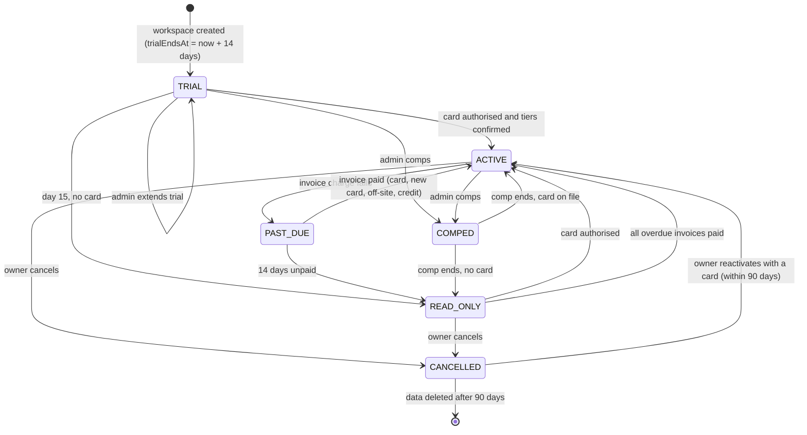
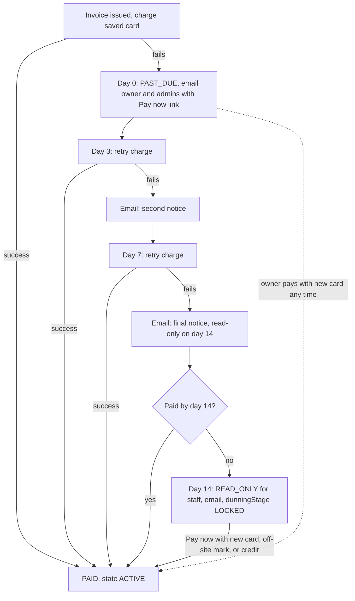

# Billing: Nexa bills workspaces (Gate 1)

**Answer first.** Each course sits on a tier, and the tier is the highest tier of the services switched on for it: Core R99, Plus R139, Pro R179 per active student per course per month. A learner is active in a course for a month when any of their `Enrollment` intervals overlaps that month, so mid-month adds and drops both count in full, with no proration. A nightly job writes idempotent `UsageRecord` rows (one per workspace, meter, scope and day) so the Billing page shows a running bill, and on the 1st of each month an invoice run bills the previous month in arrears and charges the saved card. Every workspace starts in a 14-day `TRIAL`, then becomes `ACTIVE` once a card is captured or goes `READ_ONLY` for tutors on day 15; failed payments follow dunning emails on days 0, 3 and 7 and read-only after 14 days. Learners and parents are never blocked by billing.

Status: draft for A2, 2026-11-16. Builds on [01-tenancy-roles.md](01-tenancy-roles.md). Payments mechanics (card capture, charging, webhooks) are in [04-payments.md](04-payments.md). All money is integer cents (ZAR), excluding VAT unless a line says otherwise.

## 1. Entities

Code: schema in `prisma/schema/billing.prisma`, logic in `src/features/billing/**`, jobs under `src/app/api/cron/billing-*`.

| Model | Fields (type) | Notes |
| --- | --- | --- |
| `Tier` | `key` (`TierKey`: `CORE`, `PLUS`, `PRO`), `rank` (Int: 1, 2, 3), `name` (String), `priceCents` (Int), `activeFrom` (DateTime), `activeTo` (DateTime?) | Seeded: 9900, 13900, 17900. A price change adds a new row; invoices snapshot the price on the line. Unique (`key`, `activeFrom`) |
| `Service` | `key` (String, PK, kebab-case), `name` (String), `kind` (`BASIC`, `PREMIUM`, `ADDON`), `tier` (`TierKey`), `status` (`ACTIVE`, `PARKED`, `HIDDEN`), `meter` (`Meter`?), `unitPriceCents` (Int?), `includedPerStudent` (Int?) | Seeded from section 2. `PARKED` keys exist (so keys are stable) but cannot be switched on and never count toward a tier |
| `CourseService` | `id`, `workspaceId`, `courseId`, `serviceKey`, `enabled` (Boolean), `changedAt` (DateTime), `changedByUserId` (String) | Unique (`courseId`, `serviceKey`). Only premium keys get rows; basic keys are always on |
| `CourseTierOverride` | `id`, `workspaceId`, `courseId` (unique), `tierKey` (`TierKey`), `until` (DateTime?), `reason` (String), `createdByUserId` | Admin only. Replaces the derived tier for billing, not for `hasService` |
| `Subscription` | `id`, `workspaceId` (unique), `provider` (`PAYSTACK`, `PAYFAST`), `providerCustomerCode` (String?), `authorizationCodeEnc` (String?, AES-GCM), `cardBrand` (String?), `cardLast4` (String?), `cardExpMonth` (Int?), `cardExpYear` (Int?), `status` (`NONE`, `AUTHORISED`, `FAILED`, `REVOKED`), `billingEmail` (String), `legalName` (String?), `customerVatNumber` (String?), `compedUntil` (DateTime?), `readOnlySince` (DateTime?), `cancelledAt` (DateTime?), `createdAt`, `updatedAt` | One per workspace, created with the workspace. Holds the card token for Gate 1 |
| `UsageRecord` | `id`, `workspaceId`, `meter` (`Meter`), `scopeKey` (String: a `courseId`, or `""` for workspace-wide), `day` (Date, workspace timezone), `quantity` (Int), `providerCostMilliCents` (Int, default 0), `source` (`NIGHTLY`, `EVENT`, `ADMIN`), `computedAt` (DateTime) | Unique (`workspaceId`, `meter`, `scopeKey`, `day`). Always written by upsert, so re-runs replace and never add |
| `BillingPeriod` | `id`, `workspaceId`, `start` (Date), `end` (Date, exclusive), `status` (`OPEN`, `CLOSED`, `INVOICED`) | Calendar month in `Workspace.timezone`. The first period starts on the conversion day. Unique (`workspaceId`, `start`) |
| `PlatformInvoice` | `id`, `number` (String, unique, `NX-2027-000123`), `workspaceId`, `billingPeriodId` (unique), `status` (`DRAFT`, `OPEN`, `PAID`, `PAST_DUE`, `VOID`, `UNCOLLECTIBLE`), `subtotalCents`, `discountCents`, `creditCents`, `vatRateBps` (Int?), `vatCents`, `totalCents` (all Int), `issuedAt`, `dueAt`, `paidAt?`, `paidVia` (`CARD`, `OFFSITE`, `CREDIT`, `COMPED`)?, `attemptCount` (Int), `nextAttemptAt?`, `dunningStage` (`NONE`, `DAY0`, `DAY3`, `DAY7`, `LOCKED`) | Nexa to workspace. Called `PlatformInvoice` so it does not clash with the parent `Invoice` in 04 |
| `PlatformInvoiceLine` | `id`, `invoiceId`, `kind` (`TIER`, `ADDON`, `PASS_THROUGH`, `DISCOUNT`, `CREDIT`, `COMP`, `VAT`), `courseId?`, `courseTitle` (String, snapshot), `tierKey?`, `serviceKey?`, `description` (String), `quantity` (Int), `unitPriceCents` (Int), `amountCents` (Int, negative for discounts and credits), `discountCodeId?`, `creditNoteId?` | The brief's `InvoiceLine` for Gate 1 |
| `CreditNote` | `id`, `workspaceId`, `amountCents` (Int > 0), `reason` (String), `status` (`OPEN`, `APPLIED`, `VOID`), `appliedToInvoiceId?`, `createdByUserId`, `createdAt` | Admin only. Applied as a `CREDIT` line on the next invoice |
| `DiscountCode` | `id`, `code` (String, unique, upper case), `issuerWorkspaceId` (String?; null = issued by Nexa), `description`, `kind` (`PERCENT`, `FIXED`), `percentBps` (Int?), `amountCents` (Int?), `scope` (`WORKSPACE_BILL`, `TIER`, `ADDON`, `PARENT_INVOICE`), `scopeTierKey?`, `scopeServiceKey?`, `startsAt`, `endsAt?`, `maxRedemptions` (Int?), `redemptionCount` (Int), `durationMonths` (Int?; null = no limit), `active` (Boolean), `createdByUserId` | `PARENT_INVOICE` codes are used in 04 |
| `Redemption` | `id`, `discountCodeId`, `redeemerKey` (String: `ws:<id>` or `user:<id>:learner:<id>`), `workspaceId?`, `payerUserId?`, `learnerId?`, `redeemedAt`, `firstPeriodStart` (Date), `monthsApplied` (Int), `exhaustedAt?` | Unique (`discountCodeId`, `redeemerKey`) |
| `UsageCap` | `id`, `workspaceId`, `meter` (`Meter`), `limitQuantity` (Int), `hardStop` (Boolean, default true), `source` (`TUTOR`, `TRIAL`), `notifiedPeriodStart` (Date?), `notifiedLevel` (Int: 0, 80, 100) | Unique (`workspaceId`, `meter`, `source`). Monthly. Trial caps are `source = TRIAL` |
| `BillingConfig` | singleton: `vatRegistered` (Boolean, false), `vatNumber` (String?), `vatRateBps` (Int, 1500), `vatEffectiveFrom` (Date?), `apiMarginBps` (Int, 8000 = divide by 0.8), `trialDays` (Int, 14) | **Decision taken here:** the VAT switch is platform config, not code. Read by `getBillingConfig()` |

`Workspace.billingState` and `Workspace.trialEndsAt` stay where 01 put them. `Meter` enum: `ACTIVE_STUDENTS`, `COURSE_TIER`, `AI_MARKS`, `DAY_PASS`, `LIVE_ROOM_MINUTES`, `STORAGE_MB`, `API_REQUESTS`, `MATH_SOLVE`.

## 2. Service keys and tiers

Keys come from [research/02-service-catalogue.md](../research/02-service-catalogue.md), adjusted by the owner decisions. The full list goes into `contracts/services.md`.

| Tier | Keys (status `ACTIVE`) |
| --- | --- |
| Core (basic) | `courses-lessons`, `templates`, `tests`, `assignments`, `gradebook`, `calendar`, `messages`, `notifications`, `portals`, `fee-collection`, `storage-allowance`, `bulk-import` |
| Plus | `graphing`, `math-input`, `question-bank`, `live-sessions`, `advanced-analytics`, `custom-branding` |
| Pro | `secure-tests`, `ai-marking`, `api-access` |
| Add-ons | `day-pass`, `live-room`, `ai-credits`, `extra-storage` |
| `PARKED` (owner decision, not in v1) | `automarker`, `judge-mode`, `code-plagiarism` (Pro), `runner-capacity` (add-on) |

`math-solve` is not seeded until the Wolfram quote, or B's local maths engine, decides whether it is metered at all.

**Course tier.** `tierOf(course, day)` = the `CourseTierOverride` if one is active, else the highest `Service.tier` among its enabled, `ACTIVE` premium services, else `CORE`. For a month, the billed tier is the **highest tier the course held on any day** of the period, read from the nightly `COURSE_TIER` records. **Decision taken here:** highest tier wins, matching "active at any point in the month". Alternative: prorate by days on each tier. The service toggle shows "this course moves to Plus for the whole month".

**Day pass.** A `day-pass` gives one course every `ACTIVE` Pro service for one day (workspace timezone) without changing its tier. It writes `UsageRecord(DAY_PASS, scopeKey=courseId, day, quantity=active students)`. Price R99 for up to 30 students plus R3 per extra student (`Service.unitPriceCents` and a small price function in `src/features/billing/pricing.ts`). `hasService(viewer, courseId, key)` is true when the course tier is at least the key's tier, or a day pass covers today, or the workspace is in `TRIAL`.

## 3. Active students

- A learner counts once per course per month when any `Enrollment` for that (`courseId`, `learnerId`) has `startedAt < periodEnd` and (`endedAt` is null or `endedAt >= periodStart`). Status does not matter; the interval does.
- **Adds:** a learner added on the 28th counts for that month. **Drops:** a learner dropped on the 3rd counts for that month and not the next. Dropped and re-added in the same month still counts once.
- A learner in two courses counts twice. A learner whose `Learner` row is `ARCHIVED` still counts if the interval overlaps.
- Staff who take their own course (a `Learner` row in their workspace) count like anyone else.
- **First period:** the period starts on the conversion day, and each tier line is prorated by days: `round(students × price × daysInPeriod / daysInMonth)`. **Decision taken here**, so a workspace converting on the 28th is not billed a full month. All later months are whole; there is no proration for adds or drops. A cancelled workspace's last period is prorated the same way.
- Query: `countActiveStudents(workspaceId, periodStart, periodEnd)` in `src/features/billing/queries.ts`, grouped by course, one SQL query over `Enrollment`. The nightly job stores the month-to-date count as `ACTIVE_STUDENTS`; the invoice run recounts from `Enrollment` (the source of truth), not from usage rows.

## 4. Billing states

| `billingState` | Meaning | Blocks for staff | Blocks for learners and guardians |
| --- | --- | --- | --- |
| `TRIAL` | First 14 days. All `ACTIVE` Pro services on, with trial caps | Over a trial cap: adding a 21st distinct student, the 101st AI mark | Nothing |
| `ACTIVE` | Card authorised, invoices paid | Nothing | Nothing |
| `PAST_DUE` | An invoice failed to charge, less than 14 days ago | Raising a course's tier and buying add-ons. Banner on every staff page | Nothing |
| `READ_ONLY` | Trial ended with no card, or past due 14 days | Every staff write except billing (`billing.*`), fee collection (`fees.*`), data export and sign-in. Tutors can still read everything | Nothing: students still take tests and submit work; parents still pay fees |
| `COMPED` | Nexa admin waived billing, optionally until a date | Nothing. Invoices are still built, with a `COMP` line that brings them to zero | Nothing |
| `CANCELLED` | Owner cancelled; data kept 90 days, then deleted per the POPIA policy | All staff writes except export and reactivation | Read access to their own work and grades until deletion |

Enforcement: `assertBillingAllows(viewer, action)` in `src/features/billing/guards.ts`, called by the workspace action client middleware for every staff mutation. `getViewer()` exposes `billingState` and a `readOnly` boolean so B can disable buttons ([contracts/viewer.md](../../contracts/viewer.md)).

## 5. Trial

Trial caps are seeded as `UsageCap` rows with `source = TRIAL`: `ACTIVE_STUDENTS` 20 (distinct learners across the workspace) and `AI_MARKS` 100. The code-runs cap is removed because the automarker is parked.

- **Day 10 and day 13 emails** go to the owner and admins: days left, current usage, the bill they would get next month, and a link to confirm tiers and add a card.
- **Confirming tiers:** at the end of the trial every Pro service is on. The owner picks a tier per course on the conversion screen (`confirmTrialTiers`), which switches off services above that tier. Courses not confirmed keep the services that were switched on, so Nexa infers their tier (plan, Gate 1).
- **Day 15** is `trialEndsAt` in the workspace timezone. The daily job moves an unconverted workspace to `READ_ONLY` and sends a third email.
- **Conversion** happens in the card-capture webhook ([04, section 4](04-payments.md)): set `Subscription.status = AUTHORISED`, open the first `BillingPeriod`, delete the `TRIAL` caps, set `billingState = ACTIVE`.

## 6. Nightly metering job

- **Trigger:** today the GitHub Actions workflow `.github/workflows/scheduled-jobs.yml` gets a daily schedule (`0 23 * * *` UTC = 01:00 SAST) that calls `POST /api/cron/billing-daily` with `Authorization: Bearer $CRON_SECRET`, like the existing auto-submit and notification routes. Later the same route is called by Vercel Cron or QStash; only the caller changes.
- **Batching:** the route processes workspaces in pages of 50 ordered by id, within a 50-second budget, and returns `{ nextCursor }`. The workflow loops until `nextCursor` is null.
- **Idempotent writes:** for each workspace it recomputes yesterday and the two days before (to catch late events) and upserts on (`workspaceId`, `meter`, `scopeKey`, `day`). Each value is recomputed from source tables, never incremented, so a re-run or a retry gives the same rows.

| Meter | Scope | Quantity | Source |
| --- | --- | --- | --- |
| `ACTIVE_STUDENTS` | course | Month-to-date distinct learners | `Enrollment` intervals |
| `COURSE_TIER` | course | Tier rank that day | `CourseService`, `CourseTierOverride` |
| `AI_MARKS` | workspace | Answers marked by AI that day; `providerCostMilliCents` from token counts | AI marking job rows (B's assessment feature writes them; A reads) |
| `DAY_PASS` | course | Active students on the pass day | `buyDayPass` writes it directly (`source = EVENT`) |
| `LIVE_ROOM_MINUTES`, `STORAGE_MB`, `API_REQUESTS` | workspace | Totals for the day | Their own feature tables, once built |

After writing, the same job: checks usage caps (section 9), sends trial emails and runs trial and comp expiry (section 5), and moves `PAST_DUE` workspaces to `READ_ONLY` at 14 days (section 8). Each email is sent once, guarded by a stored marker (`notifiedLevel`, `dunningStage`, or a `trialEmailDay` marker on `Subscription`).

## 7. Monthly invoice run

Runs inside `billing-daily` on any day the previous period of a workspace is still `OPEN` and has ended, so a missed night catches up. Code: `buildPlatformInvoice(periodId)` in `src/features/billing/invoice.ts`, inside one transaction; unique `billingPeriodId` makes it idempotent.

**Formula:**
`subtotal = Σ courses (activeStudents × tierPrice) + Σ add-ons + ceil(Σ providerCost ÷ 0.8)`
`total = subtotal − discounts − credits + VAT`, where VAT = `round((subtotal − discounts − credits) × vatRateBps / 10000)` and is added only when `BillingConfig.vatRegistered` is true on the invoice date.

Order of lines: `TIER` lines (one per course), `ADDON` lines (day passes, live room, extra storage, AI marks above the Pro allowance), `PASS_THROUGH` lines (provider cost converted to cents: `ceil(milliCents / 1000 / 0.8)`), then `DISCOUNT`, `CREDIT`, `COMP`, `VAT`. Totals never go below zero; an unused credit stays `OPEN` for the next month.

Then: close the period, open the next one, set `status = OPEN`, `dueAt = issuedAt`, `nextAttemptAt = now`, and email the invoice (PDF from `src/features/billing/pdf.ts`). A zero total is marked `PAID` (`paidVia = CREDIT` or `COMPED`) and not charged. The collect step calls `chargeAuthorization` ([04, section 4](04-payments.md)); a success webhook marks the invoice `PAID`.

### Worked example (owner prices)

A solo tutor on Plus: 2 courses (Grade 11 Maths and Grade 12 Maths), each with `graphing` on, 12 students each, February 2027, Nexa not VAT-registered.

| Line | Quantity | Unit (cents) | Amount (cents) |
| --- | --- | --- | --- |
| `TIER` Grade 11 Maths, Plus | 12 | 13 900 | 166 800 |
| `TIER` Grade 12 Maths, Plus | 12 | 13 900 | 166 800 |
| **Subtotal** | 24 | | **333 600** (R3,336.00) |
| VAT | | | 0 (not registered) |
| **Total charged** | | | **333 600** |

If one Grade 12 student drops on 3 February and another joins on 20 February, Grade 12 has 13 active students and the bill is 25 × 13 900 = 347 500. With a Nexa code `LAUNCH20` (20%, `WORKSPACE_BILL`, first 3 months), a `DISCOUNT` line of −66 720 gives 266 880. Once VAT-registered, the 333 600 bill becomes 333 600 + 50 040 = 383 640.

## 8. Dunning

Paystack does not retry failed charges, so Nexa retries. Code: `src/features/billing/dunning.ts`.

- **Pay now** (`payPlatformInvoice`) opens a card checkout for the invoice total. The new card's authorisation replaces the old one.
- Learners are never blocked at any step. Paying the last overdue invoice moves `READ_ONLY` back to `ACTIVE` at once.
- After 60 days unpaid in `READ_ONLY` the invoice becomes `UNCOLLECTIBLE` for reporting; the workspace stays read-only until it pays or cancels.

## 9. Discount codes and usage caps

**Discount codes.** Validation in `src/features/billing/discounts.ts`: active, `startsAt ≤ now < endsAt`, `redemptionCount < maxRedemptions`, scope matches, one redemption per `redeemerKey`. A workspace may hold one `WORKSPACE_BILL` code at a time plus scoped codes. Application per invoice:

- `WORKSPACE_BILL`: applies to the subtotal. `TIER`: applies to the `TIER` lines of that tier. `ADDON`: applies to lines with that `serviceKey`. `PARENT_INVOICE`: used in 04 against parent invoices only.
- `PERCENT`: `round(base × percentBps / 10000)`. `FIXED`: `min(amountCents, base)`.
- `durationMonths`: after each invoice that used the code, increment `monthsApplied`; when it reaches `durationMonths`, set `exhaustedAt`.
- Codes with `issuerWorkspaceId` set may only have `PARENT_INVOICE` scope (a workspace cannot discount Nexa's bill).

**Usage caps.** Owners set a monthly cap per metered meter (`setUsageCap`). The nightly job and each metered call (`assertUnderCap(workspaceId, meter, n)` in `src/features/billing/caps.ts`) compare month-to-date usage with `limitQuantity`. At 80% and at 100% it emails the owner and admins once per period (tracked by `notifiedPeriodStart` and `notifiedLevel`). At 100% with `hardStop`, the metered service refuses new work with a clear message; learners see "your tutor's AI marking is paused", and the tutor marks by hand.

## 10. Admin overrides

All in `src/features/admin/billing-actions.ts`, behind `admin.override`. Each one writes an `AuditLog` row (`targetType = "Workspace"` or the row type) in the same transaction and needs a `note`.

| Override | Effect | `AuditLog.action` |
| --- | --- | --- |
| Extend trial | `trialEndsAt += days`; `READ_ONLY` from an expired trial goes back to `TRIAL` | `billing.trial.extend` |
| Comp | `billingState = COMPED`, `Subscription.compedUntil` | `billing.comp.set` / `billing.comp.end` |
| Change tier | Upsert `CourseTierOverride` (or delete it) | `billing.tier.override` |
| Credit note | Create `CreditNote`; applied to the next invoice | `billing.credit.issue` |
| Mark paid off-site | `OffsitePayment` against a `PlatformInvoice` ([04](04-payments.md)) | `billing.invoice.offsite` |
| Void invoice | `status = VOID` (only if unpaid); rebuilt invoice gets a new number | `billing.invoice.void` |
| Discount codes | Create, deactivate | `billing.discount.create` / `.deactivate` |

## 11. For contracts/billing.md

Actions are next-safe-action clients with Zod input. `workspaceAction(permission)` checks the permission from 01 against the active workspace; `adminAction` checks `NEXA_ADMIN`. Errors come back as `serverError` with a stable code prefix (`TRIAL_CAP_REACHED`, `READ_ONLY`, `CODE_INVALID`, `CODE_EXPIRED`, `CODE_USED`, `CARD_REQUIRED`, `PROVIDER_ERROR`). Money is always `{ cents: number }` fields named `*Cents`.

**Queries** (`src/features/billing/queries.ts`, server-only):

| Name | Permission | Input | Returns |
| --- | --- | --- | --- |
| `getBillingOverview()` | `billing.view` | none | `{ state: BillingState, trialEndsAt: string \| null, trialDaysLeft: number \| null, card: { brand, last4, expMonth, expYear } \| null, period: { start, end }, runningTotalCents, estimate: EstimateLine[], caps: CapStatus[], overdueInvoiceId: string \| null, vatRegistered: boolean }` |
| `getCourseTiers()` | `billing.view` | none | `Array<{ courseId, title, tierKey, monthTierKey, drivers: string[] /* service keys raising the tier */, activeStudents, unitPriceCents, monthToDateCents, override: { tierKey, until } \| null, dayPasses: string[] }>` |
| `getCourseServices(courseId)` | `courses.services` | `{ courseId }` | `Array<{ key, name, kind, tierKey, status, enabled, availableNow: boolean, reason?: "PARKED" \| "PAST_DUE" \| "READ_ONLY" }>` |
| `previewServiceChange(input)` | `courses.services` | `{ courseId, enable: string[], disable: string[] }` | `{ fromTier, toTier, activeStudents, monthDeltaCents, appliesWholeMonth: boolean }` |
| `getUsage(input)` | `billing.view` | `{ meter: Meter, month: "YYYY-MM" }` | `{ days: Array<{ day, quantity }>, totalQuantity, cap: CapStatus \| null, estimatedCents }` |
| `listPlatformInvoices(input)` | `billing.view` | `{ cursor?: string, limit?: number }` | `{ items: Array<{ id, number, periodStart, periodEnd, status, totalCents, issuedAt, paidAt }>, nextCursor: string \| null }` |
| `getPlatformInvoice(id)` | `billing.view` | `{ id }` | `{ ...summary, lines: Array<{ kind, description, quantity, unitPriceCents, amountCents }>, subtotalCents, discountCents, creditCents, vatCents, payments: Array<{ at, amountCents, via, status }>, pdfUrl }` |
| `adminListWorkspaceBilling(input)` | `admin.console` | `{ state?: BillingState, q?: string, cursor?: string }` | `{ items: Array<{ workspaceId, name, kind, state, trialEndsAt, mrrCents, overdueCents }>, nextCursor }` |

`EstimateLine` = `{ kind, description, quantity, unitPriceCents, amountCents }`. `CapStatus` = `{ meter, used, limit, percent, hardStop, source }`.

**Actions** (`src/features/billing/actions.ts`):

| Name | Permission | Input | Returns |
| --- | --- | --- | --- |
| `setCourseServices` | `courses.services` | `{ courseId, enable: string[], disable: string[] }` | `{ tierKey, monthTierKey }` |
| `confirmTrialTiers` | `billing.manage` | `{ courses: Array<{ courseId, tierKey }> }` | `{ updated: number }` |
| `startCardCapture` | `billing.manage` | `{ returnPath: string }` | `{ authorizationUrl, reference }` |
| `payPlatformInvoice` | `billing.manage` | `{ invoiceId }` | `{ status: "CHARGED" } \| { status: "REDIRECT", authorizationUrl, reference }` |
| `getCardCaptureStatus` | `billing.manage` | `{ reference }` | `{ status: "PENDING" \| "AUTHORISED" \| "FAILED" }` |
| `buyDayPass` | `billing.manage` | `{ courseId, day: "YYYY-MM-DD" }` | `{ priceCents, day }` |
| `setUsageCap` | `billing.manage` | `{ meter, limitQuantity, hardStop }` | `CapStatus` |
| `redeemDiscountCode` | `billing.manage` | `{ code }` | `{ description, scope, monthsLeft: number \| null }` |
| `updateBillingDetails` | `billing.manage` | `{ billingEmail, legalName?, customerVatNumber? }` | `{ ok: true }` |
| `cancelWorkspace` | `workspace.delete` | `{ reason: string }` | `{ finalInvoiceEstimateCents, deleteAfter: string }` |
| `adminExtendTrial` | `admin.override` | `{ workspaceId, days: number, note }` | `{ trialEndsAt }` |
| `adminSetComp` | `admin.override` | `{ workspaceId, until: string \| null, note, end?: boolean }` | `{ state }` |
| `adminOverrideCourseTier` | `admin.override` | `{ courseId, tierKey: TierKey \| null, until?: string, note }` | `{ tierKey }` |
| `adminIssueCreditNote` | `admin.override` | `{ workspaceId, amountCents, reason }` | `{ creditNoteId }` |
| `adminVoidPlatformInvoice` | `admin.override` | `{ invoiceId, note }` | `{ status }` |
| `adminCreateDiscountCode` | `admin.override` | the `DiscountCode` fields minus counters | `{ id, code }` |
| `adminDeactivateDiscountCode` | `admin.override` | `{ id, note }` | `{ active: false }` |

## Issues with 01

- **Enrollment history.** Billing needs every interval. If `Enrollment` were unique on (`courseId`, `learnerId`) and a re-enrolment reset `startedAt`, a drop and re-add in the same month could lose the earlier interval. Proposal: re-enrolment creates a new `Enrollment` row, or reopens the old one without moving `startedAt` back into a later month. 01 does not say which; this file assumes intervals are never overwritten.
- **Migrated workspace.** 01 sets the migrated workspace to `COMPED` with no end date. That fits this design; the owner ends the comp from the admin console.

## Open questions

1. Does Pro still bundle an AI-marking allowance (research suggested 30 answers per student per month) at R179? This file supports it through `Service.includedPerStudent`; marks above it bill as pass-through at cost ÷ 0.8, which replaces the fixed `ai-credits` price of R45 per 100. Alternative: keep the R45 block price.
2. Is "highest tier on any day of the month" acceptable, or should tier changes prorate by days?
3. Is the first-month proration (section 3) wanted, or should the first month be free after the trial?
4. The day-pass price (R99 up to 30 students, +R3 each) was set against the old R89 Pro price. Keep it at the new R179 Pro price?
