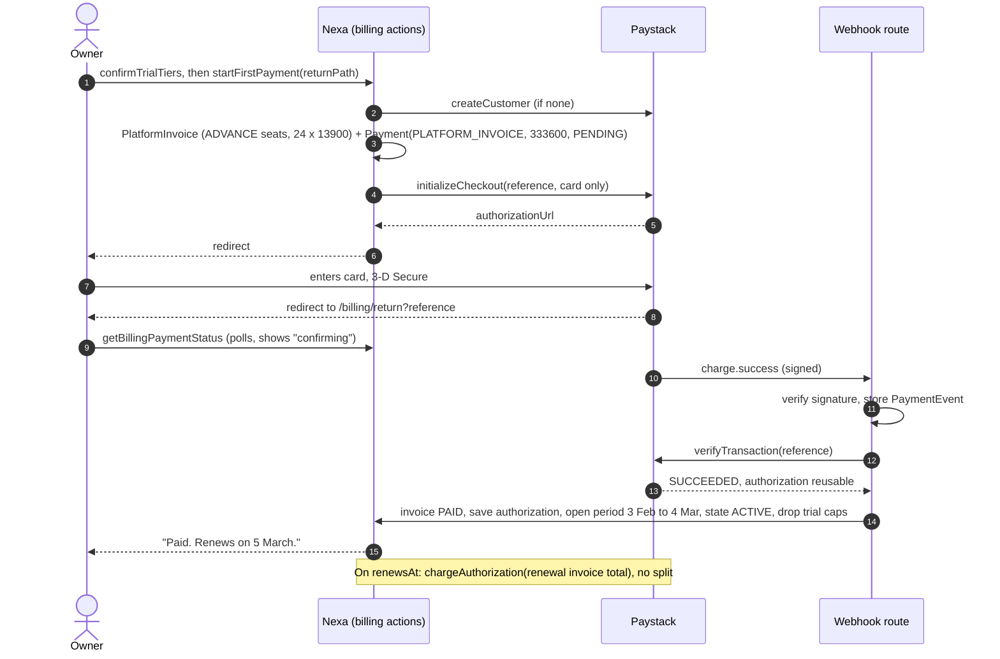
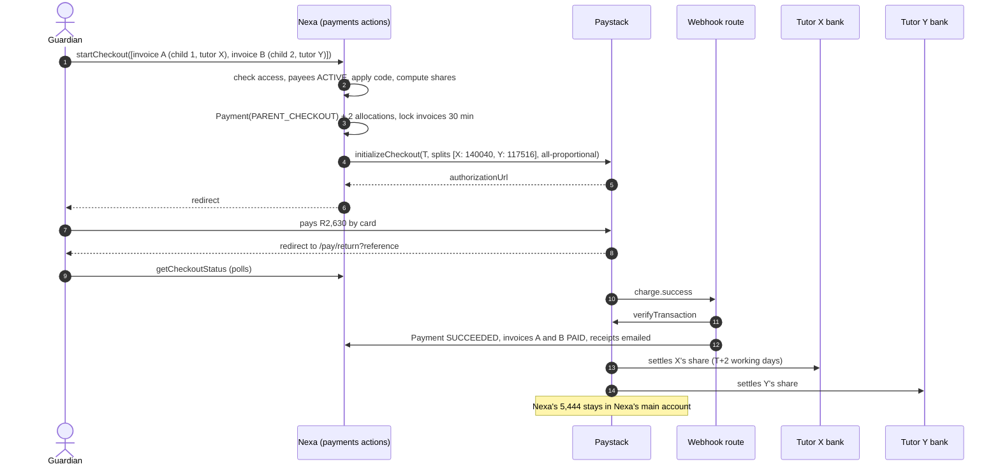
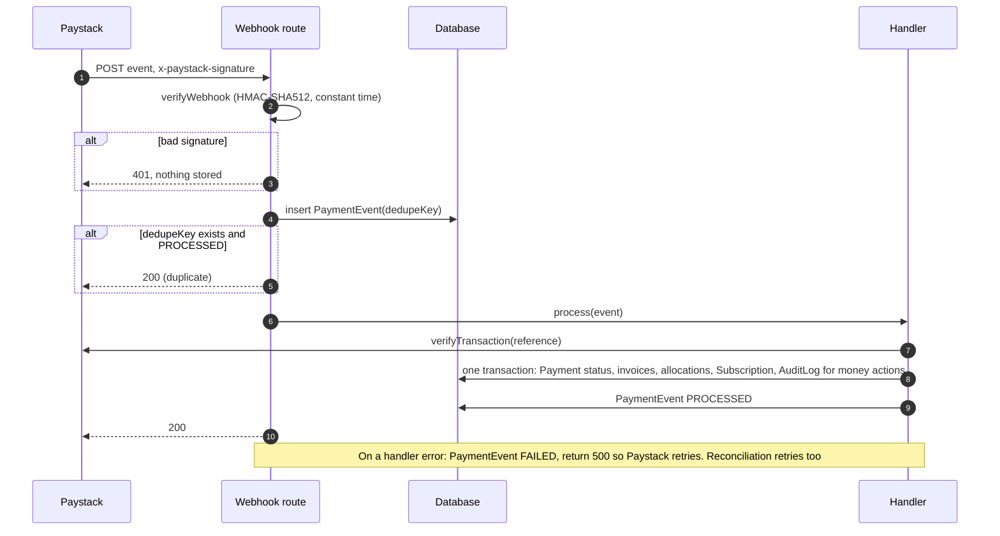
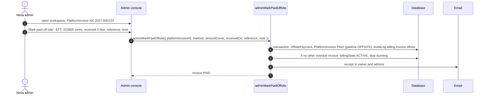

# Payments: provider, workspace billing and parent fees

**Answer first.** All money moves through one `PaymentProvider` interface, implemented for Paystack first and Payfast as the fallback, so a switch touches one folder. For Gate 1 (workspace pays Nexa) the owner's first payment at the end of the trial saves the card and covers the next 30 days, and every 30 days Nexa charges that card for the renewal `PlatformInvoice`, with no split (periods and amounts are in 03). For Gate 2 (parents and adult students pay tutors) each payee has a `PayoutAccount` that is a Paystack subaccount, and one parent checkout can pay many invoices across children and tutors in **one** Paystack transaction with a multi-split: one share per payee, Nexa keeps 2%, and the card fee is borne by the payees in proportion. Webhooks are the source of truth: signatures are verified, every event is stored once in `PaymentEvent`, and the redirect is never trusted. Nexa never holds tutor money: the provider's escrow is not used and tutor shares settle straight to the tutor's bank.

Status: draft for A2, 2026-11-16. Builds on [01-tenancy-roles.md](01-tenancy-roles.md) and [03-billing.md](03-billing.md) (`Subscription`, `PlatformInvoice`, `DiscountCode`, `Redemption`). All amounts are integer cents (ZAR); Paystack's ZAR subunit is also cents.

## 1. Entities

Schema in `prisma/schema/billing.prisma`; code in `src/features/payments/**`.

| Model | Fields (type) | Notes |
| --- | --- | --- |
| `ProviderCustomer` | `id`, `provider` (`PAYSTACK`, `PAYFAST`), `ownerType` (`WORKSPACE`, `USER`), `workspaceId?`, `userId?`, `customerCode` (String), `email` (String) | Gate 1 customer is the workspace; Gate 2 customer is the paying user. Unique (`provider`, `ownerType`, `workspaceId`, `userId`) |
| `PaymentSettings` | `workspaceId` (PK), `payoutMode` (`WORKSPACE`, `PER_TUTOR`), `defaultDueDays` (Int, 7), `overdueReminders` (Boolean, true), `restrictOnOverdue` (Boolean, false), `offsiteInstructions` (String?) | One per workspace. A `SOLO` workspace is always `WORKSPACE` mode (the owner is the payee) |
| `PayoutAccount` | `id`, `workspaceId`, `membershipId?` (set only in `PER_TUTOR` mode), `provider`, `subaccountCode` (String, unique), `businessName`, `bankCode`, `bankName`, `accountNumberLast4` (String), `accountName` (String, as resolved), `status` (`PENDING`, `ACTIVE`, `DISABLED`), `verifiedAt?`, `createdByUserId`, `createdAt` | Unique (`workspaceId`, `membershipId`). The full account number goes to the provider and is never stored |
| `FeeSchedule` | `id`, `workspaceId`, `courseId`, `learnerId?` (null = course default), `kind` (`MONTHLY`, `LESSON_PACK`, `ONCE_OFF`), `amountCents` (Int), `lessonsInPack` (Int?), `description` (String), `billingDay` (Int 1-28, `MONTHLY` only), `startsOn` (Date), `endsOn` (Date?), `active` (Boolean) | A learner row overrides the course default. Tutor-set calendar schedules; the 30-day rule in 03 applies only to Gate 1 |
| `Invoice` | `id`, `number` (String, unique per workspace), `workspaceId`, `payoutAccountId`, `learnerId`, `studentUserId`, `status` (`DRAFT`, `OPEN`, `PAID`, `VOID`, `REFUNDED`, `PARTIALLY_REFUNDED`), `issuedAt`, `dueAt`, `periodStart?`, `periodEnd?`, `subtotalCents`, `discountCents`, `totalCents` (Int), `paidAt?`, `paidVia` (`ONLINE`, `OFFSITE`)?, `payerUserId?`, `lockedByPaymentId?`, `lockedUntil?` | One per child per payee per run. Payee to payer. Not the same table as `PlatformInvoice` |
| `InvoiceLine` | `id`, `invoiceId`, `feeScheduleId?`, `courseId?`, `description`, `quantity` (Int), `unitAmountCents` (Int), `amountCents` (Int), `discountCodeId?` | |
| `Payment` | `id`, `provider`, `reference` (String, unique, ours), `purpose` (`CARD_AUTHORISATION`, `PLATFORM_INVOICE`, `PARENT_CHECKOUT`), `workspaceId?` (Gate 1), `payerUserId?` (Gate 2), `platformInvoiceId?`, `status` (`PENDING`, `SUCCEEDED`, `FAILED`, `ABANDONED`, `REFUNDED`, `PARTIALLY_REFUNDED`), `amountCents`, `commissionCents` (Int, 0 for Gate 1), `estimatedFeeCents` (Int), `feeCents` (Int?, actual), `channel` (String?), `splitSent` (Json?), `paidAt?`, `createdAt` | One provider transaction |
| `PaymentAllocation` | `id`, `paymentId`, `invoiceId`, `payoutAccountId`, `amountCents` (invoice total), `shareCents` (sent to the subaccount), `commissionCents`, `feeShareCents` | Gate 2 only. Unique (`paymentId`, `invoiceId`) |
| `PaymentEvent` | `id`, `provider`, `dedupeKey` (String, unique), `type` (String), `reference` (String?), `payload` (Json), `receivedAt`, `status` (`RECEIVED`, `PROCESSED`, `IGNORED`, `FAILED`), `attempts` (Int), `error` (String?), `processedAt?` | Every webhook, stored before processing |
| `Refund` | `id`, `paymentId`, `allocationId?`, `amountCents`, `commissionReturnedCents`, `reason`, `providerRefundId?`, `status` (`PENDING`, `PROCESSED`, `FAILED`), `requestedByUserId`, `createdAt`, `processedAt?` | Unique idempotency key = `id`, sent to the provider |
| `OffsitePayment` | `id`, `workspaceId`, `invoiceId?`, `platformInvoiceId?` (exactly one set), `method` (`CASH`, `EFT`, `OTHER`), `amountCents`, `receivedOn` (Date), `reference?`, `note` (String, required), `markedByUserId`, `markedAs` (`TUTOR`, `WORKSPACE_ADMIN`, `NEXA_ADMIN`), `voidedAt?`, `voidReason?` | Nexa earns no commission on off-site payments |

Gate 1 card details (authorisation code, brand, last 4) live on `Subscription` in 03.

## 2. PaymentProvider interface

File: `src/features/payments/provider/types.ts`. Implementations: `paystack.ts`, `payfast.ts`; `getProvider()` in `index.ts` reads `PAYMENT_PROVIDER`. Discounts, commission and split shares are computed in Nexa first; the provider only sees final amounts.

```ts
export type Cents = number; // integer ZAR cents

export interface PaymentProvider {
  readonly id: "PAYSTACK" | "PAYFAST";
  capabilities(): { multiSplit: boolean; variableCharge: boolean; refunds: boolean; eft: boolean };

  createCustomer(input: { email: string; name: string; metadata: Record<string, string> }):
    Promise<{ customerCode: string }>;

  initializeCheckout(input: {
    reference: string;               // Payment.reference, generated by Nexa
    email: string;
    amountCents: Cents;
    callbackUrl: string;
    channels?: Array<"card" | "eft">;
    splits?: Array<{ subaccountCode: string; shareCents: Cents }>; // remainder goes to Nexa
    feeBearer?: "PLATFORM" | "PAYEES_PROPORTIONAL";
    metadata: Record<string, string>; // ids only, no personal data
  }): Promise<{ authorizationUrl: string; reference: string }>;

  chargeAuthorization(input: {
    authorizationCode: string; email: string; amountCents: Cents;
    reference: string; metadata: Record<string, string>;
  }): Promise<{ status: "SUCCEEDED" | "FAILED" | "PENDING"; gatewayMessage?: string }>;

  createSubaccount(input: {
    businessName: string; bankCode: string; accountNumber: string;
    contactEmail: string; description: string;
  }): Promise<{ subaccountCode: string; accountName?: string }>;

  verifyTransaction(reference: string): Promise<{
    status: "SUCCEEDED" | "FAILED" | "ABANDONED" | "PENDING";
    amountCents: Cents; currency: "ZAR"; feeCents?: Cents; channel?: string; paidAt?: Date;
    authorization?: { code: string; reusable: boolean; brand: string; last4: string; expMonth: number; expYear: number };
  }>;

  refund(input: { reference: string; amountCents?: Cents; reason: string; idempotencyKey: string }):
    Promise<{ providerRefundId: string; status: "PENDING" | "PROCESSED" | "FAILED" }>;

  listBanks(): Promise<Array<{ code: string; name: string }>>;

  resolveAccount(input: { bankCode: string; accountNumber: string; idNumber?: string }):
    Promise<{ accountName: string } | null>;

  verifyWebhook(rawBody: string, headers: Headers): NormalisedEvent; // throws InvalidSignature

  listTransactions(input: { from: Date; to: Date }): Promise<Array<{ reference: string; status: string; amountCents: Cents }>>; // reconciliation only
}

export type NormalisedEvent = {
  dedupeKey: string;
  type: "charge.succeeded" | "charge.failed" | "refund.processed" | "refund.failed" | "dispute.opened" | "other";
  reference: string | null;
  raw: unknown;
};
```

`listTransactions` is an addition to the brief's list, needed by the reconciliation job (section 7).

**Paystack implementation notes**

- `initializeCheckout` calls `POST /transaction/initialize` with a dynamic `split` object: `type: "flat"`, `bearer_type: "all-proportional"`, `subaccounts: [{ subaccount, share }]`. Shares are in cents; what is left goes to Nexa's main account.
- `chargeAuthorization` calls `POST /transaction/charge_authorization`. Only authorisations with `reusable: true` are saved.
- `createSubaccount` calls `POST /subaccount` with `percentage_charge: 2` (a default; every Nexa checkout overrides it with a dynamic split).
- `verifyWebhook` computes HMAC-SHA512 of the raw body with `PAYSTACK_SECRET_KEY` and compares it with `x-paystack-signature` in constant time. `dedupeKey` = `paystack:<event>:<data.id>`.
- `resolveAccount`: **Open question.** South African account checks on Paystack may need the holder's ID number (`/bank/validate`) rather than the simple `/bank/resolve`. If so, the ID number is passed through once and never stored.

**Payfast fallback notes**

- Gate 1 works: tokenisation ("adhoc" agreements) gives a reusable token and variable-amount charges.
- Gate 2 is weaker: a Payfast split reportedly goes to one other Payfast account per transaction, and each payee needs their own Payfast merchant account. `capabilities().multiSplit = false`, so the checkout builder creates one `Payment` per payee and the parent pays several times.
- ITN webhooks are verified by signature (MD5 with the passphrase), source IP range and a server-to-server validate call.

## 3. Money rules

- **Nexa never holds tutor money.** Tutor shares split at capture and settle from Paystack to the payee's bank. Provider escrow, held payouts and transfers from Nexa's balance are not used. A checkout is refused if any payee's `PayoutAccount` is not `ACTIVE`.
- **Webhooks decide.** A `Payment` becomes `SUCCEEDED` only after a verified webhook **and** `verifyTransaction` agree on status, amount and currency. The redirect page only polls.
- **Commission** is 2% of the amount the parent pays for each invoice (after discounts), only on online payments. The card fee is borne by the payees.
- **Paystack sole-proprietor limit.** Nexa's Paystack account is a sole proprietorship with a **R1,000,000 lifetime collection limit** (100 000 000 cents), and every rand of both gates passes through it. A monitor sums `SUCCEEDED` `Payment.amountCents` (less refunds) each night; at 70% (70 000 000 cents) and again at 90% it emails Nexa admins and shows a banner in the admin console. Nothing is blocked automatically. The fix is registering a (Pty) Ltd and moving to a registered-business account before the limit. Config: `PAYSTACK_LIFETIME_CAP_CENTS`, `PAYSTACK_CAP_ALERT_BPS=7000`.

## 4. Gate 1: workspace pays Nexa

- **First payment** ends the trial: `startFirstPayment` (03) creates the `ProviderCustomer` and a `Payment` with `purpose = PLATFORM_INVOICE` for the first renewal invoice (seats in advance for 30 days), card channel only, and redirects. On success the reusable authorisation goes to `Subscription`, the first 30-day period starts at the payment time, and the workspace converts (03, section 6). No separate card-verification charge is needed.
- **Renewal charge:** on `renewsAt` (30 days after the last payment) the daily job builds the renewal invoice (03, sections 4 and 7), creates a `Payment` with `purpose = PLATFORM_INVOICE` and reference `nx-inv-<invoiceId>-<attempt>`, and calls `chargeAuthorization` for the total. No split. The webhook marks the `PlatformInvoice` `PAID` and opens the next period from the payment time. A failure starts dunning, counted from the renewal date (03, section 7).
- **Pay now:** `initializeCheckout` for the invoice total; the new authorisation replaces the saved one.
- **Replace card without paying** (`startCardReplacement`): a `Payment` with `purpose = CARD_AUTHORISATION` of 1 000 cents, refunded as soon as the webhook confirms. Also used if a first payment would be zero (no learners yet). **Decision taken here.** Alternative: only allow card changes through Pay now.



## 5. Gate 2: parents and adult students pay tutors

**Payees.** In a `SOLO` workspace the owner connects one `PayoutAccount`. In an `ORGANISATION` the owner connects the workspace account (`payoutMode = WORKSPACE`), or chooses `PER_TUTOR` and each tutor connects their own (`payouts.connect`, 01). `resolvePayee(course)` returns the course lead's account in `PER_TUTOR` mode, else the workspace account. Connecting: `listBanks` → `resolveAccount` (the name is shown to confirm) → `createSubaccount`. The account is `ACTIVE` once Paystack verifies it; Paystack holds a new subaccount's first payout until then.

**Invoices.** The daily `fees-daily` job (same cron mechanism as 03) creates `MONTHLY` invoices on each schedule's `billingDay`; tutors issue `LESSON_PACK` and `ONCE_OFF` invoices by hand. Lines are grouped into one `Invoice` per (learner, payee). Who sees and pays follows 01, section 6: every active guardian, else the student if `paymentVisible`, else nobody (off-site only). Overdue reminders go out 1 and 7 days after `dueAt`; restricting a learner is off and not built in v1.

**Checkout.** A guardian picks any open invoices across children and tutors and pays once (`startCheckout`).

1. Load the invoices; check the payer may pay each one (`fees.pay`), each is `OPEN` and not locked, and each payee is `ACTIVE`.
2. Apply a `PARENT_INVOICE` discount code, if given, to invoices of the issuing workspace.
3. `T` = sum of invoice totals. Commission `C` = Σ round(2% × invoice total). Estimated fee `F` = round((2.9% × T + 100) × 1.15) (card, VAT included while Nexa is not VAT-registered; stored as config).
4. With `all-proportional`, every party bears the fee in proportion to its share. To keep Nexa's net at `C`, Nexa's gross share is `S_N = ceil(C × T / (T − F))`. Payee shares split `T − S_N` in proportion to their invoice totals (largest remainder, so they add up exactly).
5. Create one `Payment` (`PARENT_CHECKOUT`) with a `PaymentAllocation` per invoice, lock the invoices for 30 minutes (`lockedByPaymentId`), and call `initializeCheckout` with one split entry per payee subaccount (invoices for the same payee are summed into one entry).

Example: invoice A R1,430 to tutor X, invoice B R1,200 to tutor Y. `T` = 263 000, `C` = 2 860 + 2 400 = 5 260, `F` = 8 886, `S_N` = 5 444. X's share 140 040 and Y's share 117 516 (corrected 2026-11-20: 257 556 × 143 000 ÷ 263 000 = 140 039.95). After Paystack's proportional fee, X nets about 135 310 and Y about 113 545, Nexa about 5 260. The actual fee from `verifyTransaction` is stored in `feeCents` and `feeShareCents`.

**Decision taken here:** gross-up Nexa's share so it nets the full 2%. Alternative: accept Nexa bearing about 2% of the fee (R1.78 here). **Open question:** confirm in Paystack test mode that `all-proportional` with a multi-split behaves this way.



## 6. Webhooks

Route: `src/app/api/webhooks/paystack/route.ts` (Node runtime, reads `await req.text()` for the raw body). Handlers in `src/features/payments/webhooks.ts`.



- Handlers are idempotent: they check the current `Payment.status` and do nothing if it is already final.
- `charge.success` for a `PARENT_CHECKOUT` whose invoice was paid meanwhile (two guardians paying at once) refunds that allocation's share automatically and emails the payer.
- `charge.failed` on `PLATFORM_INVOICE` feeds dunning. `refund.processed` and `refund.failed` update `Refund`. `charge.dispute.create` emails Nexa admins and the payee; disputes are handled by hand in v1.
- Unknown event types are stored as `IGNORED`.

## 7. Off-site payments, refunds, reconciliation

**Off-site.** A tutor (own learners), a workspace admin or a Nexa admin marks an `Invoice` paid off-site; only a Nexa admin can do so for a `PlatformInvoice`. A note is required. The invoice becomes `PAID` with `paidVia = OFFSITE`, and an `AuditLog` row is written. Voiding the off-site payment reopens the invoice.



**Refunds.** Staff with `fees.manage` can refund a paid online `Invoice` in full or in part (`requestRefund`); Nexa admins can refund any payment, including Gate 1. The refund calls `provider.refund` with the `Refund.id` as idempotency key. Nexa returns its commission pro rata (`commissionReturnedCents`); the card fee is not refunded by Paystack and stays with the payee. Paystack refunds within one year. **Open question:** how Paystack debits a partial refund of a multi-split transaction across the subaccounts and the main account; Nexa must not fund a tutor's refund.

**Reconciliation** (`POST /api/cron/payments-reconcile`, nightly, `CRON_SECRET`):

1. `PENDING` payments older than 30 minutes: `verifyTransaction` and apply. Still unpaid after 24 hours: `ABANDONED`, unlock invoices.
2. `PaymentEvent` rows in `FAILED`: reprocess, up to 5 attempts, then alert admins.
3. `listTransactions` for the previous day versus `Payment` rows: missing or mismatched amounts are fixed through the same idempotent handler or reported to admins.
4. `PENDING` refunds: poll the provider.
5. The lifetime-limit monitor (section 3).

## 8. For contracts/billing.md (payments)

Same conventions as 03, section 10. Files: `src/features/payments/queries.ts` and `actions.ts`.

| Name | Kind | Permission | Input | Returns |
| --- | --- | --- | --- | --- |
| `listPayableInvoices` | query | guardian or `fees.pay` | `{ status?: "OPEN" \| "PAID" }` | `Array<{ id, number, child: { userId, name }, payee: { name }, workspaceName, totalCents, dueAt, status, lockedUntil }>` |
| `startCheckout` | action | `fees.pay` | `{ invoiceIds: string[], discountCode?: string }` | `{ authorizationUrl, reference, totalCents, discountCents }` |
| `getCheckoutStatus` | query | payer | `{ reference }` | `{ status: PaymentStatus, invoices: Array<{ id, status }> }` |
| `getPayoutSettings` | query | `payouts.connect` or `fees.manage` | none | `{ payoutMode, accounts: Array<{ id, membershipId, businessName, bankName, accountNumberLast4, accountName, status }> }` |
| `listBanks` | query | `payouts.connect` | none | `Array<{ code, name }>` |
| `resolvePayoutAccount` | action | `payouts.connect` | `{ bankCode, accountNumber, idNumber? }` | `{ accountName }` |
| `connectPayoutAccount` | action | `payouts.connect` | `{ bankCode, accountNumber, businessName, idNumber? }` | `{ id, status }` |
| `setPayoutMode` | action | `workspace.settings` | `{ payoutMode }` | `{ payoutMode }` |
| `upsertFeeSchedule` | action | `fees.manage` | `{ id?, courseId, learnerId?, kind, amountCents, lessonsInPack?, description, billingDay?, startsOn, endsOn? }` | `{ id }` |
| `listFeeInvoices` | query | `fees.manage` | `{ courseId?, learnerId?, status?, cursor? }` | `{ items: Array<{ id, number, learnerName, payeeName, totalCents, status, dueAt, paidVia }>, nextCursor }` |
| `issueInvoice` | action | `fees.manage` | `{ learnerId, lines: Array<{ courseId?, description, quantity, unitAmountCents }>, dueAt }` | `{ id, number }` |
| `voidInvoice` | action | `fees.manage` | `{ invoiceId, reason }` | `{ status }` |
| `markInvoicePaidOffsite` | action | `fees.markOffsite` | `{ invoiceId, method, amountCents, receivedOn, reference?, note }` | `{ status: "PAID" }` |
| `voidOffsitePayment` | action | `fees.markOffsite` | `{ offsitePaymentId, reason }` | `{ invoiceStatus }` |
| `requestRefund` | action | `fees.manage` | `{ invoiceId, amountCents?, reason }` | `{ refundId, status }` |
| `adminMarkPaidOffsite` | action | `admin.override` | `{ platformInvoiceId, method, amountCents, receivedOn, reference?, note }` | `{ status: "PAID" }` |
| `adminRefundPayment` | action | `admin.override` | `{ paymentId, amountCents?, reason }` | `{ refundId, status }` |
| `adminGetPaymentVolume` | query | `admin.console` | none | `{ lifetimeCents, capCents, percent }` |

## Open questions

1. Paystack sales: confirm that one South African account allows dynamic multi-split to many subaccounts, `charge_authorization` for Gate 1, and an education marketplace, and give chargeback fees (research 03).
2. Paystack's minimum charge for the card-replacement step, and whether a zero-amount authorisation exists, which would avoid the R10 charge and refund.
3. How `all-proportional` distributes the fee in a multi-split, and how refunds debit split shares (sections 5 and 7).
4. Whether South African account resolution needs the holder's ID number.
5. When the (Pty) Ltd is registered, so the R1,000,000 sole-proprietor limit stops applying.
