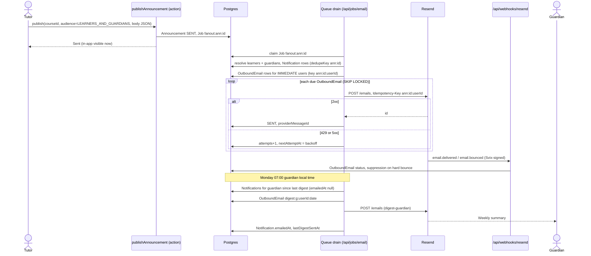

# Messaging and email infrastructure

**Answer first.** A owns delivery; B owns the screens and the message editor. Messages and announcements are stored as **Tiptap JSON** (B's decision), with a derived plain-text copy. Three new models carry them:

- `Announcement`, scoped to a course or the whole workspace.
- `Thread` with `ThreadParticipant`, for direct tutor–learner and tutor–guardian conversations.
- `Message`, the posts inside a thread.

Every recipient gets one row in the existing `Notification` table, which becomes the single in-app feed and the source for email. Email goes through a database-backed **send queue** (`OutboundEmail`). Each send has an idempotency key, which is also passed to Resend, and failures retry with backoff. The queue is drained today by the GitHub Actions scheduled-jobs workflow and later by QStash. Mail is sent from `notify.nexa-lms.co.za`. **Until that domain is verified in Resend, mail can only reach the owner's inbox.** Transactional mail cannot be switched off. Everything else follows per-category preferences, digests and one-click unsubscribe. Subject lines never contain student personal information.

Status: draft for A2, 2026-11-16. Builds on [01-tenancy-roles.md](01-tenancy-roles.md) and [02-identity.md](02-identity.md). Depends on B's `contracts/editor.md`, which does not exist yet.

## 1. Today

| Piece | State (read from code) |
| --- | --- |
| `src/lib/email/send.ts` | `sendEmail()` posts to the Resend REST API and never throws. It has no idempotency key and no retry |
| `src/lib/email/config.ts` | `EMAIL_FROM` defaults to `onboarding@resend.dev` (dev sender, reaches only the Resend account owner) |
| `src/lib/email/templates.ts` | String templates with inline styles: verification, single notification, digest. The footer links to settings, but there is no unsubscribe |
| `src/features/notifications/server.ts` | `emitNotification()` resolves recipients **by email**, filters on `notifyOn*` preferences, writes one `Notification` per user, and emails `IMMEDIATE` users inside `after()` |
| `src/features/notifications/jobs.ts` | Hourly due-date, study and grading reminders, plus daily/weekly digests at 07:00 local time. Idempotent through `emailedAt` and `lastDigestSentAt` |
| `.github/workflows/scheduled-jobs.yml` | Calls `/api/cron/notifications` hourly and `/api/auto-submit` every 5 minutes with `CRON_SECRET` |
| Messages | `NotificationType.MESSAGE` and `UserPreferences.notifyOnMessages` exist, but there is no message model |

## 2. Models (`prisma/schema/messaging.prisma`)

| Model | Fields | Notes |
| --- | --- | --- |
| `Announcement` | `id`, `workspaceId`, `scope` (`COURSE`, `WORKSPACE`), `courseId?`, `audience` (`LEARNERS`, `GUARDIANS`, `LEARNERS_AND_GUARDIANS`, `STAFF`), `authorUserId`, `title` (plain, max 120), `body` (Json, Tiptap), `bodyText` (derived), `status` (`DRAFT`, `SCHEDULED`, `SENT`, `WITHDRAWN`), `sendAt?`, `sentAt?`, `pinnedUntil?`, `emailNow` (bool, default true), `createdAt`, `editedAt?` | `courseId` is required when `scope = COURSE`. `STAFF` is valid only for `WORKSPACE` scope. An edit after sending updates the in-app copy only; emails are not re-sent |
| `Thread` | `id`, `workspaceId`, `aboutLearnerId?`, `courseId?`, `subject` (plain, max 120), `createdById`, `lastMessageAt`, `lockedAt?`, `createdAt` | Every thread is direct (2+ participants). `aboutLearnerId` is required when a guardian takes part |
| `ThreadParticipant` | `threadId`, `userId`, `role` (`STAFF`, `LEARNER`, `GUARDIAN`), `lastReadAt?`, `mutedAt?`, `leftAt?` | Unique (`threadId`, `userId`) |
| `Message` | `id`, `threadId`, `workspaceId`, `authorUserId`, `body` (Json), `bodyText`, `createdAt`, `editedAt?`, `deletedAt?` | A soft delete shows "Message removed". Attachments are later, through B's upload contract |

Indexes: `Announcement(workspaceId, courseId, sentAt)`, `Thread(workspaceId, lastMessageAt)`, `ThreadParticipant(userId, threadId)` and `Message(threadId, createdAt)`. All four models are tenant models under `withWorkspace` (01 §4). The guardian inbox crosses workspaces through `src/features/messaging/guardian-queries.ts`, the same pattern as `parents/queries.ts`.

### Who may message whom

| Sender | Can start a thread with | Can announce |
| --- | --- | --- |
| Owner, admin | Any member, learner or guardian in the workspace | Workspace-wide (any audience) and any course |
| Tutor | Learners in courses where they are `CourseStaff`, and those learners' active guardians | Courses where they are `CourseStaff` |
| Learner | Staff on their enrolled courses | – |
| Guardian | Staff on their child's courses (`CourseStaff` on the child's active enrolments), always `aboutLearnerId` = that child | – |
| Nexa admin | Only while impersonating (audited) | – |

There is no learner-to-learner and no guardian-to-guardian messaging.

**Decision taken here (safeguarding):** every thread between staff and a **minor** learner automatically includes that learner's active guardians as participants. Workspace owners and admins can read any thread in their workspace, and each read writes an `AuditLog` row. The alternative is to block direct staff–minor threads entirely.

New permission keys, which add to the matrix in 01: `messages.announce` (owner, admin; tutor ◐ for own courses) and `messages.direct` (everyone ◐ per the table).

## 3. Delivery through `Notification`

`Notification` gains these fields:

| Field | Purpose |
| --- | --- |
| `workspaceId?` | Tenant column (01 §4). Null only for account and platform notices |
| `category` | `NotificationCategory`: `ACCOUNT`, `BILLING`, `ANNOUNCEMENT`, `MESSAGE`, `COURSE_ACTIVITY`, `REMINDER`, `GRADES` |
| `announcementId?`, `threadId?` | Back-links |
| `dedupeKey` | Unique with `userId`. For example `ann:<id>`, `msg:<threadId>:<messageId>`. A retried fan-out cannot double-insert |

`NotificationType` gains `ANNOUNCEMENT` (`MESSAGE` already exists).

`emitNotification()` changes in four ways:

1. Recipients are resolved by `userId` only (02 §8), never by email.
2. Every row gets a `category` and `workspaceId`.
3. Rows are written with `createMany({ skipDuplicates: true })` on `dedupeKey`.
4. Immediate email is **enqueued** (§6), not sent inline in `after()`. The single exception is transactional auth mail (magic link, verify, reset, invite), which is enqueued and also attempted at once in `after()`, because a user is waiting for it.

Message notifications collapse: the second and later unread messages in the same thread update the existing unread row instead of adding new ones.

## 4. Templates

All templates live in `src/lib/email/templates/<key>.ts`, each exporting `render(data): { subject, html, text }` over a shared `layout.ts`. **Decision taken here:** we keep plain TypeScript string templates (as today), styled with B's tokens copied as inline hex values. The alternative is React Email, a new dependency we revisit if templates pass about 30.

| Key | Trigger (owner doc) | To | Category | Can opt out? |
| --- | --- | --- | --- | --- |
| `invite-staff`, `invite-learner`, `invite-guardian` | `createInvites` (02 §5) | Invitee | Transactional | No |
| `guardian-claim-confirm` | Claim code used (02 §5) | Guardian | Transactional | No |
| `magic-link` | Sign-in (02 §6) | User | Transactional | No |
| `verify-email` | Sign-up, email change (02 §4, §8) | User | Transactional | No |
| `password-reset`, `password-changed`, `lockout` | 02 §7, §10 | User | Transactional | No |
| `email-change-confirm`, `email-change-notice` | 02 §8 | New / old address | Transactional | No |
| `data-export-ready`, `deletion-scheduled` | 02 §8 | User or guardian | Transactional | No |
| `receipt` | Payment succeeded (04) | Payer | `BILLING` | No |
| `invoice` | Invoice issued to a parent or adult learner (04) | Payer | `BILLING` | No |
| `trial-day-10`, `trial-day-13` | Trial machine (03) | Workspace owner (+ admins) | `BILLING` | No |
| `dunning-day-0`, `dunning-day-3`, `dunning-day-7` | Failed Nexa bill (03); also parent invoice reminders (04) | Owner, or payer | `BILLING` | No |
| `quota-80`, `quota-100` | Metered service cap (03) | Owner (+ the course lead for 80%) | `BILLING` | No |
| `announcement` | §5 | Audience | `ANNOUNCEMENT` | Yes |
| `new-message` | New message in a thread | Participants | `MESSAGE` | Yes (falls into the digest) |
| `notification` | Any other `emitNotification` | Recipient | Its category | Yes |
| `digest-guardian` (weekly or daily) | §5 | Guardian | Digest | Yes |
| `digest-member` (weekly or daily) | Existing `emailDigests` | Staff, learners | Digest | Yes |

"Transactional" means mail about the account or about money the person owes or paid. It ignores preferences, but it still respects a hard-bounce suppression (§7).

**Subject rule (POPIA).** Subjects take only these variables, all typed by `SafeSubjectVars`:

- `workspaceName`
- `tutorName` (staff names are not student data)
- `invoiceNumber`
- `amountCents`
- `days`

They never include a student's name, marks, grades or health or behaviour notes. For example: "New message from Bright Maths", "Your weekly Nexa summary", "Invoice INV-2027-0012 from Bright Maths". The email body may name the guardian's own child.

### Rendering Tiptap JSON to email HTML

`src/lib/email/render-rich-text.ts` exports `renderEmailHtml(doc: JSONContent): { html, text }`. It runs on the server only.

- **Dependency on B:** the node and mark list in `contracts/editor.md`. Until that contract exists, this module is blocked. A placeholder renders `bodyText` only.
- Use Tiptap's static renderer (free, per B's research) with an **email node map**: paragraph, heading (h2/h3 only), lists, bold, italic, underline, links (absolute `https` only, `rel="noopener"`), blockquote, hard break. Each tag is written with inline styles.
- Nodes email cannot render become a short placeholder with a link to the item in Nexa:
  - math becomes its TeX source in a monospace span. Gmail strips SVG, and rendering PNGs costs a function run per formula.
  - graph, embed and code become "Open in Nexa to see this graph" (or embed, or code).
  - images are included only when their URL is public. Private Blob images become a link.
- Unknown nodes are dropped. The output is checked against an allow-list (no `style` from content, no `script`, no `on*`). Bodies over about 6,000 characters are cut, with "Read the full announcement".
- The plain-text part comes from the same walk, not from `bodyText`, so the links survive.

## 5. Fan-out and digests

**Announcement fan-out** (`src/features/messaging/fanout.ts`, `fanOutAnnouncement(id)`):

1. Resolve the audience.
   - Learners: users with an `ACTIVE` `Enrollment` in the course, or any `ACTIVE` `Learner` for workspace scope.
   - Guardians: the `ACTIVE` `Guardianship` of those learners.
   - Staff: `ACTIVE` memberships.
2. Write `Notification` rows in batches of 500 with `dedupeKey = ann:<id>`.
3. For each recipient whose `ANNOUNCEMENT` email mode is `IMMEDIATE`, enqueue `announcement` with key `ann:<id>:<userId>`. `DIGEST` recipients are left for the digest. `OFF` recipients get in-app only.

Scheduled announcements (`sendAt`) are picked up by the queue drain when due.

**Guardian digest** (`src/features/email/digests/guardian.ts`): one email per guardian across all children and workspaces. It runs from the hourly job at 07:00 in the guardian's time zone, weekly on their `digestWeekday` (default Monday) or daily. The idempotency key is `digest:g:<userId>:<period-start-date>`. For each child, it gathers:

- new grades
- work due in the next 7 days
- announcements
- unread messages (count and senders)
- invoices due or overdue

If nothing happened for any child, nothing is sent.

## 6. Send queue

`OutboundEmail` (in `messaging.prisma`):

| Field | Notes |
| --- | --- |
| `id` | |
| `idempotencyKey` (unique, max 256) | Sent to Resend as `Idempotency-Key`. Resend keeps keys for 24 hours and returns the original response for a repeat ([docs](https://resend.com/docs/dashboard/emails/idempotency-keys), checked 2026-11-16) |
| `userId?`, `toEmail`, `workspaceId?` | |
| `template`, `category`, `priority` (`AUTH`, `BILLING`, `NORMAL`, `DIGEST`) | |
| `data` (Json) | Template input. Rendering happens at send time |
| `status` | `QUEUED`, `SENDING`, `SENT`, `DELIVERED`, `BOUNCED`, `COMPLAINED`, `FAILED`, `SUPPRESSED` |
| `attempts`, `nextAttemptAt`, `lockedUntil`, `lastError` | |
| `providerMessageId?`, `sentAt?`, `createdAt` | |

How the queue works:

- **Enqueue:** `enqueueEmail({ key, template, to, data, category })` in `src/lib/email/queue.ts`. It does an upsert on `idempotencyKey`, so the same event never queues twice, even after 24 hours, when Resend's own key has expired.
- **Drain:** `drainEmailQueue({ limit: 50 })` claims rows with `FOR UPDATE SKIP LOCKED` (a raw query), sets `lockedUntil` to now + 2 minutes, renders and sends them.
- **Order:** highest priority first, `AUTH` before `BILLING` before `NORMAL` before `DIGEST`.
- **Retries:** after 1 minute, 5 minutes, 30 minutes, 2 hours and 12 hours, then `FAILED` (alert in Sentry). 429 and 5xx retry; other 4xx fail at once. A 409 `concurrent_idempotent_requests` retries.
- **Daily budget:** `EMAIL_DAILY_BUDGET` (default 90 while on Resend Free, which caps at 100 a day, see [research 07](../research/07-domain-email.md)). When it is reached, only `AUTH` and `BILLING` go out, and the rest wait for tomorrow. Move to Resend Pro (R340 a month) before guardian digests pass this cap.
- **Today:** route `src/app/api/jobs/email/route.ts` (bearer `CRON_SECRET`) is called by `.github/workflows/scheduled-jobs.yml` on the existing 5-minute schedule. Auth mail also gets the immediate `after()` attempt. The hourly `/api/cron/notifications` runs reminders and enqueues digests.
- **Later (Vercel Pro, January 2027):** QStash publishes one message per `OutboundEmail` to the same route, with its own retries. The table and keys stay, so switching is a change to the trigger only.

Generic jobs such as `fanout:ann:<id>` use a small `Job` table (`key` unique, `kind`, `payload`, `runAt`, `status`, `attempts`) drained by the same route. 06-deployment may replace it with the shared queue.

### Non-production guard

`src/lib/email/send.ts` gains an allow-list. If `VERCEL_ENV` is not `production`, any recipient not in `EMAIL_ALLOWLIST` (the owner's address, stored in env, never in the repo) is marked `SUPPRESSED` with reason `non-production`. Preview runs on a fake-data Neon branch (owner decision), and fake addresses must never be mailed. AGENTS.md §4 also requires the owner's approval before mail reaches anyone else.

## 7. Domain, sender and webhooks

**Constraint, kept explicit:** until `notify.nexa-lms.co.za` shows "Verified" in Resend, `EMAIL_FROM` stays on the dev sender. That sender delivers only to the Resend account owner, so **no invite, magic link or invoice reaches a real user**. Launch testing (plan launch checklist: "reach Gmail and Outlook inboxes") needs verification first. The owner does the DNS steps.

Records, in the `nexa-lms.co.za` zone on Cloudflare, all set to "DNS only". Copy the exact values from Resend's Records tab; these are the shapes from [research 07](../research/07-domain-email.md):

| Purpose | Type | Name | Value |
| --- | --- | --- | --- |
| Return path / SPF | MX | `send.notify` | `feedback-smtp.eu-west-1.amazonses.com`, priority 10 |
| SPF | TXT | `send.notify` | `v=spf1 include:amazonses.com ~all` |
| DKIM | TXT | `resend._domainkey.notify` | Public key from Resend |
| DMARC | TXT | `_dmarc` | `v=DMARC1; p=none; rua=mailto:dmarc@nexa-lms.co.za` |

DMARC moves to `p=quarantine` after 2 to 4 clean weeks, then to `p=reject`. The record covers Zoho Mail on the root domain too. Region: eu-west-1. Resend keeps logs in the US in every region, which counts as a cross-border transfer under POPIA ([research 09](../research/09-compliance.md)).

Sender and headers:

- From: `Nexa <no-reply@notify.nexa-lms.co.za>`, Reply-To `support@nexa-lms.co.za` (Zoho).
- Tutor messages show the tutor's name ("Thandi via Nexa") with a "Reply in Nexa" button. Inbound reply-by-email is not in v1.
- Every non-transactional email carries `List-Unsubscribe` (an https URL plus `mailto:`), `List-Unsubscribe-Post: List-Unsubscribe=One-Click` (RFC 8058) and a visible link. Google requires these above 5,000 messages a day ([Google sender guidelines](https://support.google.com/a/answer/81126), checked 2026-11-16), and we add them from day one.

**Webhooks:** `src/app/api/webhooks/resend/route.ts` verifies the Svix headers (`svix-id`, `svix-timestamp`, `svix-signature`) against the raw body ([docs](https://resend.com/docs/dashboard/webhooks/verify-webhooks-requests), checked 2026-11-16). It stores `svix-id` in the shared `WebhookEvent` table (`provider`, `eventId` unique; defined with payments in 04) so each event is handled once. Event types come from Resend's [event list](https://resend.com/docs/dashboard/webhooks/event-types), checked 2026-11-16.

| Event | Action |
| --- | --- |
| `email.delivered` | `OutboundEmail.status = DELIVERED` |
| `email.bounced` (hard) | `BOUNCED`. Add `EmailSuppression(emailHash, reason, at)` and set `User.emailBouncedAt`. Show an in-app banner "We can't reach your email". Tutors see "Parent's email bounced" on the learner |
| `email.complained` | `COMPLAINED`. Opt the user out of every optional category and record it |
| `email.suppressed`, `email.failed` | `SUPPRESSED` or `FAILED`, with the reason |
| `email.delivery_delayed` | Log only |

A suppressed address gets no optional mail. Transactional mail to it is attempted once more only after the user changes or re-verifies their email.

## 8. Preferences

`UserPreferences` gains these fields (existing fields stay):

| Field | Default | Notes |
| --- | --- | --- |
| `digestFrequency` (`NONE`, `DAILY`, `WEEKLY`) | `WEEKLY` for guardians, `NONE` for others | Replaces `notificationFrequency` for digests. The backfill sets `DAILY`/`WEEKLY` users to match their current setting and `IMMEDIATE` users to `NONE` |
| `digestWeekday` | `MON` | |
| `emailModes` (Json, `{ [category]: "IMMEDIATE" \| "DIGEST" \| "OFF" }`) | `ANNOUNCEMENT: IMMEDIATE`, `MESSAGE: IMMEDIATE`, `GRADES: DIGEST`, `COURSE_ACTIVITY: DIGEST`, `REMINDER: IMMEDIATE` | Per-category email. The in-app toggles (`notifyOn*`) keep controlling the feed |
| `marketingOptIn` | `false` | POPIA s69 direct marketing needs opt-in. No marketing mail exists in v1 |
| `emailNotifications` | (existing) | The master switch for optional mail. It never stops transactional mail |

**Decision taken here:** a Json map for category modes. Adding a category then needs no migration, and the map is validated by Zod in `src/features/users/preferences.ts`. The alternative is a `NotificationPreference` table, one row per user per category.

**Unsubscribe:** `src/lib/email/unsubscribe.ts` signs `{ userId, category, exp }` with HMAC (`UNSUBSCRIBE_SECRET`). The token lasts 90 days, and no sign-in is needed. `GET /api/email/unsubscribe` shows a confirm page, and `POST` (one-click) sets that category to `OFF`. The page offers "Change all email settings". Transactional templates have no unsubscribe link, only "Why am I getting this?".

## 9. POPIA and retention

- Subjects follow the subject rule in §4. Previews in push or the email preheader also use `bodyText` only from announcements, not student data.
- Email goes only to verified addresses, except the verify and invite emails themselves.
- Bodies to guardians name only that guardian's linked children.

| Data | Kept |
| --- | --- |
| `OutboundEmail` | 90 days in full. Then `toEmail` and `data` are cleared (keeping `template`, `category`, `status`, `userId`) until 1 year, then deleted. Nightly job `purgeEmailLog` |
| `Notification` | Deleted 12 months after `createdAt` |
| `Message`, `Thread` | Kept while the workspace exists. Deleted 90 days after the workspace closes. A deleted user's messages are anonymised (02 §8) |
| `EmailSuppression` | Stores a SHA-256 of the email, kept indefinitely so a re-added address stays suppressed |
| Resend logs | 30 days (Resend's retention, [research 07](../research/07-domain-email.md)) |

## 10. Code locations

| Path | Contents |
| --- | --- |
| `src/lib/email/{config,send,queue,unsubscribe,render-rich-text}.ts` | Transport, queue, signing, Tiptap rendering |
| `src/lib/email/templates/*.ts` | One file per template plus `layout.ts` |
| `src/features/notifications/{server,jobs}.ts` | `emitNotification` (userId-based, categories), reminders, digest scheduling |
| `src/features/messaging/{actions,queries,guardian-queries,fanout,schemas}.ts` | Announcements, threads, messages |
| `src/features/email/digests/{guardian,member}.ts` | Digest builders |
| `src/app/api/jobs/email/route.ts`, `src/app/api/webhooks/resend/route.ts`, `src/app/api/email/unsubscribe/route.ts` | Routes |
| B: inbox, thread view, announcement composer, preference screen | Built against `src/features/messaging/actions.ts` and `features/users/preferences.ts` |

## Issues with 01

- 01 lists `Notification` rows "tied to a course" as tenant rows. This doc adds `workspaceId` on all of them (nullable only for account notices), so the guardian cross-workspace feed goes through `guardian-queries.ts`.
- It adds the permission keys `messages.announce` and `messages.direct` to 01's matrix.

## Open questions

1. **Editor contract:** `contracts/editor.md` (B) must list the nodes and marks, so `renderEmailHtml` can be written. Until then, emails show plain text.
2. **Safeguarding:** do we keep guardians auto-added to every staff–minor thread and let owners read all threads, or block direct staff–minor threads?
3. **Resend Pro (R340 a month):** do we upgrade at launch or when the queue first hits the 90-a-day budget? Weekly guardian digests for more than about 80 guardians need it.
4. **Inbound replies:** may parents reply by email (Resend inbound) after v1, or only in the app?
