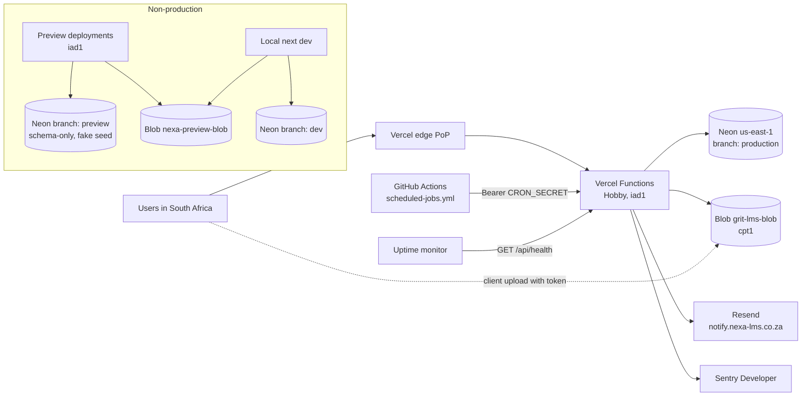
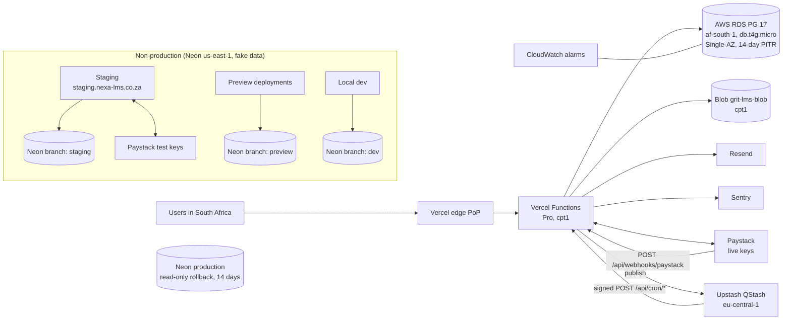

# Deployment, environments and operations

**Answer first.** Deployment runs in two stages. **Stage 1 (now to January 2027)** keeps today's free stack: Vercel Hobby with functions in `iad1`, Neon Postgres in us-east-1 (a `production` branch, a schema-only `preview` branch with fake data, and a `dev` branch), GitHub Actions for scheduled jobs, and a **separate Blob store for Preview and local work**, so no preview build can touch live files or live rows again. **Stage 2 (January 2027, before the first payment in February 2027)** moves production to Vercel Pro with functions in `cpt1` and AWS RDS Postgres 17 in af-south-1, adds a `staging` environment on Neon, moves schedules to **Upstash QStash**, and switches production to Paystack live keys. Schema changes move from `prisma db push` to `prisma migrate`, starting from a baseline that is checked against production without running any DDL on it. Every job is a plain route handler that accepts either `CRON_SECRET` or a QStash signature, so moving from GitHub Actions to QStash changes the caller, not the code.

Status: draft for A2, 2026-11-16. Sources: [research/05-hosting.md](../research/05-hosting.md), [research/06-database.md](../research/06-database.md), [research/08-blob-cleanup.md](../research/08-blob-cleanup.md), `.github/workflows/scheduled-jobs.yml`, `package.json`, `next.config.ts`, `src/lib/email/config.ts`. Owner decisions in [research/SUMMARY.md](../research/SUMMARY.md) apply. Every cloud change below (plans, stores, branches, databases, env vars, migrations) needs the owner's approval first (AGENTS.md section 4).

**Judge0 and the coding automarker are parked (not in v1), so this file plans no runner VM.**

## 1. Today (2026-11-16)

| Item | State | Problem |
| --- | --- | --- |
| Hosting | Vercel Hobby, project `grit-lms`, functions `iad1`, URL `grit-lms.vercel.app` | Hobby is non-commercial only; fine until money flows |
| Database | Neon project `grit-lms-sb`, us-east-1, PG 17, ~35 MB, 6-hour restore window | **Preview and Production share `DATABASE_URL`** |
| Schema changes | `prisma db push`; `prisma/migrations/` holds 4 old folders (last `20260428013359_inital_mod_from_legacy`) that do not match the live schema; one `DATABASE_URL`, no `directUrl` | No reviewed, reversible migrations |
| Blob | Store `grit-lms-blob`, `cpt1`, 888.7 MB of 1 GB, 802 files; now connected to the project | **Preview shares the production token** |
| Scheduled jobs | `.github/workflows/scheduled-jobs.yml`: `/api/auto-submit` every 5 min, `/api/cron/notifications` hourly, Bearer `CRON_SECRET` | GitHub may run late and pauses schedules after 60 days without commits on a public repo |
| Email | Resend dev sender (`onboarding@resend.dev`) until `EMAIL_FROM` is set | Domain `notify.nexa-lms.co.za` not live yet |
| Monitoring | None. Hobby keeps runtime logs for 1 hour | Nobody hears about errors |

## 2. Environments

| Environment | Stage 1 | Stage 2 | Deploys from | Database | Blob | Email | Paystack | Scheduled jobs |
| --- | --- | --- | --- | --- | --- | --- | --- | --- |
| `dev` (local) | Yes | Yes | `next dev` on a laptop | Neon branch `dev` | Preview store | Resend dev sender, or log only | Test keys | Run by hand with `curl` |
| `preview` | Yes | Yes | Every pull request branch | Neon branch `preview` (schema-only, fake seed) | Preview store | Resend dev sender (reaches the owner only) | Test keys | None |
| `staging` | **No** | Yes | `main` | Neon branch `staging` (schema-only, fake seed) | Preview store | Verified domain, owner-only allow-list | Test keys, stable webhook URL | QStash, every 30 min, manual for the rest |
| `production` | Yes | Yes | `main` (Stage 1); `production` branch (Stage 2) | Neon `production` (Stage 1); RDS af-south-1 (Stage 2) | `grit-lms-blob` | `notify.nexa-lms.co.za` | Test keys (Stage 1); **live keys** (Stage 2) | GitHub Actions (Stage 1); QStash (Stage 2) |

**Decision taken here: no separate staging in Stage 1.** Hobby has no custom environments, there is one deployer, no paying users and no live payments, so Preview on the `preview` branch is the staging check. Alternative: a long-lived `staging` git branch whose preview URL acts as staging; rejected because it adds a branch to keep in sync for no extra safety. Staging arrives in Stage 2 because Paystack test webhooks need one stable URL (`staging.nexa-lms.co.za`) and live keys need a place to stay out of.

**Decision taken here (Stage 2): production deploys from a `production` git branch**, fast-forwarded from `main` by the owner after staging passes. `main` auto-deploys to `staging` (a Vercel custom environment). Alternative: keep production on `main` with "auto-assign production domain" off and promote by hand; rejected because a staged production build already talks to the live database. How many custom environments Pro allows is **Unverified**; one is enough.

Preview deployments keep Vercel's default Standard Deployment Protection (sign-in required). Webhooks that must reach a preview use the "Protection Bypass for Automation" secret (availability on Hobby **Unverified**).

## 3. Stage 1: now to January 2027



### 3.1 Neon branches

| Branch | Made from | Data | Role used by the app | Who writes |
| --- | --- | --- | --- | --- |
| `production` (root) | n/a | Live | Today's owner role (Stage 1); a DML-only role is a Stage 2 item | The app; migrations through the workflow in 3.4 |
| `preview` | `production`, **schema-only** | Fake, from `scripts/seed/index.ts` | `nexa_preview`, created on this branch only | Preview builds; the reset workflow |
| `dev` | `production`, **schema-only** | Fake, same seed | `nexa_dev`, created on this branch only | Developers |

- Schema-only branches copy the schema and no rows. If Neon's schema-only option is not available on the plan (**Unverified**), use a separate Neon project for non-production instead. Never create a full-data branch for preview.
- **Decision taken here:** each non-production branch gets its own role created on that branch. A child branch can inherit the parent's roles and passwords (**Unverified** for this plan), and a leaked preview URL must not hold a password that also opens production.
- Neon free-plan branch and compute limits are **Unverified**; three branches plus a short-lived check branch fit any plan we have seen.

### 3.2 Seed script

- `scripts/seed/index.ts` runs `seedTenancy()` (A, `scripts/seed/tenancy.ts`: workspaces, memberships, learners, guardians, enrolments) and `seedLearning()` (B supplies `scripts/seed/learning.ts`: courses, lessons, tests, assignments).
- Names come from a fixed fake list. Emails use `@example.test`. The password for every seeded user comes from `SEED_USER_PASSWORD` in the environment, never from the repo.
- `assertNotProduction()` runs first and stops unless `VERCEL_ENV !== "production"`, `SEED_ALLOWED=1` is set, and the database host is not in `PRODUCTION_DB_HOSTS` (a comma list kept in env).
- Seed uses at most five small fixture files (under 200 KB each) from `scripts/seed/fixtures/`, uploaded to the preview Blob store.
- `.github/workflows/reset-preview-db.yml` (manual): `prisma migrate reset --force --skip-seed` on the `preview` branch, then the seed. Used when two pull requests leave the preview schema in a bad state.

### 3.3 Blob for Preview and dev

Today Preview writes to `grit-lms-blob` with the production token, and local work may have too (research 08 lists likely orphans from that).

| Option | Isolation | Hobby limits | Work |
| --- | --- | --- | --- |
| **A. Separate store `nexa-preview-blob`**, connected to Preview and Development only | Full: the preview token cannot read or delete production files | Hobby Blob limits apply per account, not per store (**Guess**), so preview use counts against the same 1 GB and 2,000 advanced operations a month | Owner creates and connects the store (free); remove the production token from Preview |
| B. Same store, `preview/` path prefix | None: same token can delete any production file | Same shared limits | One line in `src/lib/blob/paths.ts` |

**Decision taken here: option A.** The prefix gives no protection, which is the point of the change. To protect the shared Hobby allowance until Stage 2:
- `issueUploadToken` in `src/lib/blob/server.ts` caps `maximumSizeInBytes` at 5 MB when `VERCEL_ENV !== "production"`.
- The preview store is emptied monthly with `scripts/blob-wipe-preview.ts` (refuses any token whose store id is not the preview store). Each wipe needs the owner's go-ahead unless the owner gives a standing yes for this store only (**Open question**).
- On Vercel Pro (Stage 2) Blob is billed per GB (about R0.46 per GB-month in `cpt1`), so the shared-limit worry ends.

### 3.4 Prisma: from `db push` to `migrate`

Order: split the schema into `prisma/schema/*.prisma` first (Phase 0, no database change), then baseline. With a multi-file schema the `migrations` folder sits next to the file that holds the `datasource` block (**Unverified** for the exact Prisma 6.x version; check before the PR). Flag names below are Prisma 5/6 (`--to-schema-datamodel`); newer versions rename it `--to-schema`.

Datasource change (A, `prisma/schema/core.prisma`):

```prisma
datasource db {
  provider  = "postgresql"
  url       = env("DATABASE_URL")   // pooled (Neon -pooler host)
  directUrl = env("DIRECT_URL")     // direct, for migrate
}
```

Baseline, safely (each step against production needs the owner's approval):

| Step | Where | Command or action | Writes? |
| --- | --- | --- | --- |
| 1 | New schema-only branch `baseline-check` from `production` | `npx prisma migrate diff --from-url "$CHECK_DIRECT_URL" --to-schema-datamodel prisma/schema --exit-code` | No. Exit 0 means the live schema equals the repo schema. Exit 2: print with `--script`, reconcile by hand, repeat |
| 2 | Same branch | `SELECT migration_name, finished_at FROM _prisma_migrations` (if the table exists) | No |
| 3 | Repo | Move the four old folders to `prisma/migrations-archive/` (kept for history, never applied) | No |
| 4 | Repo | `npx prisma migrate diff --from-empty --to-schema-datamodel prisma/schema --script > <migrations>/0_baseline/migration.sql` | No |
| 5 | Fresh empty branch | `prisma migrate deploy`, then step 1's diff against it | Only the throwaway branch. Proves the baseline rebuilds the schema (used by `dev`, `preview`, `staging`, RDS) |
| 6 | `baseline-check` | If step 2 found rows: `DELETE FROM _prisma_migrations`. Then `npx prisma migrate resolve --applied 0_baseline`, then `prisma migrate status` | Metadata only |
| 7 | `production` | Repeat steps 1, 2 and 6, after a dump (section 6) | **Metadata only, no DDL**. Owner approval |

After the baseline:
- **Local:** `prisma migrate dev` against `dev`, with `SHADOW_DATABASE_URL` pointing to a `shadow` branch.
- **Preview:** a `vercel-build` script runs `prisma migrate deploy` only when `VERCEL_ENV === "preview"`, then `next build`. Production builds never migrate.
- **Production:** `.github/workflows/db-migrate.yml`, manual dispatch, GitHub environment `production` with the owner as required reviewer, runs `prisma migrate deploy` with `DIRECT_URL`. Run it before the deploy that needs it.
- Migrations are expand-then-contract: add columns and tables first; drop them in a later release once no code reads them. Destructive SQL in a migration needs a note in the pull request and a snapshot first.
- `db push` stays forbidden against `production` and `staging`. In Stage 2 the app role on RDS (`nexa_app`) has no DDL rights; only `nexa_migrator` owns the schema.

### 3.5 Stage 1 limits to watch

| Limit (Hobby) | Effect | Mitigation |
| --- | --- | --- |
| Non-commercial use | No payments before Stage 2 | Paystack live keys only after Pro |
| Blob 1 GB, then 30 days blocked | Uploads and file views stop | Audit and clean (research 08); 5 MB cap on previews |
| Runtime logs kept 1 hour | No history | Sentry is the record |
| Cron once a day | Not used | GitHub Actions |

## 4. Stage 2: January 2027, before the first payment (February 2027)



| Week (2027) | Step | Owner approval |
| --- | --- | --- |
| Early January | Upgrade Vercel to Pro (one seat, R340/month); spend alert at $40. Create the staging custom environment and `staging` Neon branch | Yes |
| Early January | QStash account; register schedules from the job registry (section 5); turn off the GitHub schedules the same day | Yes |
| Mid January | Create RDS (settings in research 06 §6); app and migrator roles; rehearse the move on a Neon branch dump | Yes |
| Late January | Maintenance window: database and `cpt1` region move together (section 8) | Yes |
| Before 1 February | Paystack live keys in Production only; R10 end-to-end test of subscription, split checkout and refund; restore drill on RDS | Yes |

Stage 2 monthly cost: Vercel Pro R340 + RDS R374 + QStash R0-R51 + Sentry R0 + uptime R0, so about **R714-R765** before Paystack fees (research 05 and 06).

## 5. Jobs and the queue

**Decision taken here: QStash, not Inngest** (research 05 §7). QStash calls plain HTTP routes we already have, its free tier (1,000 messages a day, 10 schedules) covers launch, and paid use costs about R17 per 100,000 messages. Inngest needs its SDK inside every handler and jumps to $99 a month once past 50,000 executions. Vercel Cron (Pro) stays the fallback: it calls the same routes with the same Bearer `CRON_SECRET`.

How a job is written, so the caller can change without code changes:

| Piece | File (A owns) | What it does |
| --- | --- | --- |
| Verifier | `src/lib/jobs/verify.ts` `verifyJobRequest(req)` | Accepts `Authorization: Bearer $CRON_SECRET` (GitHub Actions, Vercel Cron, manual curl) or a valid `Upstash-Signature` checked with `Receiver` from `@upstash/qstash` (`QSTASH_CURRENT_SIGNING_KEY`, `QSTASH_NEXT_SIGNING_KEY`). Constant-time compare. Fails closed when no secret is set |
| Route factory | `src/lib/jobs/define.ts` `defineJob(name, run)` | Returns `{ GET, POST }`; verifies, writes a `JobRun` row (start, end, ok, counts, no personal data), drops a duplicate `Upstash-Message-Id`, returns `{ ok, nextCursor? }` |
| Registry | `src/lib/jobs/registry.ts` | Job name, path, schedule, `maxDuration`. The GitHub workflow is edited by hand to match in Stage 1; `scripts/qstash-sync-schedules.ts` creates the QStash schedules from it in Stage 2 |
| Enqueue | `src/lib/jobs/enqueue.ts` `enqueue(job, payload, { dedupeKey })` | Stage 1: runs the job in the same request with `after()` from `next/server`. Stage 2: `publishJSON` to QStash with `deduplicationId`. Callers never change |
| Routes | `src/app/api/cron/<job>/route.ts`: `export const { GET, POST } = defineJob(...)`, one file per job so each sets its own `maxDuration` | Job logic stays in the owning feature (`src/features/notifications/jobs.ts`, `src/features/billing/jobs.ts`; auto-submit logic moves to `src/features/assessments/jobs.ts` with B's agreement) |

| Job | Path | Schedule (UTC) | Owner of logic |
| --- | --- | --- | --- |
| Auto-submit expired attempts | `/api/cron/auto-submit` (today `/api/auto-submit`, kept as an alias until the scheduler moves) | Every 5 min | B |
| Notifications and digests | `/api/cron/notifications` | Hourly | A |
| Billing daily (metering, trial ends, dunning) | `/api/cron/billing-daily` ([03-billing.md](03-billing.md)) | `0 23 * * *` | A |
| `JobRun` prune (older than 30 days) | `/api/cron/housekeeping` | Daily | A |
| Retention deletes (section 6.1) | `/api/cron/retention` | Daily | A |

Every job must be idempotent: QStash delivers at least once and GitHub can double-run. Auto-submit already is (it updates only `IN_PROGRESS` rows). `JobRun` lives in `prisma/schema/core.prisma` (A). `src/lib/jobs/**` is not in the AGENTS.md map; A claims it as infrastructure and notes this in HANDOFF.md.

## 6. Backups and restore drill

| | Stage 1 (Neon) | Stage 2 (RDS) |
| --- | --- | --- |
| Point-in-time restore | 6-hour history window (current plan) | Automated backups, **14 days**, deletion protection on |
| Extra copy | **Weekly** `pg_dump -Fc` (owner decision; daily if demand grows), encrypted with `age` to the owner's public key, uploaded to the private Tigris bucket **`nexa-lms-backups`** in Johannesburg (`jnb`, created 2026-11-16) under `db/YYYY-MM-DD.dump.age`, with a 30-day expiry rule. The owner runs it by hand at first; `.github/workflows/db-backup.yml` automates it once the owner adds the Tigris and read-only database secrets. Moves to S3 af-south-1 with the full AWS transition | Monthly `pg_dump` to the same bucket; manual snapshot before every migration |
| Never | Dumps as GitHub artifacts or in the repo (children's personal data) | Snapshots copied out of af-south-1 |
| Drill | Once before Stage 2: Neon restore to a timestamp as a new branch, `scripts/check-restore.ts` compares row counts and the newest `createdAt` per table, then delete the branch | Before 1 February, then quarterly: PITR to a new instance `nexa-restore-drill`, same check script, then delete it |
| Record | `docs/revamp/a/ops/restore-log.md`: date, target time, minutes to restore (RTO), data lost (RPO) | Same |

Targets: RPO 5 minutes and RTO 2 hours in Stage 2 (**Guess**; confirm after the first drill). Every backup workflow reads production, so it needs the owner's go-ahead before it is turned on.

### 6.1 Data retention and how it meets backups

Owner decision (16 November 2026): a workspace's data is kept until **2 months after its last payment**, then deleted. Financial records (invoices, payments, refunds, payouts, usage records) are kept, as set in [02-identity.md](02-identity.md) and [03-billing.md](03-billing.md).

| Piece | Design |
| --- | --- |
| Clock | `Workspace.retentionDeleteAfter` = last successful payment + 2 months, recomputed by the billing daily job ([03-billing.md](03-billing.md)). A workspace that never paid uses the trial end date instead (**Decision taken here**; alternative: the creation date) |
| Warning | Emails to the owner at 30 and 7 days before the date (through the notifications job) |
| Deletion | `/api/cron/retention` (daily, A, `src/features/workspaces/retention.ts`): deletes tenant rows and the workspace's Blob files by exact URL from the database, keeps financial rows with personal fields reduced to name and invoice details, writes one `AuditLog` row with counts only. Dry-run mode lists what it would delete; the first real runs need the owner's approval |
| Backups | Deleted rows stay in RDS PITR for up to 14 days and in logical dumps for up to 30 days, then age out. Backups are never edited. A restore from backup re-runs the retention job before the database goes live, so deleted workspaces do not come back |
| Preview and staging | Fake data only, so no retention work |

## 7. Secrets and environment variables

Values live only in Vercel environment variables (marked Sensitive), GitHub Actions secrets in a protected environment, AWS (RDS master password in the owner's password manager, not in Vercel), and local `.env.local` from `vercel env pull` (Development values only). `.env*` is already git-ignored. `src/lib/env.ts` (A) validates required names with zod at build time and fails a production build when one is missing. No value ever goes into the repo, a pull request, a log line or chat.

| Variable | Dev | Preview | Staging (S2) | Production | Notes |
| --- | --- | --- | --- | --- | --- |
| `DATABASE_URL` | Neon `dev`, pooled | Neon `preview`, pooled | Neon `staging`, pooled | Neon `production` pooled (S1); RDS app role, `sslmode=require&connection_limit=5` (S2) | Different on every row; Preview **must** change now |
| `DIRECT_URL` | `dev` direct | `preview` direct | `staging` direct | Neon direct (S1); RDS migrator role (S2) | Migrations only. Also a GitHub secret in environment `production` |
| `SHADOW_DATABASE_URL` | Neon `shadow` | – | – | – | `migrate dev` only |
| `NEXTAUTH_SECRET` | Own value | Own value | Own value | Own value | NextAuth v4 today. After the Better Auth move ([02-identity.md](02-identity.md)) becomes `BETTER_AUTH_SECRET` plus `BETTER_AUTH_URL`. **Decision taken here:** do not also set `AUTH_SECRET`; one name per library |
| `NEXTAUTH_URL` / `NEXT_PUBLIC_APP_URL` | `http://localhost:3000` | Unset (falls back to the deployment URL) | `https://staging.nexa-lms.co.za` | `https://nexa-lms.co.za` | Used by `src/lib/email/config.ts` for links |
| `CRON_SECRET` | Own value | Own value | Own value | Own value; same value as GitHub secret `CRON_SECRET` | Rotate yearly and when someone leaves |
| `BLOB_READ_WRITE_TOKEN` | Preview store | Preview store | Preview store | `grit-lms-blob` | Preview loses the production token in Stage 1 |
| `VERCEL_BLOB_*` (added when a store is connected) | Preview store | Preview store | Preview store | `grit-lms-blob` | Exact names: owner checks with `vercel env ls` (names only) |
| `RESEND_API_KEY` | Sending key, dev | Same dev key | Domain key, staging | Domain key, sending-only, production | Separate keys so one can be revoked alone |
| `EMAIL_FROM`, `EMAIL_REPLY_TO` | Unset (dev sender) | Unset | `Nexa <staging@notify.nexa-lms.co.za>` | `Nexa <hello@notify.nexa-lms.co.za>` | |
| `PAYSTACK_SECRET_KEY`, `NEXT_PUBLIC_PAYSTACK_PUBLIC_KEY` | Test | Test | Test | Test (S1); **live (S2)** | Webhook signature is HMAC-SHA512 of the raw body with the secret key, so there is no separate webhook secret |
| `QSTASH_TOKEN`, `QSTASH_CURRENT_SIGNING_KEY`, `QSTASH_NEXT_SIGNING_KEY` | – | – | Own | Own (S2) | |
| `SENTRY_DSN` / `NEXT_PUBLIC_SENTRY_DSN` | Unset | Set | Set | Set | Environment tag from `VERCEL_ENV` |
| `SENTRY_AUTH_TOKEN` | – | Build only | Build only | Build only | Source-map upload |
| `REVAMP_UI`, `BILLING`, `CODING`, `AI_MARKING` | Any | Per PR | `1` while testing | Off until released | Flags; `CODING` stays off (parked) |
| `SEED_ALLOWED`, `SEED_USER_PASSWORD`, `PRODUCTION_DB_HOSTS` | Set | Set | Set | **Never set** (`PRODUCTION_DB_HOSTS` is set everywhere else) | Seed guard |
| `MAINTENANCE_MODE` | – | – | – | `1` only during the move | Read by middleware; blocks writes |

Rotation: on a suspected leak, rotate at the provider, update Vercel and GitHub, redeploy, and note it in HANDOFF.md. Rotating the auth secret signs everyone out, so do it in a quiet hour.

## 8. Database move runbook (summary)

Full plan: [research/06-database.md §6](../research/06-database.md). Nothing runs against Neon production without the owner's written go-ahead, including the read-only dump.

1. Before: owner approves cost and window; create RDS (PG 17, `db.t4g.micro`, gp3 20 GB, encrypted, 14-day backups, deletion protection, `rds.force_ssl=1`); create `nexa_migrator` and `nexa_app`; rehearse with a dump of a schema-and-data copy branch into RDS from a `cpt1` preview; time each step; pre-set `DATABASE_URL` and `DIRECT_URL` for Production; prepare the commit adding `"regions": ["cpt1"]` to a root `vercel.json`; warn users by email and banner.
2. Window (~30 min): `MAINTENANCE_MODE=1` and pause QStash schedules; wait for in-flight attempts; `pg_dump -Fc --no-owner --no-privileges` from Neon's direct endpoint; `pg_restore --no-owner --role=nexa_migrator` into RDS; verify row counts, `_prisma_migrations` and sequences; swap env vars and deploy the `cpt1` commit; smoke test (tutor and student sign-in, open a course, take and submit a test, upload a file, `/api/health` green); lift maintenance; resume schedules.
3. Rollback: before go-live, point env vars back to Neon and revert the region commit together. After go-live, fix forward, or copy rows written since the cutover timestamp back to Neon in a second window. Functions and database always move together.
4. After: CloudWatch alarms (section 9); snapshot before the first migration; Neon production stays read-only for 14 days, then, with the owner's approval, its data is removed and Neon keeps only non-production branches; update the operator list in [research/09-compliance.md](../research/09-compliance.md).

## 9. Monitoring and alerting

| Signal | Tool | Alert when | Goes to |
| --- | --- | --- | --- |
| Unhandled errors (server and browser) | Sentry Developer (free, 5k errors/month, one user), `@sentry/nextjs`, `sendDefaultPii: false`, `beforeSend` strips emails and names | New issue, or more than 20 events in 10 minutes | Owner's email |
| Site up | Uptime monitor on `GET /api/health` every 3-5 minutes (free tier of a hosted checker, for example Better Stack; tier limits **Unverified**) | 2 failures in a row | Email and phone push |
| Jobs running | `/api/health` returns 503 when the last good `auto-submit` `JobRun` is older than 20 minutes or `notifications` older than 2 hours | Through the uptime monitor | Same |
| Database (S2) | CloudWatch alarms to an SNS email topic | CPU over 70%, free storage under 5 GB, CPU credit balance low, connections over 60 | Owner's email |
| Spend (S2) | Vercel Spend Management; AWS Budgets | Vercel $40; AWS $30 a month | Owner's email |
| Payments (S2) | Sentry plus `/api/health` count of unprocessed `PaymentEvent` rows older than 15 minutes ([04-payments.md](04-payments.md)) | Any | Owner's email |
| Blob size (S1) | Monthly check of store size in the dashboard (one look, not paging) | Over 900 MB | Owner |

`src/app/api/health/route.ts` (A) runs `SELECT 1` with a 2-second timeout and reads the latest `JobRun` per job. It returns only `ok` flags and ages, never data. Sentry moves to Team (about R442-R493 a month) when a second person needs alerts.

## Issues with 01

None. This file only adds `JobRun` to `core.prisma` and does not change any tenancy entity.

## Open questions

1. May the preview Blob store be emptied monthly without a fresh approval each time (a standing yes for `nexa-preview-blob` only)?
2. Answered: weekly encrypted dumps to Tigris `nexa-lms-backups` (jnb) in Stage 1, daily if demand grows.
3. Is Neon's schema-only branching available on the current plan? If not, may we use a separate Neon project for non-production?
4. Which uptime checker does the owner prefer (Better Stack, UptimeRobot, or another free tier)?
5. Confirm the Stage 2 release flow: `main` to staging automatically, `production` branch fast-forwarded by the owner.
