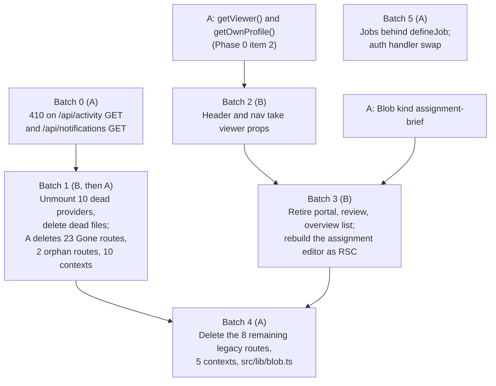

# Legacy routes and contexts: inventory and replacement

**Answer first.** There are **37 route files** under `src/app/api/**` and **15 contexts** under `src/context/**`. Most of the work is already done: 23 route files return only `410 Gone`, 4 must stay as routes (auth, two cron jobs, the Blob upload token), and only **10 route files still do real work**. Of those, 8 serve the four legacy assignment pages under `/dashboard/submissions/(…)` and `portal/`, and 2 (`/api/activity`, `/api/notifications`) serve no screen at all. Those 2 are still called on every page load by global providers, and **both let any signed-in user read another user's rows**. The replacements for nearly everything already exist as server actions and queries. A adds `getViewer()`, `getOwnProfile()` and one Blob upload kind. B moves the header, the nav and the assignment editor off the contexts. The work runs in six batches. The rule is fixed: replace first; delete only after B confirms no page calls the route and the owner has tested.

Status: draft for A2, 2026-11-16. Read from every `route.ts`, every file in `src/context/`, and a search for `fetch`, `axios` and `use<Name>()` calls across `src/` on this date. "Dead" means the file is imported nowhere (checked with a search, not a build). Ownership follows AGENTS.md section 2: A owns `src/app/api/**`, `src/lib/{auth,db,safe-action,api-guard,email,blob}*`, `src/lib/viewer.ts` and the features `users`, `notifications`, `parents`, `billing` and friends; B owns the pages and the features `courses`, `lessons`, `assessments`, `submissions` (to become `assignments`), `events` (to become `calendar`), `grades` and `activity`.

## 1. Findings that change the order

| Finding | Evidence | Effect |
| --- | --- | --- |
| **IDOR on `/api/activity` GET** | Checks only that a token exists, then filters by any `userId` or `courseIds` from the query string. Returns rows with the user's `name` and `email` | Any signed-in user can read anyone's activity. Fix in Batch 0 |
| **IDOR on `/api/notifications` GET** | Same pattern with `studentId` and `courseIds` | Any signed-in user can read anyone's notifications. Fix in Batch 0 |
| Global providers fetch on every page and nobody reads the result | `src/app/providers.tsx` mounts `ProfileProvider`, `CoursesProvider`, `NotificationProvider` and `ActivityLogProvider` in the root layout. The last two call `/api/courses?studentId=…` (with a heavy `include`) and then their own route in `useEffect`. No component calls `useNotifications()` or `useActivityLog()` | About 5 wasted function calls per page view per signed-in user, and the IDOR routes are hit all the time |
| 11 legacy providers wrap every dashboard page | `src/app/dashboard/dashboard-shell.tsx` | 8 of them have no consumer left |
| `ProfileContext.updateProfile` PUTs to `/api/profile`, which has no PUT | `src/context/ProfileContext.tsx` | Returns 405. Nothing calls it; `updateOwnProfile` in `src/features/users/actions.ts` replaced it |
| Four legacy assignment pages still use contexts | `submissions/(tutor)/create/[[...id]]`, `(tutor)/overview/[id]/(overview)`, `(student-details)/review/[id]`, `portal/[id]` | Only **create** is still linked (from `submissions/page.tsx` and `tutor-submission-actions.tsx`). `portal`, `review` and the overview list are reachable only by typed URL or from each other |
| Dead legacy files still import contexts | `src/app/dashboard/calendar/{student,tutor}-calendar.tsx`, `src/app/dashboard/tests/hooks/use-test-session.ts`, every file in `src/app/dashboard/tests/components/` | Imported nowhere outside their own folders. Deleting them removes the last consumers of `TestContext` and `TestSubmissionContext` |

## 2. Route inventory

Status: **Live** (does work, has a caller), **Orphan** (does work, nothing reads the result), **Gone** (every handler returns 410), **Keep** (must stay a route).

### 2.1 Routes that still do work

| # | Path | Methods | What it does | Auth guard | Called by | Replacement (exists unless marked new) | Replacement owner | Caller owner | Batch |
| --- | --- | --- | --- | --- | --- | --- | --- | --- | --- |
| 1 | `/api/activity` | GET live; POST 410 | Last 20 `ActivityLog` rows for a `userId` and/or `courseIds`, with user name and email | Token exists only (**IDOR**) | `ActivityLogContext` auto-fetch in `providers.tsx`; no screen reads it | None needed. If a feed is wanted later: `listRecentActivity(viewer)` (new) in `src/features/activity/queries.ts` | B | B | 0 (410), 1 (delete) |
| 2 | `/api/notifications` | GET live; PUT 410 | Notifications for a `studentId` and/or `courseIds`, with course and student names | Token exists only (**IDOR**) | `NotificationsContext` auto-fetch in `providers.tsx`; no screen reads it | `listNotifications`, `getUnreadCount` in `src/features/notifications/queries.ts`; `markNotificationRead`, `markAllNotificationsRead`, `getNotificationsForBell` in `src/features/notifications/actions.ts` | A | B | 0 (410), 1 (delete) |
| 3 | `/api/profile` | GET | The caller's `Student` or `Tutor` row by token email, or `{ id, fullName, email }` for admin and parent | Token with `id` and `role`; reads only the caller's own row | `ProfileContext` (root, every page). Read by `models/header.tsx` (`fullName`, `imageUrl`/`profileImageUrl`), `models/nav.tsx` (`fullName`, `email`), the create page (`profile.id` as tutor id), review and portal | `getViewer()` in `src/lib/viewer.ts` (new, [contracts/viewer.md](../../contracts/viewer.md)) for name, email, role and ids; `getOwnProfile(viewer)` (new) in `src/features/users/queries.ts` for the avatar URL | A | B | 2 |
| 4 | `/api/courses` | GET (POST removed, so 405) | Courses with tutor, students, lessons, quizzes, tests, submissions and events, filtered by `tutorId`, `studentId` or `ids` | `requireApiSession` + `visibleCoursesWhere` | `CourseContext`: create (`fetchCoursesByTutorId`), overview, review, portal (`fetchCoursesByIds`); also the two orphan providers | `listCoursesByTutorId`, `listCoursesByIds` in `src/features/courses/queries.ts`. In Phase 1 these become viewer-scoped through `withWorkspace(viewer)` ([01-tenancy-roles.md](01-tenancy-roles.md) §4) | B | B | 3 |
| 5 | `/api/events` | POST live; GET 410 | Creates a `CourseEvent` and emits a notification | `requireApiRole("TUTOR")` + `tutorOwnsCourse` | `EventContext.createEvent` in the create page (adds the due date to the calendar after saving) | `createCourseEvent` in `src/features/events/actions.ts` | B | B | 3 |
| 6 | `/api/submissions` | GET, POST | GET: assignments by `courseId`, `tutorId`, `studentId` or `id`, inside visible courses. POST: create an assignment and notify students | GET: session + `visibleCoursesWhere`. POST: tutor + `tutorOwnsCourse` | `SubmissionContext`: `fetchSubmissionById` (create, overview, review, portal), `createSubmission` (create) | `getSubmissionDetailById` with `studentCanAccessSubmission` / `submissionBelongsToTutor` (`src/features/submissions/queries.ts`); `createSubmission` (`src/features/submissions/actions.ts`) | B | B | 3 |
| 7 | `/api/submissions/[id]` | PUT, DELETE | Update (and notify) or delete an assignment | Tutor + owns the assignment's course | `SubmissionContext.updateSubmission` (create, edit mode); `deleteSubmission` (overview list) | `updateSubmission`, `deleteSubmission` in `src/features/submissions/actions.ts` | B | B | 3 |
| 8 | `/api/submission-entry` | GET, POST | GET: entries visible to the caller. POST: a student hands in; writes `ActivityLog`, calls `notifyHandIn` | GET: session + `visibleEntriesWhere`. POST: student, enrolled, assignment open | `SubmissionEntryContext`: `fetchEntriesBySubmissionId` (overview), `fetchEntryByStudentIdSubId` (review, portal), `createEntry` (portal) | `listEntriesForSubmission`, `getEntryByStudentAndSubmission` (queries); `submitEntry` (actions) | B | B | 3 |
| 9 | `/api/submission-entry/[id]` | PUT, DELETE; GET 410 | PUT: student resubmits own entry. DELETE: tutor removes an entry | PUT: student, entry's email matches. DELETE: tutor owns the course | `updateEntry` (portal); `deleteEntry` (overview list) | PUT: `submitEntry` (already handles resubmission and `maxAttempts`). DELETE: **no action exists**; `deleteEntry` (new) in `src/features/submissions/actions.ts`, or drop the feature (**Open question** for B) | B | B | 3 |
| 10 | `/api/upload` | POST live; DELETE 410 | Server-side `put()` of a form file to `<folder>/<name>` or the store root, public, random suffix; 4.5 MB body limit | `requireApiSession` (any role) | `uploadFile` in `src/lib/blob.ts`, used by the create page (assignment brief files, live), portal (orphan), `tests/components/question-input.tsx` (dead) | `uploadFile` in `src/lib/blob/client.ts` (client upload through `/api/blob/upload-token`) with a new kind `assignment-brief` → `submissions/<submissionId>/brief/<name>`, tutor only (new, `src/lib/blob/paths.ts` and the token route) | A | B | 3 |

### 2.2 Routes that must stay routes

| # | Path | Methods | What it does | Auth guard | Why it stays a route | Change planned |
| --- | --- | --- | --- | --- | --- | --- |
| 11 | `/api/auth/[...nextauth]` | GET, POST | NextAuth v4 handler | NextAuth | The auth library needs an HTTP endpoint for sign-in, callbacks and session | Replaced by `/api/auth/[...all]` for Better Auth ([02-identity.md](02-identity.md)), in the same PR that swaps the library |
| 12 | `/api/auto-submit` | GET | Closes `IN_PROGRESS` test attempts past their deadline plus grace | Bearer `CRON_SECRET`; 500 if unset in production | Called by a scheduler from outside (GitHub Actions now, QStash later) | Moves to `/api/cron/auto-submit` with `defineJob` ([06-deployment.md](06-deployment.md) §5); old path kept as an alias until the scheduler is switched |
| 13 | `/api/cron/notifications` | GET | `runNotificationJobs()`: due-date, study and grading reminders, email digests | Same | Same | Wrapped in `defineJob`; adds POST for QStash |
| 14 | `/api/blob/upload-token` | POST | Issues a signed client-upload token after checking session, role and pathname per kind; handles Blob's upload-completed callback | Session + `assertRoleAllowsKind` | `@vercel/blob` client uploads need a server URL that signs tokens and receives the completion callback; files go straight to Blob, avoiding the 4.5 MB function body limit | Gains `assignment-brief`; in Phase 1 the role check becomes a viewer permission check (`courses.edit`, `content.view`) |

New routes this design adds (all A): `/api/health` (uptime check, [06](06-deployment.md) §9), `/api/cron/<job>` for each scheduled job, `/api/webhooks/paystack` (provider callbacks must be HTTP; [04-payments.md](04-payments.md)), and the Better Auth handler. Webhooks and jobs stay routes because outside systems call them with a signature or secret, not a browser session.

### 2.3 Routes that already return 410 Gone

All 23 have no caller left (the context methods that hit them are unused, or the callers are dead files). Each was replaced before this session. Batch 1 deletes them.

| # | Path | Methods (all 410) | Was | Replaced by (owner) | Context that still names the URL |
| --- | --- | --- | --- | --- | --- |
| 15 | `/api/courses/[id]` | PUT, DELETE | Edit or delete a course | `updateCourse`, `deleteCourse` in `src/features/courses/actions.ts` (B) | `CourseContext` |
| 16 | `/api/events/[id]` | GET, PUT, DELETE | Read, edit, delete an event | `src/features/events/queries.ts`; `updateCourseEvent`, `deleteCourseEvent` (B) | `EventContext` |
| 17 | `/api/grades` | GET, POST | Grades by student, course, type | `src/features/grades/queries.ts`; grading actions in `assessments/actions.ts`, `submissions/actions.ts` (B) | `GradeContext` |
| 18 | `/api/grades/[id]` | GET, PUT, DELETE | One grade | Same (B) | `GradeContext` |
| 19 | `/api/grades/submission` | GET, POST | Grade for an entry | Same (B) | `GradeContext` |
| 20 | `/api/grades/submission/[submissionId]` | GET | Grade by assignment | Same (B) | none |
| 21 | `/api/lesson-completions` | GET, POST | Completions by student or lesson | `src/features/lessons/queries.ts`; `markLessonComplete`, `unmarkLessonComplete` (B) | `LessonCompletionContext` |
| 22 | `/api/lesson-completions/[id]` | GET, PUT, DELETE | One completion | Same (B) | `LessonCompletionContext` |
| 23 | `/api/lessons` | GET, POST | Lessons by course; create | `src/features/lessons/queries.ts`; `createLesson` (B) | `LessonContext` |
| 24 | `/api/lessons/[id]` | PUT, DELETE | Edit, delete a lesson | `updateLesson`, `deleteLesson` (B) | `LessonContext` |
| 25 | `/api/login` | POST | Old custom sign-in | NextAuth credentials provider (A) | none |
| 26 | `/api/notifications/[id]` | PUT | Toggle `isRead` | `markNotificationRead`, `markNotificationUnread` (A) | `NotificationsContext` |
| 27 | `/api/question-grades` | GET, POST | Per-question grades | Grading actions (B) | `QuestionGradeContext` |
| 28 | `/api/question-grades/[id]` | GET, PUT, DELETE | One question grade | Same (B) | `QuestionGradeContext` |
| 29 | `/api/seed-users` | GET | Unauthenticated user seeding with fixed passwords | `createStudentUser` in `src/features/users/actions.ts` (A); fake data via `scripts/seed/` ([06](06-deployment.md) §3.2) | none |
| 30 | `/api/students` | GET, POST | List, create students | `listAllStudents` (`src/features/students/queries.ts`); `createStudentUser` (A) | `StudentContext` |
| 31 | `/api/students/[id]` | PUT, DELETE | Edit, delete a student | User-management actions in `src/features/users/actions.ts` (A) | `StudentContext` |
| 32 | `/api/test-submission` | GET, POST | Test attempts | `src/features/assessments/queries.ts` and actions (B) | `TestSubmissionContext` |
| 33 | `/api/test-submission/[id]` | GET, PUT, DELETE | One attempt | Same (B) | `TestSubmissionContext` |
| 34 | `/api/tests` | GET, POST | Tests by course; create | Same (B) | `TestContext` |
| 35 | `/api/tests/[id]` | PUT, DELETE | Edit, delete a test | Same (B) | `TestContext` |
| 36 | `/api/tutors` | GET, POST | List, create tutors | User-management actions (A) | `TutorContext` |
| 37 | `/api/tutors/[id]` | PUT, DELETE | Edit, delete a tutor | Same (A) | `TutorContext` |

## 3. Context inventory

"Live consumers" are pages B must move. "Dead consumers" are files imported nowhere, which B deletes. In the last column A supplies the query or action and B moves the page.

| Context | Provides | Mounted in | Routes it calls | Live consumers (B) | Dead consumers | Replacement | Batch |
| --- | --- | --- | --- | --- | --- | --- | --- |
| `ActivityLogContext` | `activities`, `fetchActivities`, `fetchActivitiesByCourseIds`, `fetchAllUserActivities`, `logActivity`; auto-fetch on session | `src/app/providers.tsx` (root) | `/api/activity` GET, POST; `/api/courses` via `useCourses` | None | None | None needed (activity is written server-side) | 1 |
| `CourseContext` | `courses`, fetch by tutor, student, ids; create, update, delete | `providers.tsx` (root) | `/api/courses` GET (POST 405); `/api/courses/[id]` (410) | create, overview, review, portal | `calendar/{student,tutor}-calendar.tsx`, `use-test-session.ts`; the two orphan contexts | `listCoursesByTutorId`, `listCoursesByIds` passed as props from an RSC page | 3 |
| `EventContext` | Events by course, one event; create, update, delete | `dashboard-shell.tsx` | `/api/events` POST (GET 410); `/api/events/[id]` (410) | create (`createEvent`) | Both calendars | `createCourseEvent` | 3 |
| `GradeContext` | Grades by student, entry, assignment, course, type; CRUD | `dashboard-shell.tsx` | `/api/grades/**` (410) | None | None | Exists in `src/features/grades/**` | 1 |
| `LessonCompletionContext` | Completions; CRUD | `dashboard-shell.tsx` | `/api/lesson-completions/**` (410) | None | None | Exists in `src/features/lessons/**` | 1 |
| `LessonContext` | Lessons by course; CRUD | `dashboard-shell.tsx` | `/api/lessons/**` (410) | None | None | Exists in `src/features/lessons/**` | 1 |
| `NotificationsContext` | Notifications; mark read, mark all read; auto-fetch on profile | `providers.tsx` (root) | `/api/notifications` GET (PUT 410); `/api/notifications/[id]` (410); `/api/courses` | None (the bell and the notifications page already use the actions) | None | Exists in `src/features/notifications/**` (A) | 1 |
| `ProfileContext` | `session`, `status`, `profile`, `fetchProfile`, `updateProfile` (broken, 405) | `providers.tsx` (root) | `/api/profile` GET | `models/header.tsx`, `models/nav.tsx`, create, review, portal | Both calendars, `use-test-session.ts` | `getViewer()` read once in `src/app/dashboard/layout.tsx` and passed down as props; `getOwnProfile(viewer)` for the avatar (A, new) | 2 (header, nav), 3 (pages) |
| `QuestionGradeContext` | Question grades; CRUD | `dashboard-shell.tsx` | `/api/question-grades/**` (410) | None | None | Exists (grading actions) | 1 |
| `StudentContext` | Students; CRUD | `dashboard-shell.tsx` | `/api/students/**` (410) | None | None | Exists (`listAllStudents`, users actions) | 1 |
| `SubmissionContext` | Assignments by course, tutor, student, id; CRUD | `dashboard-shell.tsx` | `/api/submissions`, `/api/submissions/[id]` | create, overview, review, portal | None | `getSubmissionDetailById`; `createSubmission`, `updateSubmission`, `deleteSubmission` | 3 |
| `SubmissionEntryContext` | Entries by assignment, student, id; CRUD | `dashboard-shell.tsx` | `/api/submission-entry`, `/api/submission-entry/[id]` | overview, review, portal | None | `listEntriesForSubmission`, `getEntryByStudentAndSubmission`, `submitEntry`; `deleteEntry` (new, or dropped) | 3 |
| `TestContext` | Tests by course, tutor, student, id; CRUD | `dashboard-shell.tsx` | `/api/tests/**` (410) | None | `use-test-session.ts` | Exists in `src/features/assessments/**` | 1 |
| `TestSubmissionContext` | Attempts; CRUD | `dashboard-shell.tsx` | `/api/test-submission/**` (410) | None | `use-test-session.ts` | Exists in `src/features/assessments/**` | 1 |
| `TutorContext` | Tutors; CRUD | `dashboard-shell.tsx` | `/api/tutors/**` (410) | None | None | Exists (users actions) | 1 |

## 4. Batches

| Batch | Who | What | Depends on | Risk | Owner test before any delete |
| --- | --- | --- | --- | --- | --- |
| **0. Close the two read leaks** | A | `/api/activity` GET and `/api/notifications` GET return 410. No page reads them, so nothing visible changes; the root providers get a 410 and keep an unseen error message. **Decision taken here:** 410 rather than adding ownership checks, since the data has no reader. Alternative: restrict `userId`/`studentId` to the caller, if B wants a few days' notice | Nothing | Low | Sign in as a tutor and as a student; open the dashboard, a course, the bell and the notifications page; check nothing breaks |
| **1. Dead weight** | B, then A | B removes `ActivityLogProvider` and `NotificationProvider` from `providers.tsx`. B removes `Student`, `Tutor`, `Lesson`, `Test`, `TestSubmission`, `Grade`, `QuestionGrade` and `LessonCompletion` providers from `dashboard-shell.tsx`. B deletes `calendar/student-calendar.tsx`, `calendar/tutor-calendar.tsx`, `tests/hooks/use-test-session.ts` and `tests/components/**`, after a build confirms nothing imports them. Then A deletes routes 1, 2 and 15-37, and the 10 contexts with no consumer left | Batch 0 | Low: the code is dead or returns 410 | Same walk-through, plus take a test and open the calendar |
| **2. Shell off `ProfileContext`** | A, then B | A ships `getViewer()` to [contracts/viewer.md](../../contracts/viewer.md) and `getOwnProfile(viewer)`. B reads the viewer in `src/app/dashboard/layout.tsx` and passes `{ name, email, avatarUrl, role }` to `DashboardShell`, `Header` and `Nav` | `viewer.md` written | Medium: every dashboard page renders the header | Each role (tutor, student, parent, admin): name, avatar and menu are correct; sign-out works |
| **3. Legacy assignment pages** | B (A supplies the Blob kind) | `portal/[id]`, `review/[id]` and `overview/[id]/(overview)` call `redirect()` to `/dashboard/submissions/[id]` (which already covers both roles). The create and edit page becomes an RSC page that loads courses with `listCoursesByTutorId` and the assignment with `getSubmissionDetailById`, plus a client form that calls `createSubmission`/`updateSubmission` and then `createCourseEvent`, and uploads with `uploadFile({ kind: "assignment-brief" })`. B decides whether tutors still need to delete a hand-in (`deleteEntry`). Afterwards B removes the remaining providers from the shell and from `providers.tsx` | Batch 2; A's Blob kind | Medium-high: the editor is the only live legacy page and it writes data | Create an assignment with a brief file and a due date; edit it; see it on the calendar; a student hands in and resubmits; the tutor grades; old portal and review links redirect |
| **4. Delete the rest** | A | Delete routes 3-10, `CourseContext`, `EventContext`, `SubmissionContext`, `SubmissionEntryContext`, `ProfileContext`, `src/lib/blob.ts`, then `src/context/` itself. Delete `src/lib/api-guard.ts` once no route imports it. Remove `axios` from `package.json` (used only by contexts today) | B confirms in HANDOFF.md that no page calls them; owner tests Batch 3 | Low once Batch 3 is tested | Full walk-through of Batch 3 on Preview with the `preview` database |
| **5. Infrastructure routes** | A | Wrap `auto-submit` and `cron/notifications` in `defineJob`; add `/api/cron/auto-submit` and keep `/api/auto-submit` as an alias until the scheduler calls the new path, then delete the alias. Swap `/api/auth/[...nextauth]` for Better Auth's `/api/auth/[...all]` with the identity work | Independent; job logic move needs B's agreement for auto-submit | Medium (auth swap) | Run each job by hand with `workflow_dispatch`; check `JobRun` rows and `/api/health`; full sign-in, sign-out and password-reset check |

Rules for every batch:
- Replace first. A route or context is deleted only after (1) B writes in HANDOFF.md that no page calls it, (2) a search for its URL and hook name finds nothing outside `src/context/` and `src/app/api/`, and (3) the owner has tested the replacement on a Preview deployment (AGENTS.md section 4).
- One batch per pull request where possible, each under 600 changed lines. Deletions go in their own pull request, so they can be reverted alone.
- Old links keep working: any retired page redirects to its replacement for at least one release.
- Replacements named here are today's functions. In Phase 1 their bodies move to the tenant data layer (`src/lib/data/**`, [01-tenancy-roles.md](01-tenancy-roles.md) §4) and take a `viewer`; the call sites B writes in Batches 2 and 3 should already pass the viewer, so they do not change again.

## 5. What A must supply, by batch

| Item | File | Batch | Notes |
| --- | --- | --- | --- |
| 410 for two GETs | `src/app/api/activity/route.ts`, `src/app/api/notifications/route.ts` | 0 | Uses `gone()` from `src/lib/api-guard.ts` |
| `getViewer()` | `src/lib/viewer.ts` | 2 | Contract first ([contracts/viewer.md](../../contracts/viewer.md)) |
| `getOwnProfile(viewer)` | `src/features/users/queries.ts` | 2 | Returns `{ name, email, avatarUrl }`; reads `Tutor.profileImageUrl` or `Student.imageUrl` by `userId` (not email, per [02-identity.md](02-identity.md)) |
| Blob kind `assignment-brief` | `src/lib/blob/paths.ts`, `src/lib/blob/server.ts`, `src/app/api/blob/upload-token/route.ts` | 3 | Tutor only; path `submissions/<submissionId>/brief/<name>`; a new assignment uses a client draft id, so its files are kept by the 14-day grace rule in [research/08-blob-cleanup.md](../research/08-blob-cleanup.md) |
| Deletions | Section 4, Batches 1 and 4 | 1, 4 | After B's confirmation and the owner's test |
| `defineJob`, verifier, `/api/health` | `src/lib/jobs/**`, `src/app/api/cron/**`, `src/app/api/health/route.ts` | 5 | [06-deployment.md](06-deployment.md) §5 and §9 |

## Issues with 01

None. Section 4's last rule follows 01 §4: replacement call sites pass the viewer, so the Phase 1 data layer does not change B's pages again.

## Open questions

1. (B) Do tutors still need to delete a student's hand-in from the overview list? If yes, B adds `deleteEntry` to `src/features/submissions/actions.ts`. If no, the feature goes with the page.
2. (B) `src/app/providers.tsx` is not in the AGENTS.md ownership map. This file assumes B edits it as part of the app shell. Confirm, or A edits it in Batch 1.
3. (Owner) Is Batch 0 (410 on the two leaking GETs) approved to ship ahead of the other batches, since it is a security fix with no visible change?
