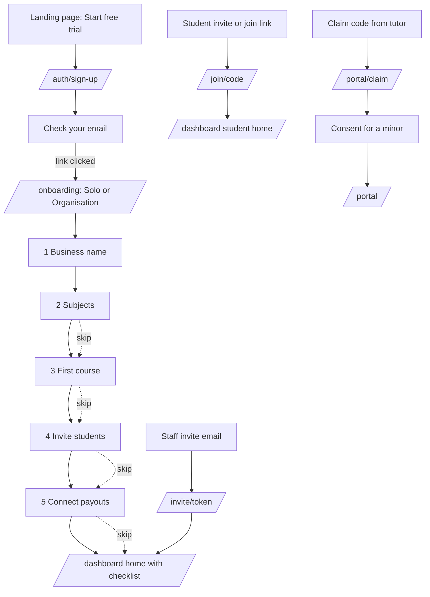

# Sign-up, onboarding, invites and claim codes

**Answer first.** A tutor signs up with an email and a password (or a magic link), verifies the email, and picks **Solo practice** or **Organisation**. That creates the workspace and starts the 14-day trial with no card. A five-step setup follows: business name, subjects, first course, invite students, connect payouts. Only the business name is required; every later step can be skipped and stays on a checklist on the home page. Students join through an emailed invite or a course join link. Parents join by **claiming** a child with a code from the tutor, and give POPIA consent for a minor in the same step. Parents and students sign in with **magic links** by default, so they never need a password.

Read [README.md](README.md) first for the shell, words and states used here.

## Flow overview



## 1. Sign-up

| | |
| --- | --- |
| Purpose | Create a user account for a new tutor or organisation owner |
| Route | `/auth/sign-up` (A owns `src/app/auth/**`) |
| Entry points | "Start free trial" on the landing page; "Create an account" on sign-in; a promo link `/auth/sign-up?code=LAUNCH10` keeps the code for later (see 05) |
| Who | Signed-out visitors. A signed-in user is sent to `/dashboard` |

```
┌─────────────────────────────────────────────┐
│ Nexa                                         │
│                                              │
│ Start your 14-day free trial                 │
│ No card needed. Every feature is on.         │
│                                              │
│ Your name        [                        ]  │
│ Email            [                        ]  │
│ Password         [                        ]  │
│                  At least 10 characters      │
│                                              │
│ [ Create account ]                           │
│                                              │
│ ── or ──                                     │
│ [ Email me a sign-in link instead ]          │
│                                              │
│ By continuing you accept the Terms and the   │
│ Privacy notice. Already have an account?     │
│ Sign in                                      │
└─────────────────────────────────────────────┘
```

- Sign-up is for staff. A parent or student who lands here sees a line under the heading: "Parent or student? Ask your tutor for an invite or a claim code." with a link to `/portal/claim`.
- The privacy notice states that data is stored outside South Africa until 2027 (owner decision; research 09).
- After submit: "Check your email" screen with the address, "Resend" (disabled for 60 seconds) and "Use a different email".

States:
- **Error:** email already used shows "You already have an account. Sign in or email yourself a link." Never reveal more than that.
- **Loading:** the button shows a spinner and stays disabled.

Actions: `signUp({ name, email, password, promoCode? })` (proposed), `requestMagicLink({ email, next })` (proposed), `resendVerification()` (proposed).

## 2. Magic links and sign-in

| | |
| --- | --- |
| Purpose | Sign in without a password. Default for parents and students; optional for staff |
| Route | `/auth/sign-in`; the emailed link lands on `/auth/link?token=...` |
| Entry points | Sign-in page; every invite and claim email; "Email me a sign-in link" |

```
Sign in                              Check your email
Email     [                    ]     We sent a link to th***@gmail.com.
Password  [                    ]     It works once and expires in 15 minutes.
[ Sign in ]                          Open it on this device.
[ Email me a link instead ]          [ Resend in 0:59 ]   Use a different email
Forgot password?
```

Rules:
- A link works once and expires after 15 minutes. It signs the person in and also verifies the email.
- `next` is kept, so an invite or claim link returns the person to the right screen.
- Opening an expired or used link shows "This link has expired" with a one-click "Send a new link" to the same address.
- Staff with two-factor turned on still get the second-factor step after the link. Nexa admins must use two factors (see 06).
- Sign-in never says whether an email has an account: "If that email has an account, we've sent a link."

Actions: `signInWithPassword` (proposed), `requestMagicLink` (proposed); the link is verified in a route handler, not a server action.

## 3. Solo or Organisation

| | |
| --- | --- |
| Purpose | Create the workspace and start the trial |
| Route | `/onboarding` |
| Entry points | First sign-in after verifying; "Create another workspace" in the workspace switcher |

```
How will you use Nexa?

┌──────────────────────────┐   ┌──────────────────────────┐
│ [illustration]           │   │ [illustration]           │
│ Solo practice            │   │ Organisation             │
│ I teach my own students. │   │ We run a centre with     │
│                          │   │ several tutors.          │
│ You own the workspace    │   │ You manage tutors and    │
│ and teach in it.         │   │ teams. You don't have to │
│                          │   │ teach.                   │
└──────────────────────────┘   └──────────────────────────┘
You can't change this later, but you can create another workspace.
```

- Choosing a card creates the workspace with a placeholder name ("Thandi's practice") and `billingState = TRIAL`, `trialEndsAt` = now + 14 days, then opens step 1.
- **Question for A2:** can a solo practice become an organisation later (adds teams; the owner keeps teaching)? The copy above says no; change it if A2 allows it.

Action: `createWorkspace({ kind })` (proposed). Returns the workspace id; the action also calls `switchWorkspace`.

## 4. The five setup steps

| | |
| --- | --- |
| Purpose | Get a tutor to a first useful moment: a course with students in it |
| Route | `/onboarding/[step]`, steps `business`, `subjects`, `course`, `students`, `payouts` |
| Entry points | After step 3 above; the "Finish setting up" checklist on the dashboard home |

Shared layout:

```
┌──────────────────────────────────────────────────────────────┐
│ Nexa                                    Trial · 14 days left │
├──────────────────────────────────────────────────────────────┤
│ ● Business  ○ Subjects  ○ First course  ○ Students  ○ Payouts │
│                                                              │
│  <step heading>                                              │
│  <one sentence on why>                                       │
│                                                              │
│  <step body>                                                 │
│                                                              │
│  [Back]                         [Skip for now]  [Continue]   │
└──────────────────────────────────────────────────────────────┘
```

- No sidebar during onboarding; the header shows only the logo and the trial chip.
- Progress saves on every Continue. Closing the tab and coming back resumes at the first unfinished step.
- "Skip for now" is shown on steps 2 to 5. Skipped steps appear on the dashboard checklist.

### Step 1: Business name (required)

```
What's your practice called?
Students and parents see this name on invites and fees.

Name        [ Thandi Maths Tutoring          ]
Web address nexa-lms.co.za/w/[ thandi-maths  ]   ✓ available
Time zone   [ Africa/Johannesburg          ▾ ]
```
- The address fills from the name and is checked as you type.
- Organisation copy: "What's your organisation called?"

Action: `saveOnboardingStep({ step: "business", name, slug, timezone })` (proposed) → `updateWorkspace`.

### Step 2: Subjects

```
What do you teach?
We use this to suggest course names and templates.

[ Mathematics ✓ ] [ Physical Sciences ✓ ] [ Life Sciences ] [ Accounting ]
[ English ] [ Afrikaans ] [ IsiZulu ] [ IT ] [ CAT ] [ + Other... ]

Grades  [ 8 ] [ 9 ] [ 10 ✓ ] [ 11 ✓ ] [ 12 ✓ ]   Curriculum [ CAPS ▾ ]
```

Action: `saveOnboardingStep({ step: "subjects", subjects, grades, curriculum })` (proposed).

### Step 3: First course

```
Create your first course
One course is one class you bill for. You can add more later.

Course name [ Grade 12 Mathematics       ]   (suggested from step 2)
Start from  (•) A blank course
            ( ) A template: CAPS Gr 12 Maths term plan
Plan        Core · R99 per student a month after the trial
            Every feature is on during your trial. [What's in each plan?]
```
- Uses B's `createCourse` action. A adds nothing here except the plan line, which reads prices from `getCourseServices()` once the course exists, or from the tier list before.
- During the trial every v1 premium service can be on (services.md rule 3), but the line shows the plan the course is on now, so the first bill is predictable.

### Step 4: Invite students

```
Invite your students
They'll get an email with a link. No password needed.

Emails  [ sipho@example.com, lerato@example.com,             ]
        [ paste a list or one per line                        ]
        2 valid · 0 problems
Course  [ Grade 12 Mathematics ▾ ]

Under 18? [x] Some of these students are under 18
          We'll ask for a parent's details next, so a parent can give consent.

── or share a join link ──
nexa-lms.co.za/join/K7QX-2M9P     [Copy]   Expires in 14 days
```
- Pasting a CSV with `email, name, parent email` fills all three. Bulk import is a Core service.
- When "under 18" is ticked, a second panel asks for each student's parent email. Minors can only be invited with a parent or by a tutor (design/01, section 6); the student account stays limited until a parent claims and consents (see section 7).
- **Organisation** variant: two tabs, "Tutors" and "Students". Tutors tab calls `inviteMembers` (see 02).
- The trial cap is 20 distinct students across all courses. The count shows here: "2 of 20 trial students".

Actions: `createStudentInvites({ courseId, rows: [{ email, name?, parentEmail?, isMinor }] })`, `createJoinLink({ courseId })` (proposed).

### Step 5: Connect payouts (skippable)

```
Get paid through Nexa (optional)
Parents can pay your fees online. Money goes straight to your bank
account two working days later. Nexa keeps 2%; card fees come off your payout.

[ Connect my bank account ]       [ I'll collect fees myself ]
```
- "Connect" opens the payout form from [04-payments-portal.md](04-payments-portal.md), section 8, in this step's frame.
- "I'll collect fees myself" finishes onboarding. Fees can still be recorded and marked paid off-site.
- Only shown to people with `payouts.connect` (owner of a solo practice, organisation owner). Organisation admins see "Your owner connects payouts" and skip straight on.

### Dashboard checklist

After onboarding, the dashboard home shows a card until every step is done or the card is dismissed:

```
Finish setting up                          3 of 5 done    [×]
✓ Name your practice
✓ Add subjects
✓ Create a course
○ Invite students              [Invite]
○ Connect payouts              [Connect]
```

Action: `getOnboarding()` (proposed) returns each step's state; `dismissOnboarding()` (proposed).

## 5. Accepting a staff invite

| | |
| --- | --- |
| Purpose | A tutor or admin joins an organisation |
| Route | `/invite/[token]` |
| Entry points | Invite email ("Thandi invited you to join Ubuntu Tutors as a Tutor") |

```
[logo of the workspace]
Ubuntu Tutors invited you to join as a Tutor
Invited by Thandi Mokoena · expires 23 Nov 2026

Signed in as sipho@example.com
[ Accept and continue ]      Decline
```
- Signed out: the page shows the same card with "Sign in to accept" or "Create an account" pre-filled with the invited email.
- Signed in with a different email: "This invite is for s***@example.com. Sign out and use that address." Never accept across emails.
- Expired, revoked or used: "This invite is no longer valid. Ask Thandi for a new one."

Actions: `getInvite(token)`, `acceptInvite(token)` (proposed).

## 6. Joining as a student

| | |
| --- | --- |
| Purpose | A student joins a course from an email invite or a join link |
| Route | `/join/[code]` |
| Entry points | Invite email; a join link shared on WhatsApp by the tutor |

```
Join Grade 12 Mathematics
Thandi Maths Tutoring

Your name   [                       ]
Your email  [                       ]
[ Join course ]
We'll email you a link to sign in. No password needed.
```
- From an emailed invite the name and email are filled and the email is locked.
- A join link asks "Are you under 18?" If yes, it asks for a parent's email, and the account is created as a minor pending consent.
- If the trial's student cap or a usage limit is reached, the page says "This course is full. Ask your tutor." and the tutor gets a notification.

Action: `joinWithLink({ code, name, email, isMinor, parentEmail? })` (proposed).

## 7. Parent claim codes

A **claim code** links a parent to a child. The tutor creates it; the parent enters it. One code can be used by up to two parents and expires after 14 days (proposal; A2 to confirm).

### 7a. Tutor creates or sends a code

| | |
| --- | --- |
| Purpose | Let a parent link to a student |
| Route | Student profile, "Parents" tab (B's page under `/dashboard/students/[id]`); A supplies the panel content |
| Who | `guardians.link` (owner, admin, or the student's tutor) |

```
Parents
No parent linked yet.

Claim code   K7QX-2M9P   [Copy]   Expires 30 Nov 2026   [New code]
             Give this to the parent. They enter it at nexa-lms.co.za/claim.

── or ──
Email a parent  [ mom@example.com        ]  [Send invite]
```
- Linked parents show as rows: name, relationship, "Consent given 16 Nov 2026", [Remove].
- Removing a parent needs a confirm and is audited.

Actions: `createClaimCode({ learnerId })`, `inviteParent({ learnerId, email })`, `revokeGuardianship({ guardianshipId })` (proposed).

### 7b. Parent claims a child

| | |
| --- | --- |
| Purpose | Link a parent to a child, and record consent for a minor |
| Route | `/portal/claim` (short form `nexa-lms.co.za/claim`) |
| Entry points | Claim code from the tutor; the parent invite email (code pre-filled); "Add a child" in the parent portal |

```
Step 1                               Step 2 (only for a student under 18)
Add your child                       Your consent
Claim code [ K7QX-2M9P ]             Sipho is under 18. To use Nexa, a parent
[ Continue ]                         must agree to how we use his information.

We found:                            [Read the privacy notice]
  Sipho Dlamini                      [x] I am Sipho's parent or legal guardian
  Grade 12 Mathematics               [x] I agree that Nexa may process Sipho's
  Thandi Maths Tutoring                  information for his lessons, as the
                                         notice explains, including storage
Your relationship [ Parent ▾ ]           outside South Africa.
[ This is my child ]  Not my child   [ Give consent and continue ]
```
- The code preview shows only the child's first name and surname, course names and the workspace. Nothing else until the claim is complete.
- Signed out: the parent enters their email after the code and gets a magic link; the claim finishes when they return.
- After claiming, the parent lands on the portal with the new child selected and a short toast "Sipho added".
- The consent screen records `consentAt`, `consentVersion` and evidence (design/01). Declining keeps the link `PENDING`; the child's account stays limited and the tutor sees "Waiting for parent consent".

States:
- **Error:** wrong code ("We couldn't find that code. Check it with your tutor."), expired, already used twice. Five wrong attempts in ten minutes locks the form for ten minutes.

Actions: `previewClaimCode({ code })`, `claimChild({ code, relationship, consent: { version, accepted } })` (proposed).

## Open points for A2

1. Solo to organisation conversion: allowed or not (section 3)?
2. Claim code limits: two parents per code, 14 days, five attempts (section 7).
3. What a minor can do before a parent consents. Proposal: sign in and see the course list, but no submissions or messages are stored until consent.
