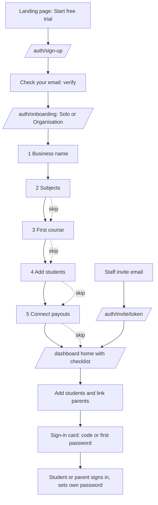

# Sign-up, onboarding, students and parents

**Answer first.** A tutor signs up with an email and a password, verifies the email, and picks **Solo practice** or **Organisation**. That creates the workspace and starts the 14-day trial with no card. A five-step setup follows: business name, subjects, first course, add students, connect payouts. Only the business name is required. Every later step can be skipped and stays on a checklist on the home page. **In v1 the tutor creates each student's account** (name, optional email, and a sign-in code or a first password the tutor hands over), and **links parents** the same way, so a parent can see and pay fees. Self-service invites for students, parent claim codes with POPIA consent, and magic links come **later**. Their flows are kept at the end of this file, marked "Later", so B can build v1 without them and A can add them without changing v1 screens.

Read [README.md](README.md) first for the shell, words and states used here. Routes follow A2's [design/02-identity.md](../design/02-identity.md) (`src/app/auth/**`).

## What ships when

| Flow | v1 | Later |
| --- | --- | --- |
| Tutor and owner sign-up and sign-in with a password | ✓ | |
| Solo or Organisation, the five setup steps | ✓ | |
| Staff invites by email (organisations) | ✓ | |
| Tutor creates student accounts and hands over a sign-in code or first password | ✓ | |
| Tutor links a parent account to a student | ✓ | |
| Magic links (sign-in by email link) | | ✓ |
| Student invites by email and course join links | | ✓ |
| Parent claim codes with consent for a minor | | ✓ |

## Flow overview (v1)



## 1. Sign-up

| | |
| --- | --- |
| Purpose | Create a user account for a new tutor or organisation owner |
| Route | `/auth/sign-up` |
| Entry points | "Start free trial" on the landing page; "Create an account" on sign-in; a promo link `/auth/sign-up?code=LAUNCH10` keeps the code for the billing page (see 05) |
| Who | Signed-out visitors. A signed-in user is sent to `/dashboard` |

```
┌─────────────────────────────────────────────┐
│ Nexa                                         │
│                                              │
│ Start your 14-day free trial                 │
│ No card needed. Every feature is on.         │
│                                              │
│ Your name        [                        ]  │
│ Email            [                        ]  │
│ Password         [                        ]  │
│                  At least 10 characters      │
│                                              │
│ [ Create account ]                           │
│                                              │
│ By continuing you accept the Terms and the   │
│ Privacy notice. Already have an account?     │
│ Sign in                                      │
└─────────────────────────────────────────────┘
```

- Sign-up is for staff. Under the heading: "Parent or student? Your tutor creates your account and gives you a sign-in code."
- The privacy notice states that data is stored outside South Africa until 2027 (owner decision; research 09), and that a workspace's data is deleted two months after its last payment (see 03).
- After submit: "Check your email" with the address, "Resend" (disabled for 60 seconds) and "Use a different email". The verification link is a normal link, not a sign-in link.

States:
- **Error:** an email already in use shows "You already have an account. Sign in instead." Nothing more.
- **Loading:** the button shows a spinner and stays disabled.

Actions: `signUp({ name, email, password, promoCode? })`, `resendVerification()` (proposed; Better Auth underneath, design/02).

## 2. Sign-in

| | |
| --- | --- |
| Purpose | Sign in staff, students and parents |
| Route | `/auth/sign-in`; owners and admins continue to `/auth/two-factor` |
| Entry points | Header "Sign in"; any protected page while signed out (`?next=` kept) |

```
Sign in
Email or username  [                    ]
Password or code   [                    ]
[ Sign in ]
Forgot password?
```

- **Students and parents in v1** sign in with the username or email and the **sign-in code** their tutor gave them (section 6). On first sign-in they must set their own password; the code then stops working.
- Two-factor (TOTP) is required for every owner and every Nexa admin (design/02, section 7). Other staff can turn it on.
- Errors never say whether an account exists: "That email and password don't match."
- Lockout after repeated failures follows design/02, section 10: "Too many attempts. Try again in 15 minutes, or reset your password."
- "Forgot password?" emails a reset link to staff and to anyone with an email. A student without an email asks their tutor, who issues a new code (section 6).

Actions: `signInWithPassword`, `requestPasswordReset` (proposed).

## 3. Solo or Organisation

| | |
| --- | --- |
| Purpose | Create the workspace and start the trial |
| Route | `/auth/onboarding` |
| Entry points | First sign-in after verifying; "Create another workspace" in the workspace switcher |

```
How will you use Nexa?

┌──────────────────────────┐   ┌──────────────────────────┐
│ [illustration]           │   │ [illustration]           │
│ Solo practice            │   │ Organisation             │
│ I teach my own students. │   │ We run a centre with     │
│                          │   │ several tutors.          │
│ You own the workspace    │   │ You manage tutors and    │
│ and teach in it.         │   │ teams. You don't have to │
│                          │   │ teach.                   │
└──────────────────────────┘   └──────────────────────────┘
You can't change this later, but you can create another workspace.
```

- Choosing a card creates the workspace with a placeholder name ("Thandi's practice"), `billingState = TRIAL` and `trialEndsAt` = now + 14 days, then opens step 1.
- **Question for A2:** can a solo practice become an organisation later? The copy above says no.

Action: `createWorkspace({ kind })` (proposed). It also calls `switchWorkspace`.

## 4. The five setup steps

| | |
| --- | --- |
| Purpose | Get a tutor to a first useful moment: a course with students in it |
| Route | `/auth/onboarding/[step]`, steps `business`, `subjects`, `course`, `students`, `payouts` |
| Entry points | After section 3; the "Finish setting up" checklist on the dashboard home |

Shared layout:

```
┌──────────────────────────────────────────────────────────────┐
│ Nexa                                    Trial · 14 days left │
├──────────────────────────────────────────────────────────────┤
│ ● Business  ○ Subjects  ○ First course  ○ Students  ○ Payouts │
│                                                              │
│  <step heading>                                              │
│  <one sentence on why>                                       │
│                                                              │
│  <step body>                                                 │
│                                                              │
│  [Back]                         [Skip for now]  [Continue]   │
└──────────────────────────────────────────────────────────────┘
```

- No sidebar during onboarding; the header shows only the logo and the trial chip.
- Progress saves on every Continue. Coming back resumes at the first unfinished step.
- "Skip for now" shows on steps 2 to 5. Skipped steps appear on the dashboard checklist.

### Step 1: Business name (required)

```
What's your practice called?
Students and parents see this name on fees and receipts.

Name        [ Thandi Maths Tutoring          ]
Web address nexa-lms.co.za/w/[ thandi-maths  ]   ✓ available
Time zone   [ Africa/Johannesburg          ▾ ]
```
- The address fills from the name and is checked as you type.
- Organisation copy: "What's your organisation called?"

Action: `saveOnboardingStep({ step: "business", name, slug, timezone })` (proposed).

### Step 2: Subjects

```
What do you teach?
We use this to suggest course names.

[ Mathematics ✓ ] [ Physical Sciences ✓ ] [ Life Sciences ] [ Accounting ]
[ English ] [ Afrikaans ] [ IsiZulu ] [ IT ] [ CAT ] [ + Other... ]

Grades  [ 8 ] [ 9 ] [ 10 ✓ ] [ 11 ✓ ] [ 12 ✓ ]   Curriculum [ CAPS ▾ ]
```

Stored as `Workspace.subjects` (design/02, section 4). Action: `saveOnboardingStep({ step: "subjects", subjects, grades, curriculum })` (proposed).

### Step 3: First course

```
Create your first course
One course is one class you pay for per student. You can add more later.

Course name [ Grade 12 Mathematics       ]   (suggested from step 2)
Start from  (•) A blank course
            ( ) A template: CAPS Gr 12 Maths term plan
Plan        Core · R99 per student for each 30 days, after the trial
            Every feature is on during your trial. [What's in each plan?]
```
- Uses B's `createCourse` action. A adds only the plan line, with prices read from billing (never hard-coded).

### Step 4: Add students

```
Add your students
You create their accounts. Each student gets a sign-in code to use once.

     Name               Email (optional)      Username       Under 18
  1  [ Sipho Dlamini  ] [ sipho@example.com ]  sipho.dlamini   [x]
  2  [ Lerato Khumalo ] [                   ]  lerato.khumalo  [x]
  3  [                ]
  [ + Add row ]   [ Paste from a spreadsheet ]

Course  [ Grade 12 Mathematics ▾ ]
2 of 20 trial students

[ Create 2 students ]
```
- The username fills from the name and is unique in the workspace; it is how a student without an email signs in.
- Pasting columns `name, email, parent name, parent email` fills the rows and, for parents, opens the parent step in section 7 after creation.
- After "Create", the step shows the **sign-in cards** from section 6 for every new student.
- **Organisation** variant: two tabs, "Tutors" (staff invites, section 5) and "Students".
- The trial allows 20 distinct students across all courses; the counter shows here.

Action: `createStudents({ courseId, rows: [{ name, email?, username, isMinor }] })` (proposed) → `{ students: [{ learnerId, username, signInCode }] }`.

### Step 5: Connect payouts (skippable)

```
Get paid through Nexa (optional)
Parents can pay your fees online. Money goes straight to your bank
account. Nexa keeps 2%; card fees come off your payout.

[ Connect my bank account ]       [ I'll collect fees myself ]
```
- "Connect" opens the payout form from [04-payments-portal.md](04-payments-portal.md), section 7, inside this step.
- "I'll collect fees myself" finishes onboarding. Fees can still be recorded and marked paid off-site. Online payment of fees needs payouts connected (design/02, section 4).
- Shown only to people with `payouts.connect`. Organisation admins see "Your owner connects payouts" and move on.

### Dashboard checklist

```
Finish setting up                          3 of 5 done    [×]
✓ Name your practice
✓ Add subjects
✓ Create a course
○ Add students                 [Add]
○ Connect payouts              [Connect]
```

Actions: `getOnboarding()`, `dismissOnboarding()` (proposed).

## 5. Accepting a staff invite (organisations)

| | |
| --- | --- |
| Purpose | A tutor or admin joins an organisation |
| Route | `/auth/invite/[token]` |
| Entry points | Invite email ("Thandi invited you to join Ubuntu Tutors as a Tutor") sent from Members (see 02) |

```
[logo of the workspace]
Ubuntu Tutors invited you to join as a Tutor
Invited by Thandi Mokoena · expires 23 Nov 2026

Signed in as sipho@example.com
[ Accept and continue ]      Decline
```
- Signed out: "Sign in to accept" or "Create an account", with the invited email filled in.
- Signed in with a different email: "This invite is for s***@example.com. Sign out and use that address."
- Expired, revoked or used: "This invite is no longer valid. Ask Thandi for a new one."

Actions: `getInvite(token)`, `acceptInvite(token)` (proposed).

## 6. Student accounts and sign-in cards (v1)

| | |
| --- | --- |
| Purpose | The tutor creates a student and hands over a way to sign in |
| Route | Onboarding step 4; "Add students" on B's student list (`/dashboard/students`); the student's profile, "Sign-in" tab |
| Who | `learners.invite` (owner, admin, or a tutor into their own courses) |

After creating students, and from a student's profile, the tutor sees a sign-in card per student:

```
┌──────────────────────────────────────────────┐
│ Sipho Dlamini · Thandi Maths Tutoring        │
│ Go to   nexa-lms.co.za/sign-in               │
│ Username   sipho.dlamini                     │
│ Code       K7QX-2M9P   (works once, 14 days) │
│ You'll choose your own password next.        │
└──────────────────────────────────────────────┘
[Copy]  [Print all]  [Email to student]  (email only if one was given)
```

- **Two ways to hand over:** a one-time **sign-in code** (default) or a **first password** the tutor types. The first password must also be changed on first sign-in. Proposal for A2: offer only the code, to avoid tutors reusing one password for a whole class.
- The code is shown in full only on this screen. Afterwards the profile shows "Code issued 16 Nov · not used yet" and [Issue a new code], which voids the old one.
- "Print all" prints one card per student on A4, for a class handout.
- **Student profile, "Sign-in" tab:** username, email, "Signed in last on 18 Nov", [Issue a new code] (also the v1 password reset for students without email), [Sign out everywhere].
- **Minors:** students under 18 are created by the tutor (allowed in v1 by the owner). **Owner decision (16 Nov):** in v1 tutors onboard every student themselves and handle consent with parents outside Nexa. There is no consent screen or tutor confirmation in v1. Nexa's own consent feature comes later (see "Later" below).

Actions: `createStudents` (above), `issueSignInCode({ learnerId })`, `setFirstPassword({ learnerId, password })`, `revokeSessions({ userId })` (proposed).

## 7. Linking a parent (v1)

In v1 the **tutor** links a parent to a student. The parent then sees the child in the parent portal and can pay fees ([04](04-payments-portal.md)). No claim code and no consent screen in v1.

| | |
| --- | --- |
| Purpose | Give a parent an account linked to one or more children |
| Route | Student profile, "Parents" tab (B's page; A supplies the panel) |
| Who | `guardians.link` (owner, admin, or the student's tutor) |

```
Parents
No parent linked yet.

Name          [ Nomsa Dlamini           ]
Email         [ nomsa@example.com       ]  (optional, needed for fee emails)
Cell          [ 082 000 0000            ]  (optional)
Relationship  [ Parent ▾ ]
[ Link parent ]

Already has a Nexa account? Type their email and we'll link the existing account.
```

- If the email belongs to an existing user, the child is added to that account; the parent gets an email "Thandi linked Sipho to your Nexa account." This is how one parent ends up with several children, even across tutors.
- If not, a new parent account is created and a **sign-in card** like the student's is shown, with a parent username and code.
- Linked parents show as rows: name, email, "Linked by Thandi on 16 Nov 2026", [Remove]. Removing needs a confirm and writes the audit log.
- Fees for a student with a linked parent go to the parent (design/01, section 6).

Actions: `linkParent({ learnerId, name, email?, phone?, relationship })` → `{ guardianshipId, newAccount: boolean, signInCode? }`, `revokeGuardianship({ guardianshipId })` (proposed).

## Later: flows kept for after v1

These stay specified so they can be added without changing the v1 screens.

### Magic links

- Route `/auth/magic?token=...`, a page with a "Sign in" button that posts, so mail scanners can't use up the link (design/02, section 6). Single use, 15 minutes.
- Sign-in gains "Email me a sign-in link". It never says whether an email has an account.
- Expired or used link: "This link has expired" with "Send a new link".

### Student invites and join links

- Tutor pastes emails and sends invites, or shares a course join link (`/join/[code]`, 14 days) for WhatsApp.
- The join page asks for name, email and "Are you under 18?"; a minor needs a parent's email and stays limited until a parent consents.
- At the trial cap: "This course is full. Ask your tutor."

### Parent claim codes with consent

- The tutor makes a code for one student (`NEXA-7KQ4-M2XD`, shown once; design/02, section 5) or emails an invite.
- The parent opens `/auth/claim`, enters the code and email, signs in by magic link, confirms the child's masked first name, and gives consent:

```
Sipho is under 18. To use Nexa, a parent must agree to how we use
his information.                       [Read the privacy notice]
[x] I am Sipho's parent or legal guardian
[x] I agree that Nexa may process Sipho's information for his lessons,
    as the notice explains, including storage outside South Africa.
[ Give consent and continue ]
```

- Consent records `consentAt`, `consentVersion` and evidence. If the child already has an active parent, the new link waits for the tutor to approve it.
- Rate limits from design/02: 5 attempts per IP per hour, 10 per code before it is voided.
- When this ships, parents linked by tutors in v1 are asked for consent on their next sign-in.

## Open points for A2

1. Solo to organisation conversion: allowed or not (section 3)?
2. Sign-in code only, or also a tutor-typed first password (section 6)?
3. **Decided by the owner (16 Nov):** no consent capture in v1; tutors handle it. The consent flow below ships later.
4. Usernames: unique per workspace or across Nexa? A student in two workspaces needs one login, so proposed: across Nexa, with the workspace slug added on a clash.
