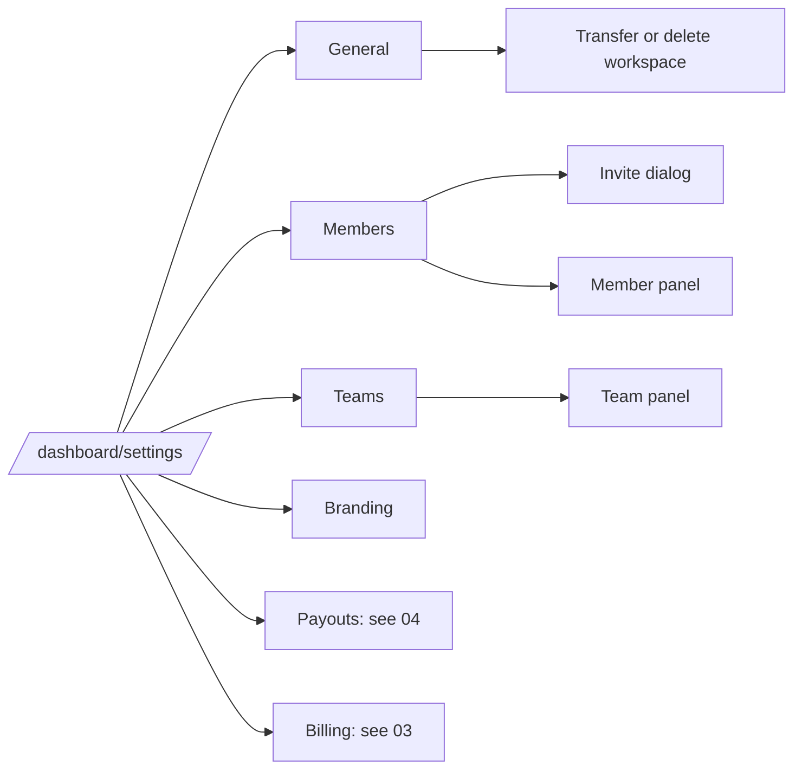

# Workspace settings, members, teams and branding

**Answer first.** Settings live under `/dashboard/settings`, with one ribbon of views: **General, Members, Teams, Branding, Payouts, Billing**. Owners and admins see all of them; tutors see only their own profile and the workspace name. Members is one table with role, teams and status, where invites and pending people sit in the same list. Teams exist only in organisations. Branding (logo, accent colour, sender name) needs the Plus `custom-branding` service on at least one course, and the screen says so instead of hiding the option. Every role change, removal and ownership transfer asks for confirmation and writes the audit log.

Read [README.md](README.md) first. Permissions come from design/01, section 3.

## Map



| View | Who sees it | Solo practice | Organisation |
| --- | --- | --- | --- |
| General | `workspace.settings` (others: read-only name and time zone) | Yes | Yes |
| Members | `members.invite` | Hidden (one owner, no staff) | Yes |
| Teams | `teams.manage` (leads see only their teams) | Hidden | Yes |
| Branding | `workspace.branding` | Yes | Yes |
| Payouts | `payouts.connect` | Yes | Yes |
| Billing | `billing.view` | Yes | Yes |

Shell: header breadcrumb `Workspace ▾ / Settings / <view>`; ribbon holds the view links on the left and the view's main tool on the right (for example "Invite people" on Members).

## 1. General

| | |
| --- | --- |
| Purpose | Name, web address, time zone, contact details; dangerous actions |
| Route | `/dashboard/settings` |
| Entry points | Avatar menu → Settings; workspace switcher → "Workspace settings" |

```
General
─────────────────────────────────────────────────────────
Name            [ Ubuntu Tutors                    ]
Web address     nexa-lms.co.za/w/[ ubuntu-tutors   ]
Time zone       [ Africa/Johannesburg            ▾ ]
Contact email   [ office@ubuntututors.co.za        ]   shown on fees and receipts
Phone           [ 082 000 0000                     ]
                                        [ Save changes ]

Danger zone
─────────────────────────────────────────────────────────
Transfer ownership   Give this workspace to another admin.   [Transfer…]
Delete workspace     Remove all courses, students and files.  [Delete…]
```

- Properties are a Notion-like property list; Save appears only when something changed.
- **Transfer ownership** (owner only): pick an active admin, type the workspace name, confirm. The old owner becomes an admin.
- **Delete workspace** (owner only, `workspace.delete`): only when the bill is paid up and no parent fees are unpaid through Nexa. The dialog lists what will go (counts of courses, students, files), asks for the workspace name, then sets a 30-day grace period: the workspace turns read-only with a banner "Scheduled for deletion on 16 Dec 2026. [Cancel deletion]". A2 confirms the grace period.

States: **read-only** keeps General editable for owners (so they can fix contact details) but disables everything else; the danger zone stays usable.

Actions: `updateWorkspace({ name, slug, timezone, contactEmail, phone })`, `transferOwnership({ membershipId, confirmName })`, `deleteWorkspace({ confirmName })`, `cancelWorkspaceDeletion()` (proposed).

## 2. Members

| | |
| --- | --- |
| Purpose | See every staff member, invite people, change roles, suspend or remove |
| Route | `/dashboard/settings/members` |
| Entry points | Settings ribbon; onboarding step 4 (organisation); "Invite tutors" on an empty course list |

```
Members                                             [ Invite people ]
[ Search name or email ]  Role [All ▾]  Team [All ▾]  Status [All ▾]
──────────────────────────────────────────────────────────────────────
Name                 Role     Teams              Courses  Status
Thandi Mokoena       Owner    —                  0        Active
Sipho Ndlovu         Admin    Maths              2        Active
Lerato Khumalo       Tutor    Maths (lead), Sci  4        Active
nomsa@example.com    Tutor    Sci                —        Invited · 3 days ago  [Resend]
Peter van Wyk        Tutor    English            3        Suspended
──────────────────────────────────────────────────────────────────────
5 people · 1 invite pending
```

- Clicking a row opens a side panel (B's peek panel), not a new page:

```
Lerato Khumalo                                  [×]
lerato@example.com · joined 3 Feb 2026
Role      [ Tutor ▾ ]        (Owner can't be picked here)
Teams     Maths (lead) · Science   [Edit]
Courses   Gr 11 Maths, Gr 12 Maths, Gr 10 Sci, Gr 11 Sci
2-step    On
──────────────────────────────────────────────
[ Suspend ]   [ Remove from workspace ]
```

- **Role change:** Owner can set Admin or Tutor for anyone except themselves. Admins can change tutors only (`members.role` ◐). The change takes effect on the member's next request.
- **Suspend:** keeps the member's courses and content; they can't sign in to this workspace. Courses they lead show "Lead suspended" to admins.
- **Remove:** asks what happens to their courses: "Move their 4 courses to [ person ▾ ]" (required when they lead courses). Removal is audited.
- Members don't count towards the bill. Only active students do. The invite dialog says so.

Invite dialog:

```
Invite people
Emails  [ nomsa@example.com, peter@example.com   ]
Role    (•) Tutor — teaches their own courses
        ( ) Admin — manages people, courses, fees and billing
Teams   [ Science ▾ ]  (optional)
[ Send invites ]   Staff are free. You pay only for active students.
```

States:
- **Empty:** never truly empty (the owner is listed). With only the owner: an illustration and "Invite your tutors. They're free; you pay per student."
- **Read-only:** invite, role change and remove are disabled; suspend still works (a safety action).
- **Error:** inviting an email that is already a member shows it inline on that email chip.

Actions: `listMembers({ q, role, teamId, status })`, `inviteMembers({ emails, role, teamIds })`, `changeMemberRole({ membershipId, role })`, `suspendMember({ membershipId, suspended })`, `removeMember({ membershipId, moveCoursesTo })`, `resendInvite({ inviteId })`, `revokeInvite({ inviteId })` (all proposed).

## 3. Teams (organisations only)

| | |
| --- | --- |
| Purpose | Group tutors and their courses, for example by subject or campus |
| Route | `/dashboard/settings/teams` |
| Entry points | Settings ribbon; the "Teams" cell in the members table |

```
Teams                                                  [ New team ]
──────────────────────────────────────────────────────────────────
Maths        Lead: Lerato Khumalo     4 tutors   9 courses   112 students
Science      Lead: —                  2 tutors   4 courses    41 students
English      Lead: Peter van Wyk      1 tutor    3 courses    30 students
```

Team panel:

```
Maths                                        [Rename] [Delete]
Members                                      [ Add people ▾ ]
  Lerato Khumalo   Lead ✓    [Remove]
  Sipho Ndlovu     Lead ☐    [Remove]
Courses (owned by this team)
  Gr 10 Maths · Gr 11 Maths · Gr 12 Maths …   Assign courses on the course's settings page
```

- A team lead can add or remove tutors in their team and manage its courses' services (design/01: `teams.manage` ◐, `courses.services` ◐ for course leads).
- Deleting a team leaves its courses with their lead tutor; the dialog says how many courses this affects.
- **Empty:** "Teams group tutors and courses. Start with one per subject." [New team].

Actions: `createTeam({ name })`, `updateTeam({ teamId, name })`, `deleteTeam({ teamId })`, `setTeamMembers({ teamId, members: [{ membershipId, isLead }] })` (proposed).

## 4. Branding

| | |
| --- | --- |
| Purpose | Logo, accent colour and the sender name on emails |
| Route | `/dashboard/settings/branding` |
| Entry points | Settings ribbon; the "Add your logo" tip on the fees page |

```
Branding                                        Plus feature
──────────────────────────────────────────────────────────────
Logo          [ upload ]  PNG or SVG, square, up to 1 MB
Accent colour [ #2563EB ] ● ● ● ● ●   (B's checked swatches)
              Contrast on white: 4.82 ✓
Email sender  [ Ubuntu Tutors ] via notify.nexa-lms.co.za

Preview
┌───────────────────────────────┐  ┌───────────────────────────┐
│ [logo] Ubuntu Tutors          │  │ From: Ubuntu Tutors        │
│ ▬▬▬ accent button             │  │ Your fees for December...  │
└───────────────────────────────┘  └───────────────────────────┘
                                                [ Save ]
```

- **Gating:** `custom-branding` is a Plus service (services.md). The workspace logo and colour apply everywhere once **any** course has it on. Proposal for A2: branding is workspace-wide, so treat it as on when at least one course has `custom-branding` enabled. Until then the form is visible but disabled, with: "Turn on Custom branding for any course to use your logo. It moves that course to Plus (R139 per student a month)." [Choose a course].
- During the trial branding works, with the same note about the plan after the trial.
- The colour picker refuses colours below 4.5:1 contrast with white text, and says why.
- The sender name changes only the display name; mail still comes from `notify.nexa-lms.co.za`.

States: **empty** shows Nexa's defaults in the preview; **read-only** disables save.

Actions: `updateBranding({ logoFile?, accentColor, senderName })` (proposed).

## 5. Profile (every staff member)

A tutor without settings permissions sees only `/dashboard/settings/profile`: name, photo, email, password or magic link preference, two-step sign-in, notification emails. This is a user-level page shared with B's account settings; A supplies the actions (`updateProfile`, `changeEmail`, `enableTwoFactor`) and B decides where it sits.

## Open points for A2

1. Delete-workspace grace period: 30 days proposed.
2. Is `custom-branding` workspace-wide once any course has it (proposed above), or should branding be a workspace add-on?
3. Can a team lead invite new tutors, or only add existing members to the team? Proposed: existing members only.
