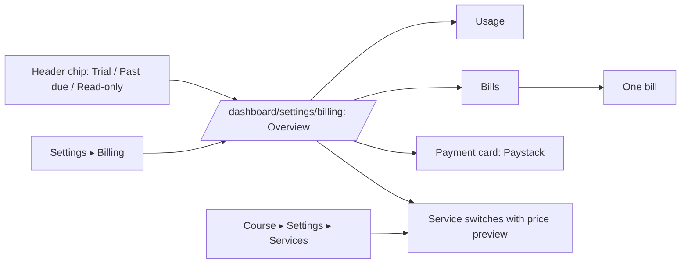

# Billing: plans per course, usage, bills, trial and dunning

**Answer first.** A workspace pays Nexa per **active student per course per month**. Each course is on a plan, **Core R99, Plus R139 or Pro R179**, set by the highest service switched on for it (services.md). The billing page shows this month's running total course by course, usage against allowances and limits, past bills and the card. Switching a service on or off always shows the price change before it takes effect. The 14-day trial needs no card and shows a countdown chip from day one and a banner from day 10. If a charge fails the workspace is **past due** (banner, retries), and if it stays unpaid it becomes **read-only** for staff. Students and parents never see any of this and never lose access.

Read [README.md](README.md) first. Only people with `billing.view` see amounts; `billing.manage` can change the card, limits and add-ons. Course leads with `courses.services` can switch services on their courses.

## Map



## Billing states and what each person sees

`viewer.workspace.billingState` drives the chip and banner.

| State | Header chip (billing people) | Banner for billing people | Banner for other staff | Learners and parents |
| --- | --- | --- | --- | --- |
| `TRIAL`, days 1 to 9 | "Trial · 9 days left" | none | none | nothing |
| `TRIAL`, days 10 to 14 | "Trial · 4 days left" (warning colour) | "Your trial ends on 30 Nov. Add a card to keep your courses open." [Add card] | "Trial ends on 30 Nov." | nothing |
| `TRIAL`, card added | "Trial · card added" | none | none | nothing |
| `ACTIVE` | none | none | none | nothing |
| `PAST_DUE` | "Payment failed" (danger) | "We couldn't charge your card for November (R3 101.40). We'll try again on 4 Dec. Update your card to avoid interruptions." [Update card] [Pay now] | none | nothing |
| `READ_ONLY` | "Read-only" (danger) | "Your workspace is read-only because the November bill is unpaid. Students can still see their work. Pay R3 101.40 to unlock." [Pay now] | "This workspace is read-only. Ask Thandi Mokoena (owner) to update billing." | nothing |
| `COMPED` | none (admins see "Comped" on the billing page only) | none | none | nothing |
| `CANCELLED` | "Cancelled" | "This workspace was cancelled on 1 Dec. Reactivate to edit again." [Reactivate] | "This workspace is closed for editing." | nothing |

Trial ends without a card → `READ_ONLY` on day 15 (research 01), with the trial wording: "Your trial has ended. Add a card to continue where you left off; nothing has been deleted."

**Dunning schedule (proposal for billing.md):** charge on the 1st for the previous month; on failure email the billing people and retry on day 3 and day 7; on day 14 the workspace becomes read-only. Each retry and the change to read-only send an email. Paying at any point returns the workspace to `ACTIVE` at once.

**What read-only blocks:** creating and editing courses, lessons, tests and assignments; inviting; switching services on. **What still works:** signing in, reading everything, exporting, marking already-submitted work (proposal, so students are not punished), recording fees and parent payments, updating the card and paying. Disabled controls carry the tooltip "Read-only until the bill is paid".

## 1. Billing overview

| | |
| --- | --- |
| Purpose | Answer "what will I pay this month, and why?" |
| Route | `/dashboard/settings/billing` |
| Entry points | Settings ribbon; the header chip; every billing banner; bill emails |
| Who | `billing.view`; actions need `billing.manage` |

```
Billing                         Overview · Usage · Bills
────────────────────────────────────────────────────────────────────────────
This month so far · 1–16 Nov 2026                     Next bill: 1 Dec 2026
R3 101.40 estimated                                   Card: Visa •• 4242  [Change]
24 active students in 2 courses                       Discount: LAUNCH10, 10% off plans until Feb

Courses                                                     [Compare plans]
Course                   Plan    Active students   Per student   So far
Grade 12 Mathematics     Plus    12                R139          R1 668   [Services]
Grade 11 Phys Sciences   Plus    12                R139          R1 668   [Services]
Grade 10 Mathematics     Core     0                R99           R0       [Services]

Add-ons and usage
Exam day pass · Gr 12 Maths · 14 Nov                             R99
AI marking above allowance                                        R0

Discount  LAUNCH10                                               −R333.60
────────────────────────────────────────────────────────────────────────────
Estimated total                                                 R3 101.40
Prices exclude VAT. An active student is one enrolled at any time this month.
```

- The total is labelled "so far" until the month closes; a line explains it can still go up if more students join.
- "Active students" links to a list of who was counted, per course, with their enrolment dates. This is the first thing a tutor will ask about.
- **Compare plans** opens a static table of the three plans and which services each has, from `SERVICES` (services.md). No hard-coded prices: they come from `getCourseServices().prices`.

States:
- **Trial:** the top block reads "Free trial · 9 days left. After the trial, with today's courses: about R3 336 a month." [Add card]. Caps from section 4 show here.
- **Empty (no courses):** "No courses yet. Your bill is R0 until a student joins a course."
- **Loading:** skeleton for the total and three table rows.
- **Error:** "We couldn't load your billing details." [Try again]. Never show a stale total without saying so.
- **Read-only / past due:** the banner shows; the overview adds an "Unpaid bills" block at the top with [Pay now].
- **Comped:** "Nexa covers this workspace's bill." Totals still show, struck through.

Actions: `getBillingOverview()` (proposed) returning per-course plan, active students, price and subtotal, add-on lines, discount, estimate, card summary and next bill date.

## 2. Service switches on a course, with the price change

| | |
| --- | --- |
| Purpose | Turn premium features on or off for one course and see what it costs |
| Route | `/dashboard/courses/[id]/settings/services` (B's course settings page; A supplies the content) |
| Entry points | Course settings; [Services] on the billing overview; an upsell spot where a gated feature would appear (for example the graph block in the editor says "Graphs are part of Plus. [Turn on for this course]") |
| Who | `courses.services` (owner, admin, course lead). Others see the list read-only |

```
Services · Grade 12 Mathematics             Plan: Plus · R139 per student a month
────────────────────────────────────────────────────────────────────────────
Included in every plan
  Lessons, tests, assignments, gradebook, calendar, messages, parent portal, fees ✓

Plus · R139
  [■] Visual maths input        Students type maths with a keyboard
  [■] Graphs                    Graphs in lessons and graph answers
  [ ] Live sessions             Schedule classes with a Meet link and attendance
  [ ] Custom branding           Your logo and colour (workspace-wide)
  [ ] Calendar feed             Students add classes to their phone calendar

Pro · R179
  [ ] Secure tests              Lockdown, tab-switch log, honours extra time
  [ ] AI marking                Suggested marks for written answers; you approve each one

Day pass                        Pro features for one day, R99      [Buy a day pass]
```

Confirm dialog on every switch that changes the plan:

```
Turn on AI marking?
This moves Grade 12 Mathematics from Plus to Pro.

                          Per student     12 students this month
Now (Plus)                R139            R1 668 a month
After (Pro)               R179            R2 148 a month
Change                    +R40            +R480 a month

Charged from tomorrow. This month's bill goes up by about R256.
[ Turn on and move to Pro ]   Cancel
```

- Switches that do not change the plan (a second Plus service on a Plus course) apply at once, with no dialog.
- Turning the last Plus or Pro service off shows the saving the same way ("−R40 per student, from tomorrow").
- During the trial the dialog says "Free during your trial. After the trial this course costs R179 per student a month."
- **Read-only:** switching on is disabled; switching off is allowed (it lowers the bill).
- Services with status `later` or `parked` are not shown (services.md rule 4).
- **Error:** the switch flips back and the message shows under it.

Actions: `getCourseServices(courseId)` and `setCourseService({ courseId, key, enabled })` (services.md); `previewServiceChange({ courseId, key, enabled })` (proposed) → `{ fromTier, toTier, perStudentFrom, perStudentTo, activeStudents, monthlyFrom, monthlyTo, thisMonthDelta }`; `buyDayPass({ courseId, date })` (proposed).

## 3. Usage and limits

| | |
| --- | --- |
| Purpose | Show metered use against allowances, and let the owner set a monthly limit |
| Route | `/dashboard/settings/billing/usage` |
| Entry points | Billing ribbon; the email at 80% and 100% of an allowance or limit |

```
Usage · November 2026
──────────────────────────────────────────────────────────────────────
AI marking        412 of 720 answers included     ▓▓▓▓▓▓▓░░░░  57%
                  (30 per student a month on Pro courses;
                   this example has 24 students on Pro)
                  Above the allowance: R29 per 100 answers
Storage           3.1 GB of 5 GB                  ▓▓▓▓▓▓░░░░░  62%
                  Above: R7 per GB a month
Active students   24 (trial cap: 20)

Monthly limit for extra usage
  [ R500 ]  When extra usage reaches this, AI marking pauses and tutors
            mark by hand until next month. [Save]
  ( ) No limit
```

- The add-on prices are read from billing, not written here; the numbers above are examples from research 01 and 02.
- Proposal: a default limit of R500 on new workspaces, so nobody is surprised by usage charges. The owner can raise or remove it.
- At the limit, AI marking on every course shows "Paused: monthly limit reached. [Raise limit]" to staff with `billing.manage`, and "Paused until 1 Dec" to other tutors. Nothing else stops.

Trial caps (research 01): **20 distinct students across all courses** and **100 AI-marked answers**. They show here and on the overview as bars. At the cap: new student invites and join links are refused ("Your trial allows 20 students. Add a card to invite more." [Add card]); AI marking pauses. Adding a card during the trial lifts the caps at once (proposal; A2 to confirm, since the card is only charged after the trial).

Actions: `getUsage({ month })`, `setUsageLimit({ amountCents | null })`, `buyAddOn({ key, quantity })` (proposed).

## 4. Trial countdown

| Day | Where | What |
| --- | --- | --- |
| 1 to 14 | Header chip (billing people) | "Trial · N days left". Clicking opens the overview |
| 1 | Onboarding and dashboard checklist | "Your trial ends on 30 Nov. No card needed until then." |
| 10 | Email + banner (billing people) | "4 days left. With today's courses you'd pay about R3 336 a month." [Add card] |
| 13 | Email | "Your trial ends tomorrow." |
| 15 | Read-only if no card | Banner and email as in the states table. Nothing is deleted |

Adding a card keeps the chip as "Trial · card added" until day 15, then it disappears. The first charge is on the 1st after the trial for the days since the trial ended (proposal for billing.md).

## 5. Payment card

| | |
| --- | --- |
| Purpose | Save or change the card Nexa charges for the bill |
| Route | Dialog on the overview; Paystack's hosted page for the card itself |
| Who | `billing.manage` |

```
Add a card
Nexa charges this card on the 1st of each month for the month before.
We take R1 now to check the card and refund it straight away.
[ Continue to Paystack ]                    Secured by Paystack
```

- Nexa never shows a card form of its own. The button calls `startCardSetup()` and redirects to Paystack, which returns to `/dashboard/settings/billing?card=added` (or `?card=failed`).
- Platform bills are card-only, because Paystack reusable authorisations are card-only (research 03). EFT is offered for parent fees, not here.
- **Error on return:** "Your card wasn't saved. Paystack said: Insufficient funds." [Try again]

Actions: `startCardSetup()` → `{ redirectUrl }`, `retryBillPayment({ billId })` (proposed).

## 6. Bills

| | |
| --- | --- |
| Purpose | Every past bill, its status, and a PDF |
| Route | `/dashboard/settings/billing/bills` and `/dashboard/settings/billing/bills/[id]` |
| Entry points | Billing ribbon; bill emails; the past-due banner |

```
Bills
Month      Number       Amount     Status
Nov 2026   NX-2026-0142 R3 101.40  Paid 1 Dec                       [PDF]
Oct 2026   NX-2026-0098 R2 640.00  Failed · retry on 4 Nov [Pay now] [PDF]
```

One bill:

```
Bill NX-2026-0142 · November 2026                 [Download PDF]
Ubuntu Tutors · office@ubuntututors.co.za
──────────────────────────────────────────────────────────────
Grade 12 Mathematics · Plus · 12 students × R139      R1 668.00
Grade 11 Phys Sciences · Plus · 12 students × R139    R1 668.00
Exam day pass · Gr 12 Maths · 14 Nov                     R99.00
Discount LAUNCH10 (10% off plans)                      −R333.60
──────────────────────────────────────────────────────────────
Total                                                 R3 101.40
Paid by Visa •• 4242 on 1 Dec 2026 · Paystack ref T12345
```

- A course whose plan changed mid-month shows one line per plan with the days, for example "Plus, 1–14 Nov" and "Pro, 15–30 Nov". billing.md decides the exact proration; the bill must show it line by line.
- **Empty:** "Your first bill arrives on 1 Dec."

Actions: `listBills()`, `getBill({ billId })`, `getBillPdf({ billId })` (proposed).

## 7. Cancelling

Owner only, from the bottom of the overview: "Cancel Nexa". The dialog shows the final bill estimate, says the workspace becomes read-only on the 1st, that students keep read access for 90 days (proposal), and offers "Export everything" first. Reactivating later is one button that needs a card. Action: `cancelWorkspace({ reason })` (proposed).

## Open points for A2 and billing.md

1. Proration for a mid-month plan change: per day (proposed, matches services.md rule 6) and how it shows on the bill.
2. Dunning schedule: retries on day 3 and 7, read-only on day 14.
3. Default usage limit of R500, and whether adding a card in the trial lifts the trial caps.
4. Marking already-submitted work while read-only: allowed (proposed).
5. How long learners keep read access after cancellation: 90 days proposed.
