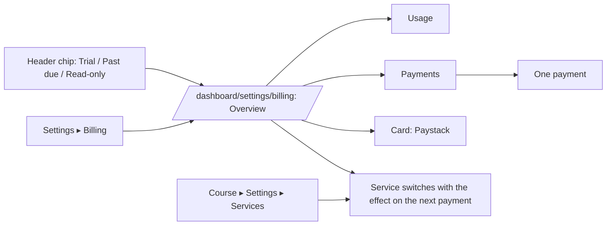
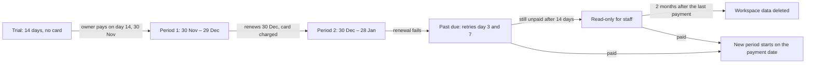

# Billing: plans per course, 30-day periods, usage, trial and dunning

**Answer first.** A workspace pays Nexa per **active student per course**, for **30 days at a time**. Each payment covers the next 30 days and the workspace **renews on** a date shown everywhere. Nothing is billed by calendar month and nothing is prorated. Each course is on a plan, **Core R99, Plus R139 or Pro R179** per student per 30 days, set by the highest service switched on for it (services.md). The billing page shows the renewal date, what the next payment will be course by course, usage, past payments and the card. Switching a service on or off always shows the effect on the next payment before it applies. The 14-day trial needs no card. When it ends, the owner pays, and that payment starts the first 30 days. If a renewal fails the workspace is **past due**, then **read-only** for staff. Data is deleted **two months after the last payment**, and every read-only and cancellation screen says on which date. Students and parents never see any of this and never lose access while data exists.

Read [README.md](README.md) first. Only people with `billing.view` see amounts; `billing.manage` can pay, change the card and set limits. Course leads with `courses.services` can switch services on their courses. Owner decisions of 16 November (via A2) apply: each period is 30 days from the most recent payment; a course that moves up mid-period is charged at the new plan's rates, and Nexa admins resolve the shortfall for the period already paid; a pooled AI allowance on Pro, no day pass in v1.

## Map



## The 30-day period



- A period starts on the day a payment succeeds and lasts 30 days. The next renewal is on day 31. On screen: "Renews on 30 Dec 2026".
- **Renewal rule (owner, 16 Nov):** the next renewal is 30 days after the most recent payment. A late payment starts a new period on the day it is paid, so the renewal date moves with it. Screens show `renewsOn` from billing and never calculate it.
- The amount for a period is fixed when it is paid: for each course, active students × the course's plan price. Students added during a period are counted in the next payment (proposal for billing.md; the screen shows "added this period, counted at renewal").

## Billing states and what each person sees

`viewer.workspace.billingState` drives the chip and the banner.

| State | Header chip (billing people) | Banner for billing people | Banner for other staff | Students and parents |
| --- | --- | --- | --- | --- |
| `TRIAL`, days 1 to 9 | "Trial · 9 days left" | none | none | nothing |
| `TRIAL`, days 10 to 14 | "Trial · 4 days left" (warning colour) | "Your trial ends on 30 Nov. Pay R3 336 to continue for 30 days." [Pay now] | "Trial ends on 30 Nov." | nothing |
| `ACTIVE` | none | none (from 3 days before renewal with a failing or expiring card: "Your card expires before 30 Dec." [Update card]) | none | nothing |
| `PAST_DUE` | "Payment failed" (danger) | "We couldn't renew on 30 Dec (R3 127.50). We'll try again on 2 Jan. Update your card to avoid interruptions." [Update card] [Pay now] | none | nothing |
| `READ_ONLY` | "Read-only" (danger) | "Your workspace is read-only because the renewal on 30 Dec wasn't paid. Students can still see their work. Pay R3 127.50 to unlock. If nothing is paid, all data is deleted on 30 Jan 2027." [Pay now] [Export data] | "This workspace is read-only. Ask Thandi Mokoena (owner) to renew." | nothing |
| `COMPED` | none (admins see "Comped until …" on the billing page) | none | none | nothing |
| `CANCELLED` | "Cancelled" | "Cancelled. Your last paid period ends on 29 Dec; after that the workspace is read-only. Data is deleted on 30 Jan 2027." [Reactivate] [Export data] | "This workspace is closing on 29 Dec." | nothing |

- Trial ends without payment → `READ_ONLY` on day 15 (research 01): "Your trial has ended. Pay to continue where you left off; nothing has been deleted." For a workspace that never paid, the deletion date is two months after the trial ended (proposal; billing.md to confirm).
- **Dunning** (design/03, section 8): emails on day 0, 3 and 7 after a failed renewal, read-only after 14 days. Paying at any point returns the workspace to `ACTIVE` at once and starts a new period.
- **Deletion warnings:** emails 30 days, 7 days and 1 day before the deletion date, to the owner and admins, each with an export link (proposal).

**What read-only blocks:** creating and editing courses, lessons, tests and assignments; adding students; switching services on. **What still works:** signing in, reading everything, exporting, marking already-submitted work (proposal, so students are not punished), recording fees and parent payments, updating the card and paying. Disabled controls carry the tooltip "Read-only until the workspace is renewed".

## 1. Billing overview

| | |
| --- | --- |
| Purpose | Answer "when do I pay next, how much, and why?" |
| Route | `/dashboard/settings/billing` |
| Entry points | Settings ribbon; the header chip; every billing banner; payment emails |
| Who | `billing.view`; actions need `billing.manage` |

```
Billing                         Overview · Usage · Payments
────────────────────────────────────────────────────────────────────────────
Current period  30 Nov – 29 Dec 2026 · paid R3 002.40  Card: Visa •• 4242  [Change]
Renews on 30 Dec 2026                                   Discount: LAUNCH10, 10% off plans
Next payment, if nothing changes: R3 127.50                       for 2 more payments

Courses                                                      [Compare plans]
Course                   Plan    Active students   Per student   Next payment
Grade 12 Mathematics     Plus    12 (+1 added)     R139          R1 807   [Services]
Grade 11 Phys Sciences   Plus    12                R139          R1 668   [Services]
Grade 10 Mathematics     Core     0                R99           R0       [Services]

Usage above allowances (added to the next payment)               R0
Plan upgrades this period (owed, under review by Nexa)          R0
Discount  LAUNCH10, 10% off plans                             −R347.50
────────────────────────────────────────────────────────────────────────────
Next payment on 30 Dec                                       R3 127.50
Prices exclude VAT. Each payment covers 30 days.
```

- "Plan upgrades this period" lists each shortfall from a mid-period upgrade, with its status: "Under review", "Added to next payment" or "Waived by Nexa".
- "Active students" links to the list counted per course, with enrolment dates. "+1 added" marks students who joined during this period and are counted at renewal.
- **Compare plans** opens a table of the three plans and their services, from `SERVICES` (services.md). Prices come from billing, never hard-coded.
- No "this month" wording anywhere: always "this period", "renews on", "next payment".

States:
- **Trial:** the top block reads "Free trial · 9 days left · ends 30 Nov. With today's courses, 30 days cost R3 336." [Pay now] (enabled from day 1; proposal: paying early starts the first period when the trial ends, so no trial days are lost).
- **Empty (no courses):** "No courses yet. Nothing to pay until a student joins a course."
- **Loading:** skeleton for the summary and three table rows.
- **Error:** "We couldn't load your billing details." [Try again]. Never show a stale amount without saying so.
- **Past due / read-only:** the banner shows; the overview adds an "Unpaid renewal" block at the top with [Pay now] and the deletion date.
- **Comped:** "Nexa covers this workspace until 31 Jan 2027." Amounts still show, struck through.

Queries: `getBillingOverview()`, `getCourseTiers()` (design/03, section 11; the return shapes need `renewsOn` and `periodStart`/`periodEnd` instead of months, see open points).

## 2. Service switches on a course

| | |
| --- | --- |
| Purpose | Turn premium features on or off for one course and see the effect on the next payment |
| Route | `/dashboard/courses/[id]/settings/services` (B's course settings page; A supplies the content) |
| Entry points | Course settings; [Services] on the billing overview; a gated spot (the graph block in the editor says "Graphs are part of Plus. [Turn on for this course]") |
| Who | `courses.services` (owner, admin, course lead). Others see the list read-only |

```
Services · Grade 12 Mathematics            Plan: Plus · R139 per student per 30 days
────────────────────────────────────────────────────────────────────────────
Included in every plan
  Lessons, tests, assignments, gradebook, calendar, messages, parent portal, fees ✓

Plus · R139
  [■] Visual maths input        Students type maths with a keyboard
  [■] Graphs                    Graphs in lessons and graph answers
  [ ] Live sessions             Schedule classes with a Meet link and attendance
  [ ] Custom branding           Your logo and colour (workspace-wide)
  [ ] Calendar feed             Students add classes to their phone calendar

Pro · R179
  [ ] Secure tests              Lockdown, tab-switch log, honours extra time
  [ ] AI marking                Suggested marks; you approve each one.
                                Includes 30 answers per student per period for the course
```

Confirm dialog when a switch moves the course **up**:

```
Turn on AI marking?
This moves Grade 12 Mathematics from Plus to Pro.

                          Per student     12 students
Now (Plus)                R139            R1 668 per 30 days
After (Pro)               R179            R2 148 per 30 days

AI marking is on from now, and this course is charged at Pro rates
from now. You've already paid Plus for this period, so the difference
(12 × R40 = R480) is recorded as owed. Nexa reviews it and either adds
it to your next payment on 30 Dec or waives it. You'll see the outcome
on the billing page.
[ Turn on and move to Pro ]   Cancel
```

Confirm dialog when the last Pro or Plus service goes **off**:

```
Turn off AI marking?
Grade 12 Mathematics goes back to Plus. AI marking stops now.
Your next payment on 30 Dec charges this course at Plus (−R480).
There is no refund for the rest of this period.
```

- Switches that don't change the plan (a second Plus service on a Plus course) apply at once, with no dialog.
- **Trial:** "Free during your trial. After the trial this course costs R179 per student per 30 days."
- **Read-only:** switching on is disabled; switching off is allowed.
- Services with status `later` or `parked` are not shown (services.md rule 4). There is no day pass in v1.
- **Error:** the switch flips back and the message shows under it.

Actions: `getCourseServices(courseId)`, `previewServiceChange({ courseId, enable, disable })`, `setCourseServices({ courseId, enable, disable })` (design/03, section 11; services.md). The preview needs `nextPaymentDeltaCents` and `renewsOn` in place of `monthDeltaCents`.

## 3. Usage and limits

| | |
| --- | --- |
| Purpose | Show metered use against allowances, and let the owner set a limit per period |
| Route | `/dashboard/settings/billing/usage` |
| Entry points | Billing ribbon; the email at 80% and 100% of an allowance or a limit |

```
Usage · period 30 Nov – 29 Dec 2026
──────────────────────────────────────────────────────────────────────
AI marking, by course (Pro courses only)
  Grade 12 Mathematics   290 of 360 included  ▓▓▓▓▓▓▓▓░░  81%
                         (30 per student × 12 students, shared by the course)
  Grade 11 Phys Sci      not on Pro
  Above the allowance: billed at cost plus 20%, added to the next payment
Storage           3.1 GB of 5 GB             ▓▓▓▓▓▓░░░░  62%

Limit on usage above allowances, per period
  [ R500 ]  When reached, AI marking pauses and tutors mark by hand
            until the next renewal.   [Save]
  ( ) No limit
```

- The AI allowance is **pooled per course**: 30 answers × active students on that Pro course, shared by everyone in it. There is no AI credit pack to buy.
- Marks above the allowance show their running cost: "42 answers above the allowance · R3.10 so far" (cost from billing; the 20% margin is billing's rule).
- Proposal: a default limit of R500 per period on new workspaces. The owner can change or remove it.
- At the limit, AI marking on that workspace shows "Paused: usage limit reached. [Raise limit]" to `billing.manage`, and "Paused until 30 Dec" to other tutors. Nothing else stops.
- **Trial caps** (research 01): 20 distinct students across all courses and 100 AI-marked answers. Bars show here and on the overview. At a cap, adding students is refused ("Your trial allows 20 students. Pay now to add more." [Pay now]) and AI marking pauses.

Actions: `getUsage({ meter, periodStart })`, `setUsageCap({ meter, limitQuantity, hardStop })` (design/03; `getUsage` takes a period, not a month).

## 4. Trial countdown

| Day | Where | What |
| --- | --- | --- |
| 1 to 14 | Header chip (billing people) | "Trial · N days left". Opens the overview |
| 1 | Onboarding and dashboard checklist | "Your trial ends on 30 Nov. No card needed until then." |
| 10 | Email + banner | "4 days left. With today's courses, 30 days cost R3 336." [Pay now] |
| 13 | Email | "Your trial ends tomorrow." |
| 14 | Pay on the last day | Payment starts the first 30-day period |
| 15 | Read-only if unpaid | Banner and email as in the states table, with the deletion date |

## 5. Paying and the card

| | |
| --- | --- |
| Purpose | Pay to start or renew a period, and keep a card for renewals |
| Route | Dialog on the overview; Paystack's hosted page for the card |
| Who | `billing.manage` |

```
Pay for 30 days
Grade 12 Mathematics · Plus · 12 × R139        R1 668
Grade 11 Phys Sciences · Plus · 12 × R139      R1 668
Discount LAUNCH10                               −R333.60
Total                                          R3 002.40
Covers 30 Nov – 29 Dec 2026 · renews 30 Dec on this card
[ Pay with Paystack ]                Secured by Paystack
```

- Nexa never shows a card form. The button calls `payPlatformInvoice` (or `startCardCapture` to only change the card) and returns to `/dashboard/settings/billing?payment=ok` or `?payment=failed`. The return page polls the status; webhooks decide (design/04, section 3).
- Renewals are card-only (Paystack reusable authorisations, research 03).
- **Error on return:** "Your payment didn't go through. Paystack said: Insufficient funds." [Try again]

Actions: `payPlatformInvoice({ invoiceId })`, `startCardCapture({ returnPath })`, `getCardCaptureStatus({ reference })` (design/03, section 11).

## 6. Payments history

| | |
| --- | --- |
| Purpose | Every payment, the period it covers, and a PDF |
| Route | `/dashboard/settings/billing/payments` and `/dashboard/settings/billing/payments/[id]` |
| Entry points | Billing ribbon; payment emails; the past-due banner |

```
Payments
Period                    Number        Amount      Status
30 Nov – 29 Dec 2026      NX-2026-0142  R3 002.40   Paid 30 Nov                    [PDF]
30 Dec – 28 Jan 2027      NX-2026-0198  R3 127.50   Failed · retry 2 Jan [Pay now] [PDF]
```

One payment:

```
NX-2026-0142 · 30 Nov – 29 Dec 2026                     [Download PDF]
Ubuntu Tutors · office@ubuntututors.co.za
──────────────────────────────────────────────────────────────
Grade 12 Mathematics · Plus · 12 students × R139      R1 668.00
Grade 11 Phys Sciences · Plus · 12 students × R139    R1 668.00
AI marking above allowance (previous period)              R0.00
Discount LAUNCH10 (10% off plans)                      −R333.60
──────────────────────────────────────────────────────────────
Total                                                 R3 002.40
Paid by Visa •• 4242 on 30 Nov 2026 · Paystack ref T12345
```

- One line per course at one plan: no proration, so no split lines.
- **Empty:** "Your first payment is due when your trial ends on 30 Nov."

Queries: `listPlatformInvoices`, `getPlatformInvoice` (design/03, section 11).

## 7. Cancelling

Owner only, at the bottom of the overview: "Cancel Nexa".

```
Cancel Nexa?
Your workspace stays fully usable until 29 Dec, the end of the period
you paid for. Then it becomes read-only.
All courses, students and files are deleted on 30 Jan 2027,
two months after your last payment. Export first if you want to keep them.
[ Export everything ]
Why are you leaving? [ ▾ ]
[ Cancel at the end of the period ]   Keep Nexa
```

- Reactivating before the deletion date is one payment; everything comes back as it was.
- After deletion the workspace can't be restored. Students and parents are told by email 7 days before (proposal).

Action: `cancelWorkspace({ reason })` → `{ deleteAfter }` (design/03, section 11).

## Open points for A2 and billing.md

1. **Decided by the owner (16 Nov):** renewal is 30 days after the most recent payment.
2. **Decided by the owner (16 Nov):** a course that moves up mid-period is charged at the new plan's rates, and Nexa admins resolve the shortfall. billing.md needs a record for that shortfall (course, from plan, to plan, students, amount, status `OPEN`, `ADDED_TO_NEXT_PAYMENT` or `WAIVED`) and an admin action to resolve it; see [06](06-admin-console.md), section 5.
3. Students added during a period: counted at the next renewal (proposed).
4. A2's design/03 still uses calendar months, `monthDeltaCents`, `month: "YYYY-MM"` and `buyDayPass`; these flows need period fields and no day pass.
5. Paying early during the trial: the first period starts when the trial ends (proposed).
6. Deletion date for a workspace that never paid: two months after the trial ends (proposed).
7. Default usage limit of R500 per period; marking submitted work while read-only allowed.
