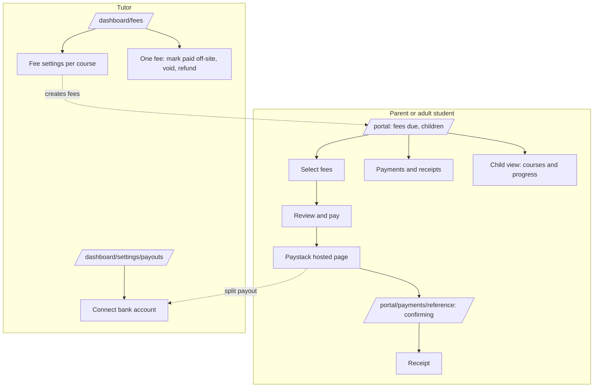

# Payments portal, tutor fees and payouts

**Answer first.** Parents pay tutors through Nexa. A parent with several children, even with different tutors, sees **one list of fees due** and pays any or all of them in **one Paystack checkout** (card or EFT). Paystack splits the payment straight to each tutor's bank account; Nexa keeps 2%, and the card fee comes off the tutor's share. Adult students whose tutor has turned on payment visibility use the same portal for their own fees. Tutors set fees per course, see who has paid, and mark fees **paid off-site** when a parent pays cash or by their own EFT. Every payment gets a receipt. A tutor connects payouts once, with bank details checked against the account holder's name. Nexa never holds tutor money.

Read [README.md](README.md) first. Mechanics are in A2's [design/04-payments.md](../design/04-payments.md); action names below are from its section 8. In v1, parents are linked by the tutor ([01](01-signup-onboarding.md), section 7), not by claim code.

## Map



## Who sees fees

From design/01, section 6:

| Situation | Sees and pays fees | Portal |
| --- | --- | --- |
| Student has a linked parent | Each linked parent | Parent portal |
| No parent, payment visibility on (adults only) | The student | Student's own portal |
| No parent, payment visibility off | Nobody in the app; the tutor collects and can mark fees paid | — |

## 1. Parent portal home

| | |
| --- | --- |
| Purpose | Show what is due across all children and tutors, and pay it in one go |
| Route | `/portal` |
| Entry points | Sign-in for a parent-only user lands here; "My children" in the workspace switcher for a parent who is also staff; fee emails ("Fees due for Sipho: R1 430") link to `/portal?pay=<feeId>` |
| Who | `viewer.persona = "guardian"`; `fees.pay` for own children |

Mobile first: most parents open this from an email on a phone.

```
┌──────────────────────────────────────────────┐
│ Nexa · My children                  [avatar] │
├──────────────────────────────────────────────┤
│ All · Sipho · Ayanda                         │  ← ribbon: child filter
├──────────────────────────────────────────────┤
│ Due now                          R2 630      │
│                                              │
│ [x] Sipho · Gr 12 Maths · December           │
│     Thandi Maths Tutoring · due 5 Dec R1 430 │
│ [x] Ayanda · Gr 9 English · December         │
│     Ubuntu Tutors · due 7 Dec        R1 200  │
│ [ ] Ayanda · Exam prep pack (4 lessons)      │
│     Ubuntu Tutors · due 20 Dec       R800    │
│                                              │
│ [ Pay R2 630 ]                               │
│ Card or EFT · one payment for all selected   │
├──────────────────────────────────────────────┤
│ Pay your tutor directly                      │
│ Ayanda · Gr 9 Maths · R950 · Bongi Tutors    │
│ Online payment isn't set up for this tutor.  │
│ Pay as arranged: "EFT to FNB 62…, ref name"  │
├──────────────────────────────────────────────┤
│ Your children                                │
│ Sipho Dlamini  · 1 course · [View]           │
│ Ayanda Dlamini · 2 courses · [View]          │
└──────────────────────────────────────────────┘
```

- Every open fee is ticked by default except ones due more than 14 days from now (proposal). The total updates as boxes change.
- Overdue fees sort first and show "Overdue since 5 Dec" in the danger colour.
- **Fees whose tutor has no active payout account** can't be paid online. They show in "Pay your tutor directly" with the tutor's off-site instructions (`PaymentSettings.offsiteInstructions`), and leave the selectable list.
- A fee locked by a checkout in progress shows "Payment in progress" and can't be selected for 30 minutes (design/04, section 5).
- The child filter in the ribbon narrows the list; "All" is the default.
- "View" on a child opens their courses and progress (B's read-only child view; `content.view` and `grades.view` ◐ for a guardian).

States:
- **Empty (nothing due):** illustration and "You're all paid up." with the last receipt linked.
- **Empty (no children):** "No children linked yet. Ask your tutor to link your account." (In "Later", a claim-code button appears here.)
- **Loading:** skeleton of three fee rows.
- **Error:** "We couldn't load your fees." [Try again].
- Parents are never blocked by a workspace's billing state.

Query: `listPayableInvoices({ status: "OPEN" })`; children from `viewer.children`.

## 2. Review and pay

| | |
| --- | --- |
| Purpose | Confirm what is being paid, then hand over to Paystack |
| Route | Sheet over `/portal` (a route on mobile: `/portal/pay`) |

```
Pay R2 630
──────────────────────────────────────────
Sipho · Gr 12 Maths · December       R1 430
  to Thandi Maths Tutoring
Ayanda · Gr 9 English · December     R1 200
  to Ubuntu Tutors
──────────────────────────────────────────
Discount code  [          ] [Apply]
Total                                R2 630
You pay exactly this. Fees and Nexa's share
come out of what your tutors receive.

[ Continue to Paystack ]     Secured by Paystack
```

- One Paystack transaction pays every selected fee (multi-split, design/04, section 5). The parent sees one charge on their statement.
- A **discount code** from a tutor applies only to that tutor's fees and shows as a line ("WELCOME −R143 on Thandi Maths Tutoring"); see [05](05-discount-codes.md).
- If a selected fee changed or was paid off-site meanwhile, the sheet says so and refreshes the total before going on.

Action: `startCheckout({ invoiceIds, discountCode? })` → `{ authorizationUrl, reference, totalCents, discountCents }`.

## 3. Returning from Paystack

| | |
| --- | --- |
| Purpose | Confirm the result, which the webhook decides |
| Route | `/portal/payments/[reference]` |

```
Confirming your payment…          ✓ Paid R2 630                    ✕ Payment didn't go through
[spinner, up to 30 s]             Thank you. We emailed a receipt   Paystack said: Declined.
                                  to nomsa@example.com.              Nothing was charged.
If this takes longer, we'll       [View receipt]  [Back to fees]     [Try again]  [Back to fees]
email you when it's confirmed.
```

- The page polls `getCheckoutStatus({ reference })`. It never marks anything paid from the redirect alone.
- After 30 seconds without a result: "Still confirming. You can close this page; we'll email you." The reconciliation job settles it (design/04, section 7).
- Abandoned checkouts unlock the fees after 30 minutes.

## 4. Payments and receipts

| | |
| --- | --- |
| Purpose | History of everything paid, with receipts |
| Route | `/portal/payments` and `/portal/payments/[reference]` |
| Entry points | Portal ribbon "Payments"; receipt emails |

```
Payments                                         [Child: All ▾]
16 Dec 2026   R2 630   Card •• 1234   Sipho, Ayanda   [Receipt]
5 Nov 2026    R1 430   EFT            Sipho           [Receipt]
3 Nov 2026    R1 200   Paid to tutor directly · Ayanda  (marked by Ubuntu Tutors)
```

Receipt (page and PDF, one per checkout):

```
Receipt NXP-2026-004512 · 16 Dec 2026
Paid by Nomsa Dlamini · Card •• 1234 · Paystack ref T98765
──────────────────────────────────────────────────────────
Thandi Maths Tutoring (fee 0042)
  Sipho · Gr 12 Maths · December                   R1 430.00
Ubuntu Tutors (fee 0117)
  Ayanda · Gr 9 English · December                 R1 200.00
──────────────────────────────────────────────────────────
Total paid                                         R2 630.00
Nexa processes payments for these tutors. Questions about a fee: contact the tutor.
```

- Off-site payments show in the history with "Paid to tutor directly" and who marked them. They have no Nexa receipt, because Nexa didn't handle the money; the tutor's note shows instead.
- Refunds show as a separate row: "Refund R1 430 · Sipho · 18 Dec".
- **Empty:** "No payments yet."

Queries: `listPayableInvoices({ status: "PAID" })`, plus a receipt query (proposed: `getReceipt({ reference })`).

## 5. Adult student portal

| | |
| --- | --- |
| Purpose | An adult student with payment visibility pays their own fees |
| Route | `/portal` (same screens; no child filter and no "Your children") |
| Entry points | "Fees" in the student's own navigation, shown only when `viewer.learner.paymentVisible` is true and no parent is linked |

- Identical to sections 1 to 4, with "Your fees" instead of "Due now" and no children list.
- The tutor turns visibility on in the student's profile, "Fees" tab: "Let Lerato see and pay her own fees" (`learners.paymentVisibility`). The switch is disabled for minors and when a parent is linked, with a tooltip saying why.

## 6. Tutor: fees

| | |
| --- | --- |
| Purpose | Set what each course costs parents, see who has paid, record cash and EFT |
| Route | `/dashboard/fees`; fee settings at `/dashboard/courses/[id]/settings/fees` |
| Entry points | Main navigation "Fees" (B's sidebar); the student profile "Fees" tab; the checklist after payouts |
| Who | `fees.manage` (owner, admin, a tutor for own students), `fees.markOffsite` |

```
Fees                         Due · Paid · All          [ New fee ] [ Settings ]
[ Search student ]  Course [All ▾]  Status [Open ▾]
──────────────────────────────────────────────────────────────────────────────
Student          Course            Fee          Due       Status
Sipho Dlamini    Gr 12 Maths       R1 430       5 Dec     Open · parent notified
Lerato Khumalo   Gr 12 Maths       R1 430       5 Dec     Overdue 3 days    [Remind]
Peter van Wyk    Gr 12 Maths       R1 430       5 Dec     Paid online 4 Dec
Ayanda Dlamini   Gr 11 Phys Sci    R1 200       5 Dec     Paid cash 2 Dec (off-site)
Bheki Zulu       Gr 11 Phys Sci    R1 200       5 Dec     No one can pay online  ⓘ
──────────────────────────────────────────────────────────────────────────────
December: R6 690 billed · R1 430 paid online · R1 200 off-site · R4 060 open
```

- "No one can pay online ⓘ": no parent linked and payment visibility off. The tooltip says how to fix it: link a parent, or mark it paid when collected.
- Without payouts connected, a banner reads "Connect payouts so parents can pay online." [Connect]. Fees still work off-site.

**Fee settings for a course:**

```
Fees · Grade 12 Mathematics
Default fee   (•) Monthly  R[ 1 430 ]  on day [ 5 ] of each month
              ( ) Lesson pack  R[     ] for [  ] lessons
              ( ) Once-off
Starts        [ 1 Dec 2026 ]
Due after     [ 7 ] days
Per student   Lerato Khumalo  R1 200 (sibling rate)   [Edit]  [+ Different fee for a student]
Paid to       Thandi Maths Tutoring · FNB ••6789
```

**One fee (side panel):**

```
Fee 0042 · Sipho Dlamini · Gr 12 Maths · December
R1 430 · due 5 Dec · Open
Sent to Nomsa Dlamini (parent) on 28 Nov

You'd receive about R1 352.56 if paid by card
  (Paystack fee about R48.84, Nexa 2% R28.60)

[ Mark paid off-site ]  [ Void ]   (paid online: [ Refund ])
History: created 28 Nov · emailed 28 Nov · reminder 6 Dec
```

**Mark paid off-site dialog:**

```
Mark paid off-site
How       (•) Cash  ( ) EFT to my account  ( ) Other
Amount    R[ 1 430 ]
Received  [ 2 Dec 2026 ]
Reference [            ]  (optional)
Note      [ Paid at lesson               ]  (required)
The parent sees this as "Paid to tutor directly". Nexa takes no commission.
[ Mark paid ]
```

States:
- **Empty:** "No fees yet. Set a monthly fee on a course and Nexa sends it to parents for you." [Set up fees].
- **Read-only workspace:** fees, reminders, off-site marking and refunds still work (money flows in; proposal in 03).
- **Error:** inline in the panel or dialog.

Actions: `listFeeInvoices`, `upsertFeeSchedule`, `issueInvoice`, `voidInvoice`, `markInvoicePaidOffsite`, `voidOffsitePayment`, `requestRefund` (design/04, section 8); `setLearnerPaymentVisibility({ learnerId, visible })` (proposed).

## 7. Tutor: connect payouts

| | |
| --- | --- |
| Purpose | Connect the bank account that receives parents' payments |
| Route | `/dashboard/settings/payouts`; also onboarding step 5 |
| Entry points | Settings ribbon; the fees banner; onboarding |
| Who | `payouts.connect`: solo owner, organisation owner, or each tutor when the organisation pays tutors directly |

```
Payouts
Parents' payments go straight to this account, 2 working days after payment.
──────────────────────────────────────────────────────────────
Paid to          (•) One account for the organisation
(organisations)  ( ) Each tutor connects their own account

Bank             [ FNB ▾ ]
Account number   [ 62xxxxxxxx ]
Business name    [ Thandi Maths Tutoring ]   (shown on parents' statements)
                 [ Check account ]

✓ Account holder: T MOKOENA          Is this right?
                 [ Yes, connect ]  No, edit
```

- **Check account** resolves the holder's name with Paystack before anything is saved (`resolvePayoutAccount`). A mismatch is the tutor's cue to fix a typo.
- After connecting: status "Verifying" until Paystack verifies the account, then "Connected". Paystack holds the first payout until then (design/04, section 5).
- Connected view: bank, "••6789", holder name, status, [Change account], and a list of recent payouts (date, amount, fees covered).
- **Changing the account** asks for the password and the 2FA code again, emails the owner, and writes the audit log (proposal; protects against a taken-over account redirecting money).
- The full account number is never stored or shown again; only the last four digits (design/04, section 1).
- **Per-tutor mode:** each tutor sees this page for their own account; the owner sees a table of tutors and their payout status.
- **Error:** "Paystack couldn't find that account. Check the bank and number." Provider errors show the provider's message.

Actions: `getPayoutSettings()`, `listBanks()`, `resolvePayoutAccount({ bankCode, accountNumber })`, `connectPayoutAccount({ bankCode, accountNumber, businessName })`, `setPayoutMode({ payoutMode })` (design/04, section 8).

## Open points for A2

1. A receipt query (`getReceipt`) and a payouts list query for the connected view are not in design/04 yet.
2. Default selection: fees due within 14 days ticked (proposed).
3. Re-authentication and an owner email when payout details change (proposed).
4. `setLearnerPaymentVisibility` is needed for section 5.
