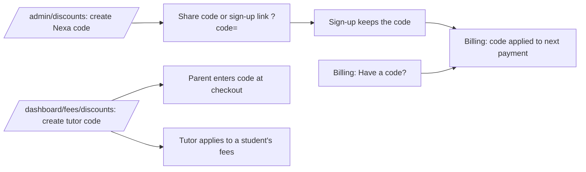

# Discount codes

**Answer first.** There are two kinds of code. **Nexa codes** take money off a workspace's payment to Nexa. A Nexa admin creates them, and an owner enters one at sign-up or on the billing page. **Tutor codes** take money off the fees parents pay a tutor. The tutor creates them, and a parent enters one at checkout or the tutor applies one to a student. Both use A2's `DiscountCode` model (design/03, section 9): percent or fixed, a start and end date, a redemption limit, and a number of **payments** they last for. Because Nexa bills in 30-day periods, "months" on screen become "payments". A workspace can never discount Nexa's bill with its own codes.

Read [README.md](README.md) first.

| | Nexa code | Tutor code |
| --- | --- | --- |
| Model scope | `WORKSPACE_BILL` or `TIER` | `PARENT_INVOICE` |
| Created by | Nexa admin (`admin.override`) | Owner, admin or tutor with `fees.manage` |
| Entered by | Owner or admin with `billing.manage` | Parent or adult student at checkout; or applied by the tutor |
| Applies to | Plan lines on the next payments | That workspace's fees only |
| Example | `LAUNCH10`: 10% off plans for 3 payments | `SIBLING15`: 15% off each fee |

## Flow



## 1. Entering a Nexa code (owner)

| | |
| --- | --- |
| Purpose | Redeem a Nexa promotion against the workspace's payments |
| Route | Billing overview (`/dashboard/settings/billing`), "Have a code?" link under the summary; sign-up via `?code=` |
| Who | `billing.manage` |

```
Have a code?   [ LAUNCH10      ] [Apply]

✓ LAUNCH10 · 10% off plans
  Applies to your next 3 payments, starting 30 Nov.
  Next payment: R3 336 → R3 002.40
```

- From sign-up, the code is kept and redeemed automatically when the workspace is created; the billing overview then shows it as applied, with "3 payments left".
- One workspace-wide code at a time (design/03). Entering a second shows "You already have LAUNCH10 (2 payments left). Replace it?" with both effects side by side.
- On the overview and on each payment: a "Discount LAUNCH10" line, and "2 payments left" next to the code.
- Errors, matching design/03's codes: `CODE_INVALID` "We don't know that code." · `CODE_EXPIRED` "That code ended on 31 Jan." · `CODE_USED` "This workspace has already used that code." · a parent code entered here: "That code is for a tutor's fees, not your Nexa payment."
- **Trial:** a code entered in the trial applies from the first payment.

Action: `redeemDiscountCode({ code })` → `{ description, scope, monthsLeft }` (design/03; should become `paymentsLeft`).

## 2. Nexa codes in the admin console

| | |
| --- | --- |
| Purpose | Create, review and end Nexa promotions |
| Route | `/admin/discounts`, `/admin/discounts/[id]` |
| Who | `admin.override`; every create and end writes the audit log |

```
Discount codes                                         [ New code ]
Code       Off                 Lasts        Used         Ends        Status
LAUNCH10   10% off plans       3 payments   14 / 100     31 Jan 27   Active
PILOT      100% off plans      2 payments    3 / 5       —           Active
SCHOOLS20  20% off Pro plans   no limit      0 / —       —           Ended 1 Dec
```

New code:

```
New discount code
Code           [ LAUNCH10 ]          (letters and numbers, saved in capitals)
Description    [ Launch offer for early tutors ]
Off            (•) Percent [ 10 ]%    ( ) Fixed R[    ]
Applies to     (•) Whole payment  ( ) Only courses on [ Pro ▾ ]
Lasts          [ 3 ] payments   ( ) No limit
Starts         [ 16 Nov 2026 ]   Ends [ 31 Jan 2027 ]  (optional)
Total uses     [ 100 ]          ( ) No limit
Sign-up link   nexa-lms.co.za/auth/sign-up?code=LAUNCH10   [Copy]
Note for the audit log [ Approved by Jassiel for launch ]
[ Create code ]
```

- Detail page: the settings (read-only once used, except the end date and the total uses), and a list of workspaces that redeemed it, with payments applied and the rand amount given away.
- **End code** asks for a note. Workspaces that already redeemed it keep their remaining payments (proposal; A2 to confirm).

Actions: `adminCreateDiscountCode`, `adminDeactivateDiscountCode({ id, note })` (design/03); a list and detail query (proposed: `adminListDiscountCodes`, `adminGetDiscountCode`).

## 3. Tutor codes on parent fees

| | |
| --- | --- |
| Purpose | Let a tutor offer a discount on their own fees |
| Route | `/dashboard/fees/discounts` (ribbon tab on Fees) |
| Who | `fees.manage` |

```
Discounts on fees                                      [ New code ]
Code        Off            Courses       Lasts        Used
SIBLING15   15% off        All courses   no limit     4 students
WELCOME     R143 off       Gr 12 Maths   1 fee        2 / 10
```

New code: the same form as the admin one, without "Applies to plans", with **Courses** (all or a list) and **Lasts** counted in fees.

Two ways it reaches a fee:
1. **The parent enters it** at checkout ([04](04-payments-portal.md), section 2). It applies only to fees of the workspace that issued it, and shows as its own line under that tutor's fees.
2. **The tutor applies it** to a student from the student's "Fees" tab: "Apply a discount [ SIBLING15 ▾ ]". Future fees for that student carry it, and the parent sees the discounted amount with a "SIBLING15 −R214.50" line.

- Nexa's 2% is worked out on the amount after the discount (design/04, section 5).
- One redemption per parent and student per code (design/03, `redeemerKey`).
- A one-off reduction for one fee without a code is "Edit amount" on the fee itself, not a discount code.

Actions: create and end use the same discount actions scoped to the workspace (proposed: `createFeeDiscountCode`, `endFeeDiscountCode`); `applyFeeDiscount({ learnerId, code })` (proposed); checkout takes `discountCode` (`startCheckout`, design/04).

## States (all screens)

- **Empty:** admin "No codes yet." [New code]; tutor "Give siblings or new students a discount. Parents enter the code when paying." [New code].
- **Loading:** skeleton table rows.
- **Read-only workspace:** tutors can still apply and create fee codes (fees keep working); entering a Nexa code still works, since it lowers the next payment.

## Open points for A2

1. design/03 counts `durationMonths`; with 30-day periods it should count payments.
2. Ending a code: existing redemptions keep their remaining payments (proposed).
3. Tutor-side create and apply actions are not in design/04 yet.
