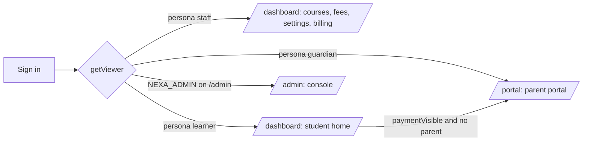

# Agent A UX flows (session A3)

**Answer first.** These six files describe the screens for Agent A's areas as flows and wireframe specs: what each screen is for, where it lives, how people reach it, what it shows in every state, and which server actions it calls. Agent B builds every screen with its own components; nothing here is a component. There is one UI, with no Simple or Technical modes (owner decision, 16 November 2026).

Status: draft for A3, 2026-11-16. Branch `revamp/a-ux`.

| File | Covers |
| --- | --- |
| [01-signup-onboarding.md](01-signup-onboarding.md) | Tutor sign-up, solo or organisation, the 5-step onboarding, staff and student invites, guardian claim codes, magic links |
| [02-org-team-settings.md](02-org-team-settings.md) | Workspace settings, members, roles, teams, branding |
| [03-billing.md](03-billing.md) | Tiers per course, service switches with the price change, usage and caps, invoices, the trial countdown, past-due and read-only banners |
| [04-payments-portal.md](04-payments-portal.md) | Parent portal and adult-student portal, one checkout for several children, off-site payments, receipts, tutor fees and payout connection |
| [05-discount-codes.md](05-discount-codes.md) | Nexa promo codes on a workspace's bill; tutor discounts on parent fees (proposal) |
| [06-admin-console.md](06-admin-console.md) | Workspaces, plans, revenue, failed payments, overrides with the audit log, impersonation and its banner |

## Sources this builds on

- Owner decisions in [a/research/SUMMARY.md](../research/SUMMARY.md) and [b/research/SUMMARY.md](../../b/research/SUMMARY.md). They override everything else.
- [contracts/viewer.md](../../contracts/viewer.md) and [contracts/services.md](../../contracts/services.md) (Draft 1, PR #43).
- A2's [design/01-tenancy-roles.md](../design/01-tenancy-roles.md) (draft in progress on `revamp/a-system-design`): roles, the permissions matrix, payment visibility, impersonation rules.
- `contracts/billing.md` and `contracts/navigation.md` do not exist yet. Action names below marked **(proposed)** are A3's suggestions for `billing.md` and A's feature folders; A2 picks the final names. The full list is at the end of this file.

## Shell assumptions (until B's `navigation.md` lands)

B's research picked an Azure-style shell: a **parent header** and a slim **child ribbon** under it (b/research/05). Every screen here uses these slots:

```
┌──────────────────────────────────────────────────────────────────────────┐
│ [logo] Workspace ▾ / Section / Page      [status chip]  [?]  [main action] [avatar] │  ← parent header
├──────────────────────────────────────────────────────────────────────────┤
│ View A · View B · View C                              [tool] [tool] [More ▾] │  ← child ribbon
├──────────────────────────────────────────────────────────────────────────┤
│ [account banner slot: trial, past due, read-only, impersonation]         │
│                                                                          │
│ page body                                                                │
└──────────────────────────────────────────────────────────────────────────┘
```

- **Workspace switcher** in the breadcrumb: lists `viewer.workspaces`, plus "My children" when `viewer.children` is not empty. Calls `switchWorkspace()`.
- **Status chip**: one short state from A, for example "Trial · 9 days left", "Payment failed", "Read-only". Clicking it opens the billing page for people with `billing.view`, or a short explanation for everyone else.
- **Account banner slot**: one full-width strip above the page body. A supplies its text and action. Only one banner shows at a time, in this order: impersonation, read-only, past due, trial ending. Learners and guardians never see billing banners.
- When `navigation.md` lands, A updates these files to use B's slot names.

## Words used on screen

Plain words, the same everywhere:

| Use | Not |
| --- | --- |
| Workspace | Tenant, org account |
| Organisation, Solo practice | Org type, kind |
| Student | Learner (the data model's name) |
| Parent | Guardian (on screen; the data model says guardian) |
| Course | Subject (a subject is a label on a course) |
| Plan: Core, Plus, Pro | Tier |
| Bill (what the workspace pays Nexa) | Subscription invoice |
| Fees (what parents pay the tutor) | Parent invoices |
| Payouts | Settlement, subaccount |

Money is shown in rand with a space as the thousands separator and a decimal point only when there are cents: `R1 430`, `R48.84`. Prices exclude VAT; Nexa is not VAT-registered, so no VAT line shows until `billing.md` says otherwise. Dates are written `16 Nov 2026`, times `14:30`, in the workspace's time zone (default Africa/Johannesburg).

## States every screen describes

| State | What it means here |
| --- | --- |
| Empty | First visit, nothing exists yet. Show one sentence, one illustration from B's set and one main action |
| Loading | Skeleton rows in the page's own layout, never a full-page spinner. Server components stream; only client parts show skeletons |
| Error | Inline message where the data would be, with "Try again". Action errors show next to the form, never as a toast alone |
| Read-only | `viewer.workspace.readOnly` is true. Writes are disabled with a tooltip that says why, and the banner shows. Reading and exporting still work |
| No permission | The menu item is hidden (`can(viewer, ...)`); a direct URL shows a "You don't have access" page with the owner's name |

## Who sees what

Personas come from `viewer.persona`; permissions from `viewer.permissions` (see design/01, section 3).



## Server actions these screens need

`viewer.md` and `services.md` already define: `getViewer`, `requireViewer`, `can`, `canIn`, `switchWorkspace`, `hasService`, `getCourseServices`, `setCourseService`. Everything else below is **(proposed)**. All writes are next-safe-action actions on the clients in `viewer.md` (`viewerActionClient`, `staffActionClient`, `guardianActionClient`, `adminActionClient`), and all return the standard `SafeActionResult`.

| Area | Proposed queries and actions | Home |
| --- | --- | --- |
| Sign-in | `signUp`, `signInWithPassword`, `requestMagicLink`, `verifyEmail`, `resendVerification` | `src/features/auth` |
| Onboarding | `createWorkspace`, `getOnboarding`, `saveOnboardingStep`, `skipOnboardingStep`, `dismissOnboarding` | `src/features/workspaces` |
| Invites | `inviteMembers`, `getInvite`, `acceptInvite`, `createStudentInvites`, `createJoinLink`, `revokeJoinLink`, `joinWithLink` | `src/features/workspaces`, `students` |
| Parents | `createClaimCode`, `inviteParent`, `previewClaimCode`, `claimChild`, `revokeGuardianship` | `src/features/parents` |
| Workspace | `updateWorkspace`, `updateBranding`, `deleteWorkspace`, `transferOwnership` | `src/features/workspaces` |
| Members and teams | `listMembers`, `changeMemberRole`, `suspendMember`, `removeMember`, `resendInvite`, `revokeInvite`, `createTeam`, `updateTeam`, `deleteTeam`, `setTeamMembers` | `src/features/workspaces` |
| Billing | `getBillingOverview`, `previewServiceChange`, `getUsage`, `setUsageLimit`, `listBills`, `getBill`, `startCardSetup`, `retryBillPayment`, `buyDayPass`, `buyAddOn`, `cancelWorkspace` | `src/features/billing` |
| Fees and payouts | `getFeeSettings`, `setCourseFee`, `listFees`, `issueFees`, `markFeePaidOffsite`, `voidFee`, `getPayoutAccount`, `listBanks`, `resolveBankAccount`, `connectPayoutAccount`, `listPayouts` | `src/features/payments` |
| Portal | `getPortalOverview`, `listPayableFees`, `createCheckout`, `getCheckoutResult`, `listReceipts`, `getReceipt` | `src/features/payments` |
| Discounts | `previewPromoCode`, `redeemPromoCode`, `setLearnerFeeDiscount`; admin: `listPromoCodes`, `createPromoCode`, `updatePromoCode`, `endPromoCode` | `src/features/billing` |
| Admin | `adminListWorkspaces`, `adminGetWorkspace`, `adminOverride`, `adminRevenue`, `adminListFailedPayments`, `adminRetryCharge`, `adminListAudit`, `startImpersonation`, `endImpersonation` | `src/features/admin` |
