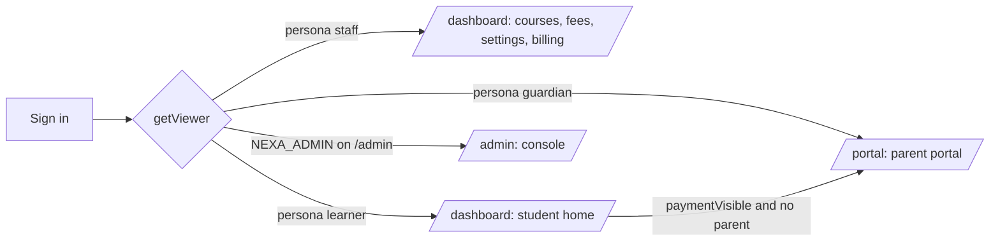

# Agent A UX flows (session A3)

**Answer first.** These six files describe the screens for Agent A's areas as flows and wireframe specs: what each screen is for, where it lives, how people reach it, what it shows in every state, and which server actions it calls. Agent B builds every screen with its own components; nothing here is a component. There is one UI, with no Simple or Technical modes (owner decision, 16 November 2026).

Status: draft for A3, 2026-11-16. Branch `revamp/a-ux`.

| File | Covers |
| --- | --- |
| [01-signup-onboarding.md](01-signup-onboarding.md) | Tutor sign-up, solo or organisation, the 5-step onboarding, staff invites, tutor-created students and parent links (v1); magic links, student invites and claim codes (later) |
| [02-org-team-settings.md](02-org-team-settings.md) | Workspace settings, members, roles, teams, branding |
| [03-billing.md](03-billing.md) | Plans per course in 30-day periods, service switches with the effect on the next payment, the pooled AI allowance and limits, payments, the trial countdown, past-due, read-only and deletion banners |
| [04-payments-portal.md](04-payments-portal.md) | Parent portal and adult-student portal, one checkout for several children, off-site payments, receipts, tutor fees and payout connection |
| [05-discount-codes.md](05-discount-codes.md) | Nexa promo codes on a workspace's bill; tutor codes on parent fees |
| [06-admin-console.md](06-admin-console.md) | Workspaces, plans, revenue, failed payments, overrides with the audit log, impersonation and its banner |

## Sources this builds on

- Owner decisions in [a/research/SUMMARY.md](../research/SUMMARY.md) and [b/research/SUMMARY.md](../../b/research/SUMMARY.md). They override everything else.
- [contracts/viewer.md](../../contracts/viewer.md) and [contracts/services.md](../../contracts/services.md) (Draft 1, PR #43).
- A2's [design/01-tenancy-roles.md](../design/01-tenancy-roles.md) (draft in progress on `revamp/a-system-design`): roles, the permissions matrix, payment visibility, impersonation rules.
- A2's design drafts on `revamp/a-system-design`: [02-identity.md](../design/02-identity.md), [03-billing.md](../design/03-billing.md) (section 11 lists billing queries and actions), [04-payments.md](../design/04-payments.md) (section 8 lists payment queries and actions). Action names here follow those drafts.
- Owner decisions relayed from A2 on 16 November: billing in **30-day periods** anchored to the payment date, no proration; a course that moves up bills at the higher plan for the next 30 days; Pro's AI allowance is 30 answers per active student per period, **pooled per course**, with marks above it at cost plus margin and no credit pack; **no day pass in v1**; in v1 **tutors create students** (name, optional email, a sign-in code or first password) and **link parents**, while magic links, student invites and claim codes with consent come later; data is **deleted two months after a workspace's last payment**. The owner's answers to A3's questions (16 November) apply as well. Renewal is 30 days after the most recent payment. A course that moves up mid-period is charged at the new rates, and Nexa admins resolve the shortfall. There is no consent capture in v1, because tutors onboard students and handle consent. Payments and payout changes are held during impersonation, on suspicious activity and for unverified accounts, with emails to everyone affected. Where A2's drafts still say months or day passes, these flows follow the decisions and list the gap in "Open points".
- `contracts/billing.md` and `contracts/navigation.md` do not exist yet. Names marked **(proposed)** are A3's suggestions where A2's drafts have no action yet; A2 picks the final names.

## Shell assumptions (until B's `navigation.md` lands)

B's research picked an Azure-style shell: a **parent header** and a slim **child ribbon** under it (b/research/05). Every screen here uses these slots:

```
┌──────────────────────────────────────────────────────────────────────────┐
│ [logo] Workspace ▾ / Section / Page      [status chip]  [?]  [main action] [avatar] │  ← parent header
├──────────────────────────────────────────────────────────────────────────┤
│ View A · View B · View C                              [tool] [tool] [More ▾] │  ← child ribbon
├──────────────────────────────────────────────────────────────────────────┤
│ [account banner slot: trial, past due, read-only, impersonation]         │
│                                                                          │
│ page body                                                                │
└──────────────────────────────────────────────────────────────────────────┘
```

- **Workspace switcher** in the breadcrumb: lists `viewer.workspaces`, plus "My children" when `viewer.children` is not empty. Calls `switchWorkspace()`.
- **Status chip**: one short state from A, for example "Trial · 9 days left", "Payment failed", "Read-only". Clicking it opens the billing page for people with `billing.view`, or a short explanation for everyone else.
- **Account banner slot**: one full-width strip above the page body. A supplies its text and action. Only one banner shows at a time, in this order: impersonation, read-only, past due, trial ending. Learners and guardians never see billing banners.
- When `navigation.md` lands, A updates these files to use B's slot names.

## Words used on screen

Plain words, the same everywhere:

| Use | Not |
| --- | --- |
| Workspace | Tenant, org account |
| Organisation, Solo practice | Org type, kind |
| Student | Learner (the data model's name) |
| Parent | Guardian (on screen; the data model says guardian) |
| Course | Subject (a subject is a label on a course) |
| Plan: Core, Plus, Pro | Tier |
| Bill (what the workspace pays Nexa) | Subscription invoice |
| Fees (what parents pay the tutor) | Parent invoices |
| Payouts | Settlement, subaccount |

Money is shown in rand with a space as the thousands separator and a decimal point only when there are cents: `R1 430`, `R48.84`. Prices exclude VAT; Nexa is not VAT-registered, so no VAT line shows until `billing.md` says otherwise. Dates are written `16 Nov 2026`, times `14:30`, in the workspace's time zone (default Africa/Johannesburg).

## States every screen describes

| State | What it means here |
| --- | --- |
| Empty | First visit, nothing exists yet. Show one sentence, one illustration from B's set and one main action |
| Loading | Skeleton rows in the page's own layout, never a full-page spinner. Server components stream; only client parts show skeletons |
| Error | Inline message where the data would be, with "Try again". Action errors show next to the form, never as a toast alone |
| Read-only | `viewer.workspace.readOnly` is true. Writes are disabled with a tooltip that says why, and the banner shows. Reading and exporting still work |
| No permission | The menu item is hidden (`can(viewer, ...)`); a direct URL shows a "You don't have access" page with the owner's name |

## Who sees what

Personas come from `viewer.persona`; permissions from `viewer.permissions` (see design/01, section 3).



## Server actions these screens need

`viewer.md` and `services.md` define `getViewer`, `requireViewer`, `can`, `canIn`, `switchWorkspace` and `hasService`. Names in the "A2 drafts" column come from design/03 section 11 and design/04 section 8. Names in the last column are **(proposed)** by A3 and not in A2's drafts yet. All writes are next-safe-action actions and return the standard `SafeActionResult`.

| Area | In A2 drafts | Proposed by A3 | Home |
| --- | --- | --- | --- |
| Sign-in and onboarding | (Better Auth, design/02) | `signUp`, `signInWithPassword`, `requestPasswordReset`, `resendVerification`, `createWorkspace`, `getOnboarding`, `saveOnboardingStep`, `dismissOnboarding` | `src/features/auth`, `workspaces` |
| Staff invites | | `inviteMembers`, `getInvite`, `acceptInvite`, `resendInvite`, `revokeInvite` | `src/features/workspaces` |
| Students and parents (v1) | | `createStudents`, `issueSignInCode`, `setFirstPassword`, `revokeSessions`, `linkParent`, `revokeGuardianship`, `setLearnerPaymentVisibility` | `src/features/students`, `parents` |
| Workspace, members, teams | | `updateWorkspace`, `updateBranding`, `transferOwnership`, `deleteWorkspace`, `cancelWorkspaceDeletion`, `listMembers`, `changeMemberRole`, `suspendMember`, `removeMember`, `createTeam`, `updateTeam`, `deleteTeam`, `setTeamMembers` | `src/features/workspaces` |
| Billing | `getBillingOverview`, `getCourseTiers`, `getCourseServices`, `previewServiceChange`, `setCourseServices`, `getUsage`, `setUsageCap`, `listPlatformInvoices`, `getPlatformInvoice`, `startCardCapture`, `getCardCaptureStatus`, `payPlatformInvoice`, `redeemDiscountCode`, `cancelWorkspace` | period fields (`renewsOn`, `periodStart`, `periodEnd`, `nextPaymentDeltaCents`) in place of month fields | `src/features/billing` |
| Fees, portal, payouts | `listPayableInvoices`, `startCheckout`, `getCheckoutStatus`, `getPayoutSettings`, `listBanks`, `resolvePayoutAccount`, `connectPayoutAccount`, `setPayoutMode`, `upsertFeeSchedule`, `listFeeInvoices`, `issueInvoice`, `voidInvoice`, `markInvoicePaidOffsite`, `voidOffsitePayment`, `requestRefund` | `getReceipt`, `listPayouts`, `getPaymentHolds` | `src/features/payments` |
| Discounts | `redeemDiscountCode`, `adminCreateDiscountCode`, `adminDeactivateDiscountCode` | `adminListDiscountCodes`, `adminGetDiscountCode`, `createFeeDiscountCode`, `endFeeDiscountCode`, `applyFeeDiscount` | `src/features/billing` |
| Admin | `adminListWorkspaceBilling`, `adminExtendTrial`, `adminSetComp`, `adminOverrideCourseTier`, `adminIssueCreditNote`, `adminVoidPlatformInvoice`, `adminMarkPaidOffsite`, `adminRefundPayment`, `adminGetPaymentVolume` | `adminGetWorkspace`, `adminRevenue`, `adminListFailedPayments`, `adminRetryCharge`, `adminReprocessEvent`, `adminListAudit`, `startImpersonation`, `endImpersonation`, `adminListPlanShortfalls`, `adminResolvePlanShortfall`, `adminPlaceHold`, `adminReleaseHold` | `src/features/admin` |

Not in v1: `buyDayPass` (no day pass) and any AI credit pack.
